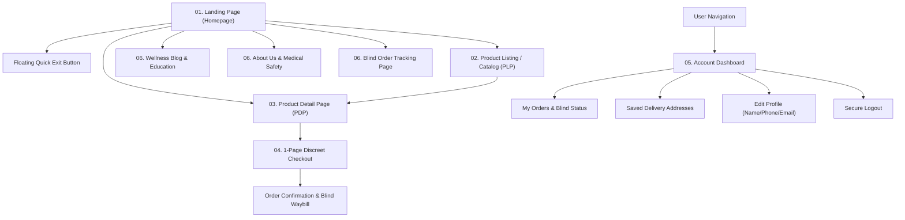

# 🎨 Phase 3: Screen & Feature Design Blueprint — Discreet Adult Wellness Marketplace

> **Phase Context:**
> Phase 1 established the Market Research, Audience, and Business Model (`/Idea`).
> Phase 2 mapped the user roles, standard e-commerce features, and standout differentiators (`/Feature map`).
> **Phase 3 formally extracts every feature into actionable Page Blueprints, Screen-by-Screen UI Layouts, Interaction Models, and Component Hierarchies.**

---

## 🗺️ Information Architecture & Sitemap

---

## 📂 Phase 3 Documentation Index

1. **[`01_Landing_Page.md`](./01_Landing_Page.md)**  
   *High-Conversion E-Commerce Entryway:* Tasteful luxury wellness aesthetic, Floating Quick Exit / Panic Redirect, 18+ subtle compliance banner, Product-Heavy Hero, Trending Best-Sellers Grid, Flash Deals / Limited-time Banners, Category Carousels, and discreet shipping reassurance badges.

2. **[`02_Catalog_and_PLP.md`](./02_Catalog_and_PLP.md)**  
   *Clean & Familiar Product Discovery:* High-performance listing grid, Standard E-Commerce Filtering (Category, Price low-to-high, Brand, Customer Rating, In-Stock), Sorting Engine, Mobile Sticky Filter Drawer, and high-conversion Product Cards.

3. **[`03_Product_Detail_Page_PDP.md`](./03_Product_Detail_Page_PDP.md)**  
   *High-Trust Conversion Engine:* 360°/High-res Photo Gallery, "Discreet Delivery by [Date]" with interactive plain box preview, "Frequently Bought Together" (Lube + Toy Cleaner bundling), Video DOA 48h Warranty Badge (Hygiene Non-Returnable explanation), Anatomical/Size reference, and Verified Anonymous Reviews.

4. **[`04_Cart_and_Checkout.md`](./04_Cart_and_Checkout.md)**  
   *1-Page Frictionless Discreet Checkout:* Mobile OTP passwordless login, Disguised Bank Billing Name live preview (e.g., `B-DOT TECH`), Blind Shipping Label confirmation guarantee, Dual Payment rails (Instant 5% Prepaid UPI discount vs COD with ₹50 advance anti-RTO commitment fee / OTP).

5. **[`05_Account_Dashboard.md`](./05_Account_Dashboard.md)**  
   *Standard Customer Hub:* Streamlined 4-pillar layout: My Orders (with disguised invoice download and live tracking), Saved Addresses (with delivery instructions), Edit Profile (Name, Phone, Email), and 1-Click Secure Logout.

6. **[`06_Content_and_Trust_Pages.md`](./06_Content_and_Trust_Pages.md)**  
   *Trust, Education & SEO Authority:* SEO-rich Educational Wellness Blog (hygiene routines, beginner couples guides), About Us (breaking taboo, medical-grade silicone stance), Standalone Blind Tracking Page (lookup via Order # / Phone), and Legal Policy Pages (Discreet Packaging Standards & Hygiene/DOA terms).

---

## 🎯 Design Guiding Principles

- **Zero Embarrassment Guarantee:** At every screen, user privacy is reaffirmed through neutral typography, plain packaging previews, and disguised descriptors.
- **Fast Conversion over Technical Clutter:** PLP and Hero focus directly on best-sellers, price clarity, and fast checkout rather than overwhelming users with unnecessary jargon.
- **Clear Hygiene & Warranty Boundaries:** Transparent communication regarding non-returnable hygiene rules paired with an unconditional 48-hour video unboxing DOA replacement policy.
