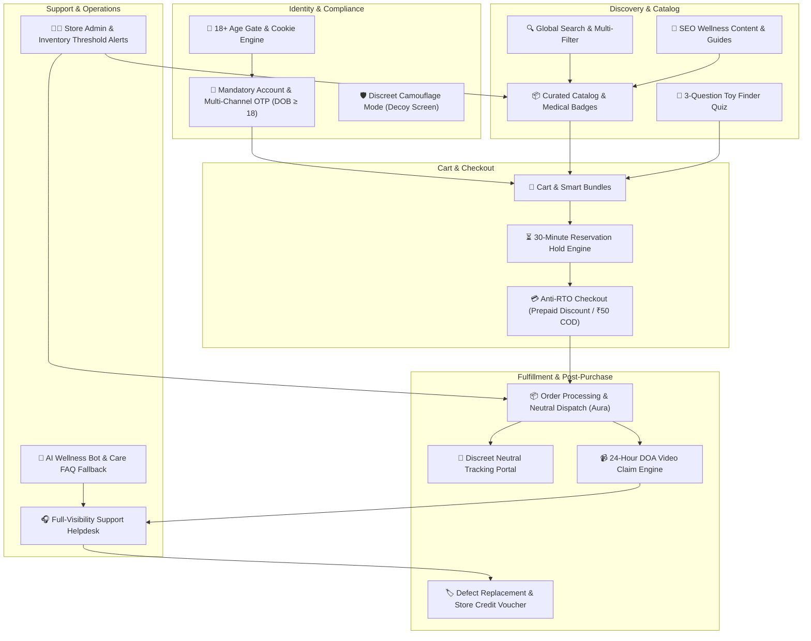

# 🗺️ Project Feature Map: Discreet Adult Wellness & Intimate Care E-Commerce Marketplace (Aura Retail & Lifestyle)

> **Purpose:** Organize and catalog all product features across user roles and functional areas. This map forms the master feature inventory that will be sliced into release versions in Phase 3.

---

## 1. User Roles & Functional System Areas
*Who interacts with the system, and what core areas exist?*

- **Customer / Registered Buyer:** 
  An adult user (18+) shopping for curated intimate health, wellness toys, and companion consumables. Interacts with the age gate, takes the guided quiz, shops discreetly, completes checkout via Prepaid or COD, tracks orders through their mandatory account, and submits warranty/defect unboxing claims within 24 hours.
- **Store Admin / Inventory Manager:** 
  Internal operations manager who oversees the multi-brand product catalog, verifies certified body-safe specifications, monitors inventory thresholds, manages COD orders, and handles order fulfillment with neutral shipping labels.
- **Customer Support Specialist:** 
  Support team member with full visibility into order and customer details to deliver fast, empathetic resolutions. Reviews and approves 24-hour unboxing video claims, issues store credit for out-of-stock defectives, and answers escalated email queries.
- **Super Admin / Platform Owner:** 
  Executive role managing overall business operations, anti-RTO analytics, payment gateway integrations with neutral billing descriptors, staff RBAC permissions, and compliance monitoring.
- **Shared / System Area:** 
  Cross-cutting platform infrastructure including 18+ Age Gate verification, Discreet Camouflage Mode (Decoy Panic Screen), Multi-Channel OTP (SMS/Email/WhatsApp), Neutral Notifications (under "Aura Retail & Lifestyle"), and 30-minute stock reservation engine.

---

## 2. Feature Inventory by Role

### A. Customer / Buyer Features

| Feature Name | Feature Group / Module | Feature Purpose (What it helps user do) | Priority (First Version / Later / Undecided) | Dependencies (Requires what?) | Open Questions / Notes |
| :--- | :--- | :--- | :--- | :--- | :--- |
| **18+ Age Gate & Safe Exit** | Compliance & Entry | Confirms legal age (18+) on entry with 30-day cookie persistence; redirects under-18 visitors to Google/Wikipedia | First Version | Client cookie / local storage | Non-blocking for SEO crawlers |
| **Discreet Camouflage Mode (Panic Button)** | Privacy & Security | Floating button that instantly disguises screen into a neutral lifestyle/news blog (decoy view) with quick escape trigger | First Version | Frontend state engine | Disguised content renders client-side instantly |
| **Standard Account & Auth** | Identity & Access | Mandatory account creation with verified Date of Birth (DOB) and multi-channel OTP (SMS/Email/WhatsApp) for order tracking | First Version | Auth Service & OTP Gateway | DOB enforced ≥ 18 years |
| **Interactive Toy Finder Quiz** | Discovery / Guidance | 3-question anonymous questionnaire matching comfort level, anatomy, and goals to curated product bundles | First Version | Product Tagging Taxonomy | 1-click add recommended kit to cart |
| **Curated Catalog & Medical Badges** | Catalog & Education | Browse products with verified badges (100% Medical Silicone, Phthalate-Free, IPX7 Waterproof, <50dB Noise) | First Version | Product Database & Media Storage | Material safety certs highlighted |
| **Smart Bundle Recommendations** | Checkout / AOV | "Complete the Experience" module recommending compatible water-based lubes and antibacterial toy cleaners | First Version | Product Association Engine | Automatic bundle discounts |
| **Anti-RTO Dual Checkout** | Transactions & Cart | Seamless checkout offering instant Prepaid UPI/Cards discount or COD with mandatory ₹50 surcharge | First Version | Payment Gateway & Surcharge Engine | Multi-channel OTP verification at checkout |
| **30-Minute Reservation Hold** | Cart & Inventory | Automatically reserves stock for 30 minutes on pending/failed payment with 1-click retry link & COD switch | First Version | Redis / Background Reservation Worker | Prevents cart stock hoarding |
| **Discreet Order Tracking** | Orders & Post-Purchase | Live tracking portal with 100% neutral terminology ("Aura Retail & Lifestyle" - "Personal Grooming & Wellness Kits") | First Version | Logistics Webhook Integration | No explicit product names in SMS/WhatsApp |
| **24-Hour DOA Defect Claim** | Warranty & Support | Upload unboxing video within 24 hours of delivery for dead-on-arrival/motor defect replacement | First Version | Cloud Object Storage (S3/R2) | Manual Admin review required before replacement |
| **AI Wellness Chatbot** | Support & Guidance | 24/7 empathetic assistant for sizing, hygiene, and care questions; disclaims medical advice and routes to FAQ/Email | First Version | AI LLM API & Curated Knowledgebase | Shows curated care guides on complex queries |
| **Verified Buyer Reviews** | Social Proof | Discreet pseudonym-based product reviews with verified purchase tag | Later (v2) | Completed Order Engine | Verified buyers only; strict moderation |

---

### B. Store Admin / Inventory Manager Features

| Feature Name | Feature Group / Module | Feature Purpose (What it helps user do) | Priority (First Version / Later / Undecided) | Dependencies (Requires what?) | Open Questions / Notes |
| :--- | :--- | :--- | :--- | :--- | :--- |
| **Product & Material Management** | Catalog Ops | Create/edit products, assign body-safe certification badges, specs (noise dB, waterproof rating, battery runtime) | First Version | Product Catalog API | Bulk image and variant management |
| **Inventory Threshold Alerts** | Inventory Control | Track stock counts in real time, set low-stock warning triggers, and view reserved stock balances | First Version | Inventory DB & Reservation System | Auto-alerts when stock < 5 units |
| **COD Verification & Risk Flagging** | Order Operations | Monitor incoming COD orders, inspect checkout OTP verification status, and flag suspicious delivery addresses | First Version | Order Management System | Prevents high-risk RTO dispatches |
| **Neutral Shipping & AWB Generation** | Logistics & Dispatch | 1-click Airway Bill (AWB) generation via Shiprocket/Delhivery with neutral sender name & label description | First Version | Courier Logistics API | Enforces "Aura Retail & Lifestyle" label |
| **Reservation Expiry Worker** | Inventory Ops | Automated background job releasing items back to public inventory if 30-minute payment hold expires | First Version | Cron / Queue Worker (BullMQ/Redis) | Automatically restores inventory |

---

### C. Customer Support Specialist Features

| Feature Name | Feature Group / Module | Feature Purpose (What it helps user do) | Priority (First Version / Later / Undecided) | Dependencies (Requires what?) | Open Questions / Notes |
| :--- | :--- | :--- | :--- | :--- | :--- |
| **Full-Visibility Customer Helpdesk** | Support Ops | Access complete customer profile (Name, Phone, Delivery Address, Purchased Items) for fast, accurate inquiry handling | First Version | Customer & Order DB | Unrestricted view for authorized support |
| **24-Hour Video Claim Review** | Warranty Claims | Inspect customer-uploaded unboxing videos, verify seal tampering or motor failure, and submit approval/rejection | First Version | Video Streaming / S3 Signed URLs | Review decision logged with timestamp |
| **Store Credit & Replacement Engine** | Support Operations | Trigger replacement dispatch upon claim approval, or instantly issue Store Credit Voucher if SKU is out of stock | First Version | Order Service & Voucher Engine | Sealed hygiene policy prohibits restock |
| **Email Support Queue** | Communications | Dedicated ticketing interface for handling escalated customer emails from chatbot fallbacks | First Version | Transactional Email Service (Resend/SES) | Inbound email integration |

---

### D. Super Admin / Platform Owner Features

| Feature Name | Feature Group / Module | Feature Purpose (What it helps user do) | Priority (First Version / Later / Undecided) | Dependencies (Requires what?) | Open Questions / Notes |
| :--- | :--- | :--- | :--- | :--- | :--- |
| **Executive Business Dashboard** | Analytics & BI | Monitor Total GMV, Prepaid vs COD ratio, RTO rate, Average Order Value (AOV), and Quiz conversion funnel | First Version | Analytics Aggregation Pipeline | Real-time metrics visualization |
| **Payment & Billing Configuration** | Financial Ops | Configure payment gateways (Razorpay/Cashfree/PhonePe) and maintain neutral billing descriptor compliance | First Version | Payment Aggregator Config | Ensures neutral bank statement name |
| **Staff RBAC & Access Audit** | Security & Compliance | Manage Admin and Support agent accounts, assign roles, and inspect immutable audit logs of staff actions | First Version | RBAC Middleware & Audit Logging DB | Tracks who viewed customer PII |
| **SEO & Content Manager** | Growth & Marketing | Manage educational wellness blog posts, buying guides, and Schema.org rich snippets for organic acquisition | First Version | Headless CMS / MDX Engine | Crucial for zero-paid-ad channel growth |

---

### E. Shared System Features (Cross-Cutting)

| Feature Name | Feature Group / Module | Feature Purpose (What it helps user do) | Priority (First Version / Later / Undecided) | Dependencies (Requires what?) | Open Questions / Notes |
| :--- | :--- | :--- | :--- | :--- | :--- |
| **Multi-Channel OTP Delivery** | Communications | Dispatches time-sensitive 6-digit OTPs via SMS, WhatsApp, or Email for login and checkout authentication | First Version | SMS/WhatsApp Gateway (MSG91/Twilio) | Fallback to secondary channel if primary fails |
| **Neutral Notification Engine** | Notifications | Sends order confirmations, dispatch updates, and tracking links using neutral identity without product names | First Version | Email & SMS Webhook Handlers | Sender name: "Aura Lifestyle" |
| **Direct-to-Cloud Video Upload** | Storage & Security | Provides pre-signed secure URLs for customer unboxing video uploads directly to object storage | First Version | AWS S3 / Cloudflare R2 | Max file size 50MB, MP4/MOV formats |
| **Global Search & Filter Engine** | Search & Navigation | Instant full-text search with multi-parameter filtering (by user persona, material, noise level, price) | First Version | PostgreSQL Full-Text / Algolia | Fast responsive search UI |

---

## 3. High-Level Feature Dependencies Graph
*Visual representation of architectural dependencies across the system:*

---

## 4. Open Questions & Decision Log Summary

- **Resolved:** Age Gate persistence is set to 30 days for anonymous visitors; 'Under 18' exit redirects immediately to Google/Wikipedia.
- **Resolved:** Account creation with verified DOB is mandatory for order tracking and post-purchase management.
- **Resolved:** Floating panic button activates **Discreet Camouflage Mode**, instantly rendering a neutral lifestyle/news decoy screen.
- **Resolved:** Checkout anti-RTO incorporates multi-channel OTP (SMS/Email/WhatsApp) plus a flat ₹50 COD surcharge.
- **Resolved:** Failed/pending payments trigger a 30-minute inventory reservation hold with 1-click retry and instant COD switch option.
- **Resolved:** Defect/DOA claim window is strictly 24 hours from delivery, requiring an unboxing video subject to manual Admin review and approval; out-of-stock items resolve via instant Store Credit voucher.
- **Resolved:** Customer Support Specialists have full visibility into customer identity, address, and order items for frictionless resolution.
- **Resolved:** AI Wellness Bot falls back to curated care/hygiene FAQs and recommends email support (`support@auralifestyle...`) on complex medical inquiries.
- **Deferred to v2:** Open customer product reviews (deferred to ensure robust post-purchase moderation and pseudonymity).
