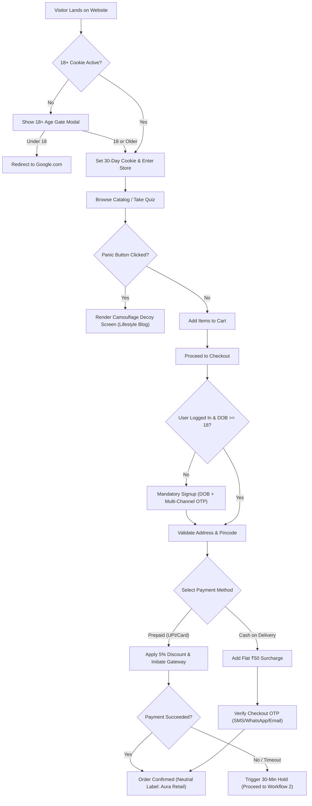
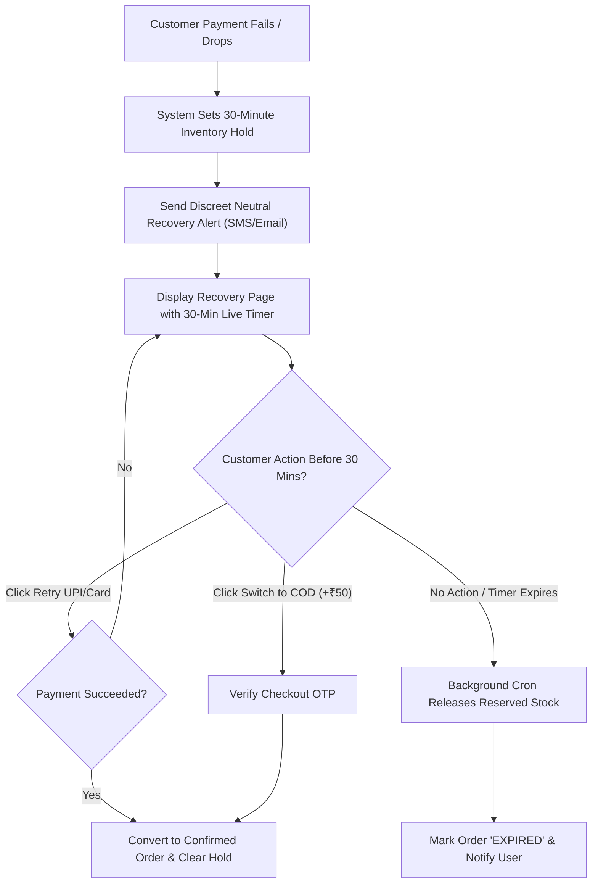
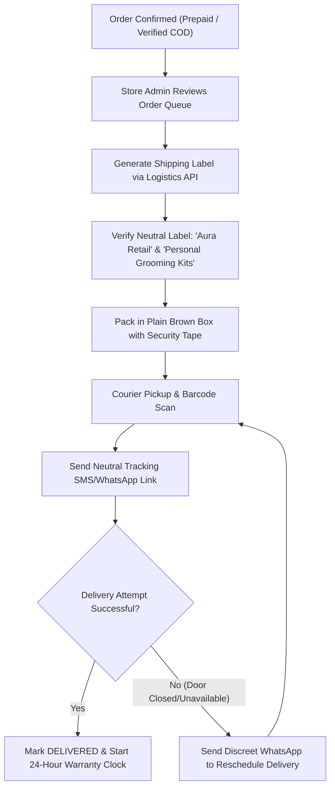
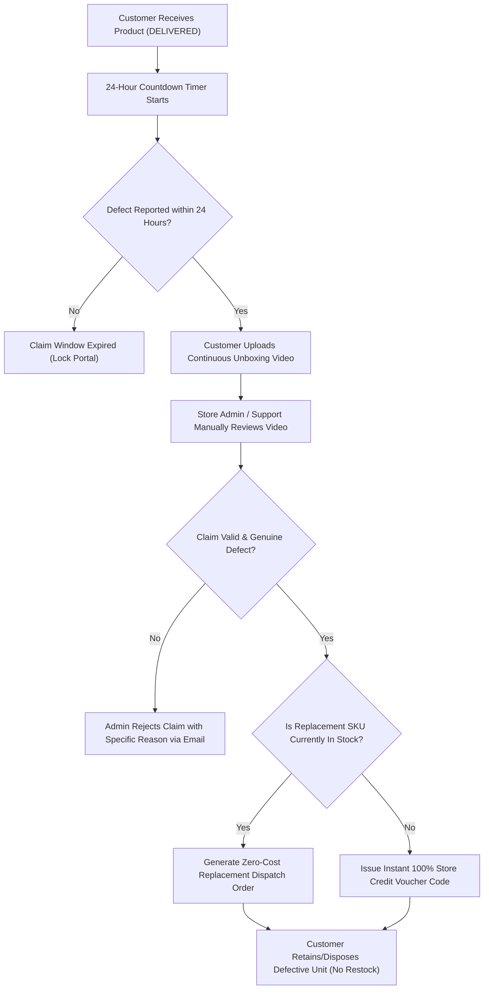
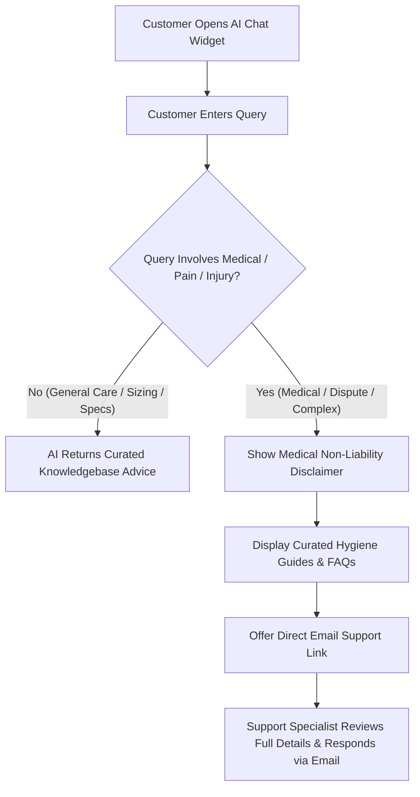

# 🔄 User Flows & Workflows: Discreet Adult Wellness Platform (Aura Retail & Lifestyle)

> **Purpose:** Map out how users move across multiple features to achieve meaningful outcomes. Identifies edge-case branches, decision trees, and drop-off points before UX design and coding begin.

---

## 🗺️ Key Workflows Overview
- **Workflow 1:** [Customer Discovery, Camouflage Trigger & Checkout Flow]
- **Workflow 2:** [Failed Payment & 30-Minute Reservation Recovery Flow]
- **Workflow 3:** [Neutral Warehouse Fulfillment & Courier Dispatch Flow]
- **Workflow 4:** [24-Hour DOA / Defect Unboxing Video Claim & Store Credit Flow]
- **Workflow 5:** [AI Wellness Assistant & Customer Support Escalation Flow]

---

## 🔁 Workflow 1: Customer Discovery, Camouflage Trigger & Checkout Flow

- **Flow Name:** First-Time Visitor Discovery to Discreet Order Completion
- **Primary Role:** Customer / Buyer
- **Starting Point (Trigger):** User lands on homepage or direct product link from organic search/blog.
- **End Result:** Payment captured or COD OTP validated, order created, 100% neutral confirmation displayed, neutral notification dispatched.

### Step-by-Step Flow:
1. **18+ Age Gate:** Visitor encounters discreet modal. If confirmed, sets 30-day cookie (`age_verified_30d=true`). If under 18, redirects to Google.com.
2. **Browsing / Quiz:** User takes anonymous 3-question Toy Finder Quiz or browses curated catalog filtered by Medical Badges (Medical Silicone, Waterproof, <50dB).
3. **Emergency Privacy Trigger (Optional Branch):** If privacy is threatened, user taps floating **"Quick Exit"** button. Screen instantly renders **Discreet Camouflage Mode** (innocent lifestyle blog article) with zero latency.
4. **Add to Cart:** User adds product to cart; system presents "Complete the Experience" companion bundle (Water-Based Organic Lube + Sanitizing Foam).
5. **Mandatory Account / DOB Verification:** User proceeds to checkout; logs in or creates account with mandatory **Date of Birth** (`age >= 18`) and multi-channel OTP (SMS/Email/WhatsApp).
6. **Address & Pincode Serviceability:** Customer inputs delivery address; system validates pincode for courier reach and COD availability.
7. **Payment Selection:**
   - *Option A (Prepaid):* User selects UPI/Card; system applies instant 5% prepaid incentive and reminds neutral descriptor (*"Aura Retail & Lifestyle"*).
   - *Option B (Cash on Delivery):* User selects COD; system adds mandatory ₹50 convenience fee to order total.
8. **Checkout OTP Verification:** User enters 6-digit OTP delivered via SMS, Email, or WhatsApp.
9. **Confirmation:** System creates order in database, deducts live stock, sends neutral confirmation email/SMS, and renders success screen.

### Decision Points & Branching:

### Failure & Alternative Paths:
- **Under 18 Clicked:** Window executes `window.location.replace("https://www.google.com")`; back button disabled.
- **COD Pincode Unserviceable:** UI disables COD radio button and highlights: *"COD unavailable in this pincode; please select Prepaid UPI/Card for guaranteed delivery."*

---

## 🔁 Workflow 2: Failed Payment & 30-Minute Reservation Recovery Flow

- **Flow Name:** Payment Failure to Order Recovery via 30-Minute Hold
- **Primary Role:** Customer & Background Reservation Worker
- **Starting Point (Trigger):** Payment gateway returns `FAILED`, `CANCELLED`, or times out after 10 minutes.
- **End Result:** Customer successfully pays via retry/COD within 30 minutes, OR inventory is released back to catalog.

### Step-by-Step Flow:
1. **Hold Triggered:** Upon payment initiation, backend locks the cart items (`stock_reserved = true`, `expires_at = NOW() + 30m`).
2. **Gateway Failure:** User’s UPI app declines or session drops; gateway sends failure callback.
3. **Redirect to Recovery Portal:** User is routed to `/checkout/recovery?order_id=xyz`.
4. **Live Countdown:** Page displays: *"Payment uncompleted. Your items are held for 29:30 minutes"*.
5. **Neutral Notification:** Neutral SMS/Email dispatched: *"Aura Lifestyle: Your item reservation is holding for 30 minutes. Complete order here: [Discreet Link]"*.
6. **Recovery Choice:**
   - *Path 1 (Retry Digital):* User clicks *"Retry UPI / Card"* -> completes payment -> Order marked `PAID`.
   - *Path 2 (Switch to COD):* User clicks *"Switch to Cash on Delivery (+₹50)"* -> verifies checkout OTP -> Order marked `CONFIRMED_COD`.
7. **Timeout Action:** If timer reaches 00:00 without completion, background worker releases reserved inventory back to public stock.

### Decision Points & Branching:

---

## 🔁 Workflow 3: Neutral Warehouse Fulfillment & Courier Dispatch Flow

- **Flow Name:** Order Received to Tamper-Evident Neutral Delivery
- **Primary Role:** Store Admin & Courier Logistics Partner (Delhivery/Shiprocket)
- **Starting Point (Trigger):** Order transitions to `CONFIRMED` (Prepaid or verified COD).
- **End Result:** Neutral parcel delivered to customer doorstep with zero content disclosure.

### Step-by-Step Flow:
1. **Admin Queue:** Order appears in `/admin/orders` queue with status `READY_TO_PACK`.
2. **AWB Generation:** Admin clicks *"Generate Neutral AWB"*.
   - Sender printed as: **Aura Retail & Lifestyle**.
   - Item category: **Personal Grooming & Wellness Kits**.
   - Explicit terms (Toy, Vibrator, Silicone) strictly filtered out.
3. **Tamper-Evident Packing:** Warehouse packs item in heavy-duty plain unprinted brown box with sealed security tape and bubble cushioning.
4. **Courier Handover:** Carrier scans barcode; webhook updates order to `IN_TRANSIT`.
5. **Discreet Customer Updates:** System sends SMS/WhatsApp notifications with neutral tracking URL.
6. **Delivery Execution:** Courier delivers parcel to customer doorstep. Courier webhook marks status as `DELIVERED`.
7. **Warranty Clock:** Delivery timestamp triggers the 24-hour DOA replacement countdown.

### Decision Points & Branching:

---

## 🔁 Workflow 4: 24-Hour DOA / Defect Unboxing Video Claim & Store Credit Flow

- **Flow Name:** Customer Unboxing Defect to Replacement or Store Credit
- **Primary Role:** Customer & Customer Support / Admin
- **Starting Point (Trigger):** Customer discovers dead-on-arrival motor failure within 24 hours of delivery.
- **End Result:** Admin-approved replacement dispatched, or 100% Store Credit issued (zero physical product return).

### Step-by-Step Flow:
1. **Claim Submission:** Customer navigates to `/account/orders/{id}/claim-warranty` within 24 hours of marked delivery timestamp.
2. **Video Upload:** Customer uploads continuous unboxing video (max 50MB, MP4/MOV) demonstrating tamper-evident courier box, seal opening, and motor non-functionality.
3. **Claim Logged:** Status set to `PENDING_ADMIN_REVIEW`.
4. **Manual Review:** Support Specialist or Admin plays video in dashboard and inspects validity.
5. **Admin Decision:**
   - *Branch A (Approved & In Stock):* System creates automated ₹0 replacement dispatch order; warehouse ships fresh unit.
   - *Branch B (Approved & Out of Stock):* System generates 100% Store Credit voucher sent via email with 1-year validity.
   - *Branch C (Rejected):* Video fails criteria (e.g., box was already unsealed); Admin inputs reason and sends courteous email explanation.
6. **Hygiene Compliance:** Defective unit is safely disposed of by customer; strictly zero return to warehouse.

### Decision Points & Branching:

---

## 🔁 Workflow 5: AI Wellness Assistant & Customer Support Escalation Flow

- **Flow Name:** Customer Question to AI Guidance or Support Ticket
- **Primary Role:** Customer, AI Wellness Bot, Support Specialist
- **Starting Point (Trigger):** User opens floating chat bubble on catalog or product page.
- **End Result:** Customer receives empathetic product guidance, or escalated ticket resolved via email.

### Step-by-Step Flow:
1. **Chat Initiated:** Customer clicks chat widget; AI greets with confidential, non-judgmental prompt.
2. **Product / Sizing / Care Query:** Customer asks about materials, cleaning, or charging. AI responds immediately with verified product specifications.
3. **Complex / Medical Query Branch:** If user asks about physical pain, medical conditions, or allergic reactions:
   - AI displays **Medical Disclaimer**: *"I am an AI assistant, not a medical professional. Please stop use and consult a doctor."*
   - AI presents curated **Hygiene & Safety Guides**.
   - AI provides 1-click **"Email Support"** option (`support@auralifestyle...`).
4. **Support Ticket Resolution:** Support Specialist views ticket with full customer details (Name, Phone, Address, Items) and responds privately via email.

### Decision Points & Branching:

