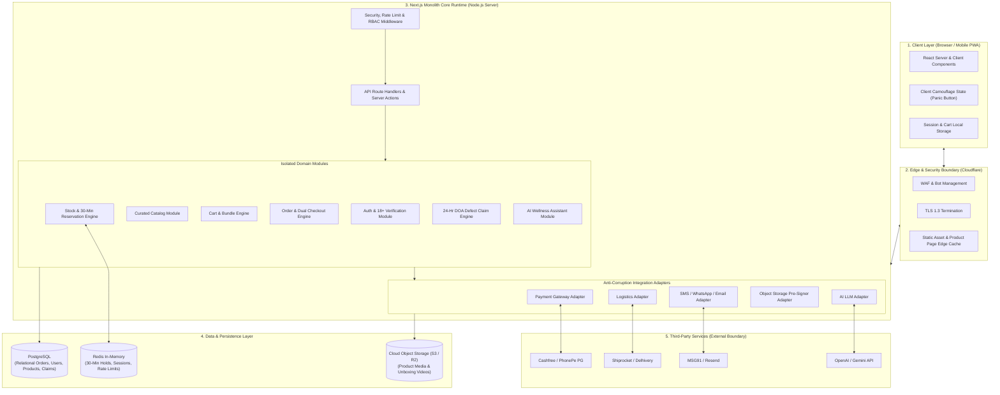
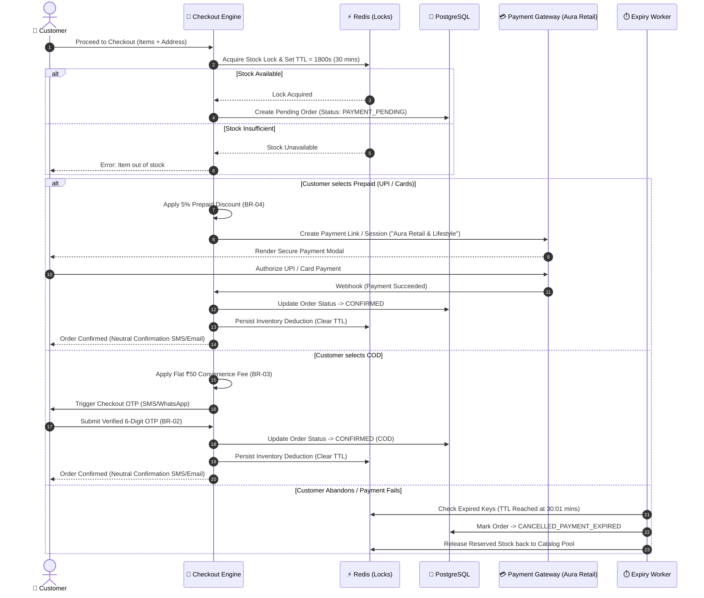
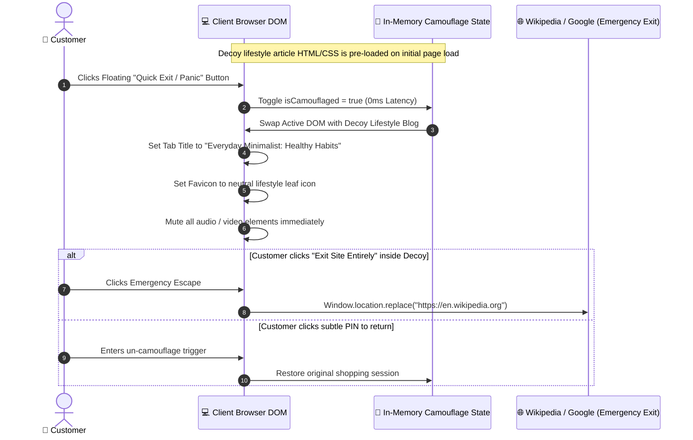
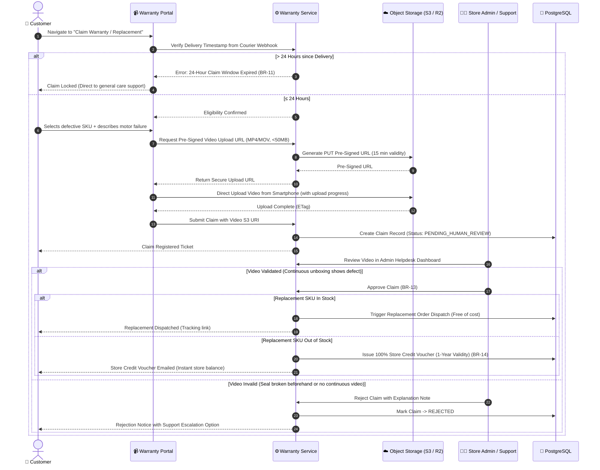

# 🏗️ Document 2: Architecture

**Project Name:** Aura Retail & Lifestyle (Discreet Adult Wellness & Intimate Care E-Commerce Marketplace)  
**Document Status:** Confirmed / Approved by User (Green Light on 2026-11-09)  
**Version:** 1.0.0  
**Date:** 2026-11-09  
**Author / Partner:** Planning & Technical Documentation Partner  

---

## 1. Purpose

Yeh document is platform ka **Technical Architecture Blueprint** hai. Iska maqsad system ke architectural style (Modular Monolith), structural boundaries (Frontend, Backend, Database, External Services), rendering strategy (SSR/SSG/CSR), component relationships aur critical data-flows ko define karna hai. Is document ke approved hone ke baad aage ke tech stack selection, database schema aur API patterns isi architectural topology par build honge.

---

## 2. Existing Approved Context Used

Yeh architecture blueprint approved context aur locked business decisions par based hai:
* [`docs/01_Master_Planning.md`](file:///c:/Users/20092/OneDrive/Desktop/Dev/Projects/Active/Black%20Dot%20ecosystem/eoc_system%20Products/ecomerce%20website%20{wellness%20toys}/docs/01_Master_Planning.md): Approved V1 boundaries, target personas, non-negotiable constraints, aur modular monolith approach (Green lighted on 2026-11-09).
* [`Feature/05_Business_Rules_and_Decisions.md`](file:///c:/Users/20092/OneDrive/Desktop/Dev/Projects/Active/Black%20Dot%20ecosystem/eoc_system%20Products/ecomerce%20website%20{wellness%20toys}/Feature/05_Business_Rules_and_Decisions.md):
  * **BR-01 & DEC-02:** Mandatory Account with DOB verification (Age ≥ 18).
  * **BR-03 & BR-04:** Anti-RTO flat ₹50 COD fee + 5% prepaid discount.
  * **BR-05:** 30-minute stock reservation lock on pending checkouts.
  * **BR-06 & BR-08:** Permanent neutral descriptor: **"Aura Retail & Lifestyle"** ("Personal Grooming & Wellness Kits").
  * **BR-09 & DEC-01:** Discreet Camouflage Mode (Decoy lifestyle screen) with 0ms client-side latency.
  * **BR-10, BR-11 & BR-12:** Strict non-return hygiene policy with 24-hr unboxing video claim engine.
* [`Feature/03_Roles_and_Permissions.md`](file:///c:/Users/20092/OneDrive/Desktop/Dev/Projects/Active/Black%20Dot%20ecosystem/eoc_system%20Products/ecomerce%20website%20{wellness%20toys}/Feature/03_Roles_and_Permissions.md): RBAC matrix across 5 roles (`anonymous`, `customer`, `support_agent`, `store_admin`, `super_admin`).

---

## 3. Decisions Table

| Decision ID | Topic / Decision | Status | Reason / Tradeoff | Source / Assumption |
| :--- | :--- | :--- | :--- | :--- |
| **ARCH-DEC-01** | **Modular Monolith Pattern** | **Proposed** | V1 D2C e-commerce ke liye microservices premature optimization hai. Monolith single repository aur unified runtime mein high developer velocity, zero network hop latency, aur ACID compliance deta hai. | Master Planning (MP-DEC-01) |
| **ARCH-DEC-02** | **App Router Server-First Rendering Strategy** | **Proposed** | Paid ads banned hone ki wajah se organic SEO mandatory hai. SSR/SSG server-side fast HTML render karta hai, jabki CSR sirf client interactivity (Panic Button, Quiz, Video Player) tak limited rehta hai. | SEO benchmark for restricted categories |
| **ARCH-DEC-03** | **Decoupled Anti-Corruption Service Adapters** | **Proposed** | External 3rd party providers (Cashfree/Razorpay, Shiprocket/Delhivery, MSG91) ko domain logic se isolate karne ke liye generic adapter pattern use hoga taaki provider swap hone par core business code na badle. | Standard Enterprise Hexagonal Design |
| **ARCH-DEC-04** | **Hybrid Data Tier (PostgreSQL + Redis)** | **Proposed** | Relational integrity (PostgreSQL) orders, users aur claims ke liye non-negotiable hai. 30-minute transient inventory locks, rate limits, aur active sessions ke liye Redis sub-millisecond memory speed deta hai. | High-concurrency cart reservation best practice |
| **ARCH-DEC-05** | **Direct-to-Cloud Pre-signed Video Uploads** | **Proposed** | Customers 50MB unboxing videos upload karenge. Server par file buffer karne se web process memory choke ho sakti hai. Client browser direct S3/R2 par secure signed URL se upload karega. | Cloud Object Storage pattern |
| **ARCH-DEC-06** | **Zero-Network Decoy Camouflage Engine** | **Confirmed** (per DEC-01) | Quick Exit panic button client-side memory mein cached neutral blog view ko instant hydrate karta hai, bina kisi server network call ya external redirect ke. | [`Feature/05_Business_Rules_and_Decisions.md`](file:///c:/Users/20092/OneDrive/Desktop/Dev/Projects/Active/Black%20Dot%20ecosystem/eoc_system%20Products/ecomerce%20website%20{wellness%20toys}/Feature/05_Business_Rules_and_Decisions.md) |

---

## 4. Detailed Architecture Content

### A. Monolith Approach & Domain Modularization
System ko **Next.js Modular Monolith** ke roop mein structure kiya gaya hai. Codebase single deployment unit hai, lekin internally strict domain boundaries maintain karta hai.

```
src/
├── app/                  # Next.js App Router (Routes, Pages, Layouts, Server Actions)
│   ├── (storefront)/     # Public & Customer routes (Catalog, PDP, Cart, Checkout, Quiz)
│   ├── (admin)/          # Store Admin & Super Admin protected dashboard
│   ├── (support)/        # Customer Support helpdesk portal
│   └── api/v1/           # Webhook listeners & public API endpoints
├── modules/              # Independent Domain Modules (Clean Architecture boundaries)
│   ├── auth/             # OTP generation, Session tokens, DOB age verification
│   ├── catalog/          # Products, Medical Badges, Care Guides, Taxonomy
│   ├── cart/             # Session cart, Cart line items, Bundle rules
│   ├── inventory/        # Stock count, 30-min reservation hold, Redis lock manager
│   ├── checkout/         # Dual checkout logic, Flat ₹50 COD, 5% Prepaid discount
│   ├── orders/           # Order state machine, Invoicing under "Aura Retail & Lifestyle"
│   ├── logistics/        # Neutral AWB generation, Shipping webhooks, Tracking
│   ├── warranty/         # 24-hr DOA claim validator, Video upload signer, Store credit
│   └── ai-assistant/     # RAG pipeline, Medical disclaimer filter, Care FAQ responder
├── adapters/             # External Integrations (Anti-Corruption Layer)
│   ├── payment/          # Cashfree / PhonePe / Razorpay payment gateway client
│   ├── courier/          # Shiprocket / Delhivery fulfillment client
│   ├── messaging/        # MSG91 (SMS/WhatsApp) & Resend (Email) notification client
│   ├── storage/          # S3 / Cloudflare R2 object storage client
│   └── llm/              # OpenAI / Gemini API client
└── shared/               # Shared utilities, database client, logger, security middleware
```

**Kyun Monolith over Microservices?**
1. **Atomic Transactions:** 30-minute stock reservation aur payment capture ke waqt distributed 2-phase commit (2PC) ki complexity avoid hoti hai; PostgreSQL single transaction block mein rollback guarantee milti hai.
2. **Operational Simplicity:** Single container deployment, zero inter-service network failure modes, aur simplified local development.
3. **Future Extensibility:** Chunki har domain `modules/` ke andar isolated hai, kal ko agar Logistics ya AI Assistant ko alag microservice banana pade, toh domain extract karna seamless hoga.

---

### B. Architectural Boundaries & Separation of Concerns



1. **Client Boundary:** Browser me sirf UI presentation, local form state, video recording, aur decoy camouflage state execute hota hai. Sensitive business rules (₹50 COD fee, age eligibility, payment integrity) kabhi client par trust nahi kiye jate.
2. **Edge Boundary (Cloudflare):** DDoS mitigation, SSL termination, and static asset delivery. Unauthenticated search engine bots ko static cached pages deliver karta hai bina database load ke.
3. **Application Server Boundary:**
   - **Server Actions & Route Handlers:** Client input validate karte hain (Zod schemas se).
   - **Domain Services:** Pure business rules run karte hain. Directly external APIs se baat nahi karte; adapters ke zariye integrate karte hain.
4. **Data Tier Boundary:**
   - Database queries Data Access Layer (DAL) ke through execute hoti hain. Row-Level Security (RLS) aur transaction locks ensure karte hain ki user sirf apna data access kar sake.
5. **External Boundary:** Sabhi third-party calls timeout, circuit breakers, aur error logging ke saath wrapped hoti hain, taaki courier ya SMS gateway down hone par core website crash na ho.

---

### C. Rendering Strategy Matrix

Sexual wellness category mein paid search aur social ads restricted hote hain, isliye organic search traffic (SEO) aur user privacy primary driving factors hain. Hum ek **Hybrid Rendering Model** use karte hain:

| Page / Route Type | Rendering Strategy | Revalidation / Invalidation | Justification & Privacy/SEO Impact |
| :--- | :--- | :--- | :--- |
| **Home, Buying Guides, Blog Posts** | **ISR (Incremental Static Regeneration)** | 1 Hour / On-demand CMS publish | Ultra-fast LCP (< 1.2s), maximum SEO crawlability, zero DB load on traffic spikes. |
| **Catalog (PLP) & Product Detail (PDP)** | **SSR (Server-Side Rendering)** + Edge Caching | Invalidate on inventory/price update | Rich structured data (Schema.org `Product`), real-time stock availability, accurate medical badges. |
| **18+ Age Gate & Discreet Camouflage Screen** | **CSR (Client-Side State)** | Persistent local cookie (30 days) | **Zero-Latency Camouflage:** Decoy screen is pre-loaded in client memory. Clicking panic button takes 0ms with zero network wait. |
| **Toy Finder Quiz** | **CSR (Client-Side Rendering)** | N/A (In-memory questionnaire) | 100% anonymous; responses are kept in browser memory until user explicitly adds kit to cart. |
| **Cart, Checkout, Account Dashboard** | **Dynamic SSR (Authenticated)** | No Cache (`Cache-Control: private, no-store`) | PII protection; dynamic surcharge calculation (₹50 COD vs 5% prepaid discount); real-time stock reservation status. |
| **Admin & Support Portal** | **Dynamic SSR (Role-Protected)** | No Cache (`private`) | Strict RBAC enforcement; real-time order/warranty data for authorized personnel only. |

---

### D. Component Diagram

Yeh diagram system ke internal software components aur unke interface contracts ko depict karta hai:

```mermaid
componentDiagram
    package "Frontend Layer (Next.js App Router)" {
        component [Storefront UI Components] as StoreUI
        component [Panic Button & Decoy Camouflage] as CamouflageComp
        component [Toy Finder Quiz Wizard] as QuizComp
        component [Direct Video Upload Widget] as VideoUploader
        component [Admin & Support UI] as AdminUI
    }

    package "API & Security Layer" {
        component [RBAC & Auth Guard] as AuthGuard
        component [Age Verification Middleware] as AgeMiddleware
        component [Zod Validation Layer] as InputValidator
    }

    package "Domain Logic Layer (Modules)" {
        component [Auth & OTP Service] as AuthService
        component [Catalog & Badge Service] as CatalogService
        component [30-Min Reservation Engine] as ReservationEngine
        component [Anti-RTO Checkout Engine] as CheckoutEngine
        component [Warranty & Defect Engine] as WarrantyService
        component [AI Assistant Service] as AIService
    }

    package "Persistence & Messaging Adapters" {
        component [ORM / Data Access Layer] as DAL
        component [Redis Lock & Key Manager] as RedisMgr
        component [Payment Gateway Adapter] as PGClient
        component [Logistics Webhook Handler] as CourierClient
        component [SMS / WhatsApp Client] as MsgClient
    }

    StoreUI --> AgeMiddleware
    StoreUI --> CamouflageComp
    StoreUI --> QuizComp
    StoreUI --> InputValidator
    VideoUploader --> WarrantyService
    AdminUI --> AuthGuard

    InputValidator --> AuthService
    InputValidator --> CatalogService
    InputValidator --> CheckoutEngine
    InputValidator --> WarrantyService
    InputValidator --> AIService

    AuthService --> DAL
    AuthService --> MsgClient
    CatalogService --> DAL
    CheckoutEngine --> ReservationEngine
    CheckoutEngine --> PGClient
    ReservationEngine --> RedisMgr
    WarrantyService --> DAL
    CourierClient --> DAL
```

---

### E. End-to-End Data Flow Diagrams

#### Flow 1: 30-Minute Reservation Hold & Anti-RTO Dual Checkout
Is flow mein customer checkout initiate karta hai, stock 30 minutes ke liye lock hota hai, aur payment mode ke basis par dynamic surcharge/discount apply hota hai.



---

#### Flow 2: Zero-Latency Discreet Camouflage Mode (Panic Button)
Agar koi room mein aa jaye, customer floating panic button click karta hai. Zero network request ke saath screen camouflage hoti hai.



---

#### Flow 3: 24-Hour DOA Defect Video Claim & Store Credit Voucher
Customer delivery ke 24 ghante ke andar dead-on-arrival defect report karta hai. Video upload direct cloud storage par hoti hai, human admin review karta hai.



---

## 5. Major Architectural Constraints & Non-Functional Enforcements

1. **Transaction Isolation:** Inventory reservation (`30-min hold`) aur order creation PostgreSQL me `READ COMMITTED` ya `REPEATABLE READ` isolation level par execute honge with Redis distributed locks, taaki concurrent buyers same stock SKU ko double-book na kar sakein.
2. **Zero PII Exposure on External Descriptors:**
   - Bank/UPI statement descriptor permanently hardcoded to `"Aura Retail & Lifestyle"`.
   - Courier Airway Bill (AWB) item description strictly set to `"Personal Grooming & Wellness Kits"`.
3. **Decoy Camouflage Performance:** Camouflage component bundle size 25KB se kam rakha jayega aur initial SSR payload ke saath ship hoga taaki panic button click par network availability par zero dependence ho.
4. **Resilient Third-Party Integrations:** Sabhi external calls (SMS, WhatsApp, Payment, Courier) ke liye `5000ms` strict timeout aur 3-retry exponential backoff policy enforce hogi.

---

## 6. Open Questions, Risks & Assumptions

### Open Questions (Architectural)
* [ ] **ARCH-OQ-01 (Background Queue Worker):** 30-minute stock expiry worker aur order notifications ke liye lightweight background job processor kaisa rahe: Redis-backed **BullMQ** (Node.js worker) ya cloud-native **Upstash QStash / Cron**? *(Proposed: BullMQ with Redis for unified monolith state).*
* [ ] **ARCH-OQ-02 (Video Transcoding):** Smartphone se upload hone wale unboxing videos (MP4/HEIC/MOV) ko direct view ke liye browser compatibility ensure karne ke liye kya serverless transcoding pipeline (e.g. AWS MediaConvert) chahiye, ya native HTML5 video player standard formats play kar lega? *(Proposed: Standard HTML5 player with MP4/MOV validation).*

### Architectural Risks & Mitigations
* **Risk (Database Connection Saturation):** Traffic spikes par serverless/SSR functions se PostgreSQL connections exhaust ho sakte hain.
  * *Mitigation:* Connection pooling use hoga (e.g., PgBouncer ya Supabase / Prisma Accelerate connection pooler) with max connection limits.
* **Risk (Redis Failure Impact):** Agar Redis temporary down ho jaye, toh kya shopping band ho jayegi?
  * *Mitigation:* Graceful degradation—agar Redis down ho, cart fallback direct PostgreSQL database row locks (`SELECT FOR UPDATE`) par switch ho jayegi.

---

## 7. Related Documents / Dependencies

Is Architecture document ke approve hone ke baad agla document sequence:
* `Document 03: Tech Stack` *(Next in line - Frameworks, ORM, DB, Libraries)*
* `Document 04: Database Design` *(Entity relationships, Schemas, Migrations)*
* `Document 05: Authentication & Authorization` *(OTP, Sessions, RBAC implementation)*
* `Document 06: Security Plan` *(WAF, Data Encryption at rest, PCI compliance)*
* `Document 07: Third-party Services & Integrations` *(APIs, Webhooks, Adapters)*

---

## 8. Sources & Technical References

1. **Next.js App Router Documentation (Rendering & Server Components):** Official Next.js architectural patterns for Server Components, Server Actions, and Streaming SSR.
2. **PostgreSQL Documentation (Concurrency Control & Transaction Isolation):** ACID guarantees for e-commerce order processing and row-level locking.
3. **Redis Distributed Locks (Redlock / Atomic Key TTL):** High-throughput inventory reservation holding patterns.
4. **AWS S3 / Cloudflare R2 Pre-Signed URL Architecture:** Secure direct-to-bucket uploads avoiding server memory bottleneck.

---

## 9. Review Checklist (Aapke Approval ke Liye Key Points)

Kripya is Architecture draft ko review karein aur green light ya changes ke liye feedback dein:

- [ ] **1. Modular Monolith:** Kya single-repository modular monolith pattern V1 ke development speed aur maintenance ke mutabiq approved hai?
- [ ] **2. Rendering Strategy:** Kya Catalog/PDP ke liye SSR aur Camouflage Mode/Quiz ke liye CSR ka combination approved hai?
- [ ] **3. 30-Minute Reservation Flow:** Kya sequence diagram mein Redis 30-minute hold aur payment verification sequence aapke business rules se match karta hai?
- [ ] **4. Pre-Signed Video Upload:** Kya customer unboxing video direct S3/R2 par secure signed URL ke zariye upload karne ka architecture approved hai?
- [ ] **5. Domain Boundaries:** Kya `modules/` aur `adapters/` ka separation clear aur acceptable hai?
