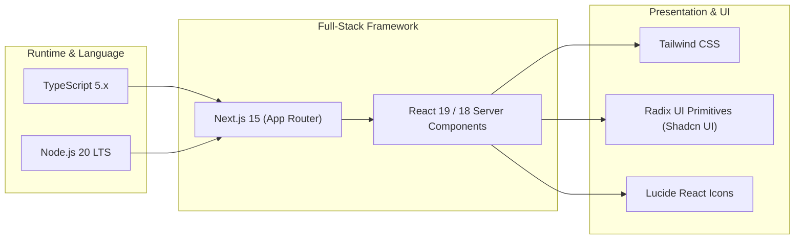
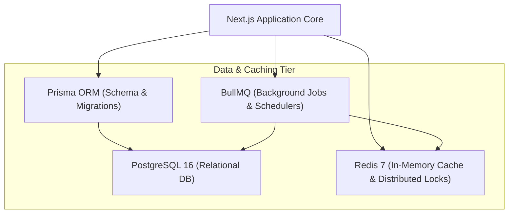

# 🛠️ Document 3: Tech Stack

**Project Name:** Aura Retail & Lifestyle (Discreet Adult Wellness & Intimate Care E-Commerce Marketplace)  
**Document Status:** Confirmed / Approved by User (Green Light on 2026-11-09)  
**Version:** 1.0.0  
**Date:** 2026-11-09  
**Author / Partner:** Planning & Technical Documentation Partner  

---

## 1. Purpose

Yeh document platform ke complete **Technology Stack Specification** ko define karta hai. Iska maqsad programming language, framework, runtime, database, ORM, caching layer, client/server libraries, testing tools aur developer environment ko evaluate aur finalize karna hai. Har choice ke peechhe clear reasoning, alternatives considered, aur official primary sources documented hain.

---

## 2. Existing Approved Context Used

Yeh tech stack selection pehle ke approved documents aur unke architectural decisions par strictly based hai:
* [`docs/01_Master_Planning.md`](file:///c:/Users/20092/OneDrive/Desktop/Dev/Projects/Active/Black%20Dot%20ecosystem/eoc_system%20Products/ecomerce%20website%20{wellness%20toys}/docs/01_Master_Planning.md) *(Approved on 2026-11-09)*: V1 boundaries, privacy-first brand promise, organic SEO necessity, aur anti-RTO business logic.
* [`docs/02_Architecture.md`](file:///c:/Users/20092/OneDrive/Desktop/Dev/Projects/Active/Black%20Dot%20ecosystem/eoc_system%20Products/ecomerce%20website%20{wellness%20toys}/docs/02_Architecture.md) *(Approved on 2026-11-09)*:
  * **ARCH-DEC-01:** Next.js Modular Monolith architecture.
  * **ARCH-DEC-02:** Hybrid rendering model (ISR for blogs, SSR for catalog/PDP, CSR for panic button & quiz).
  * **ARCH-DEC-03:** Anti-corruption adapters for payment, logistics, messaging, storage.
  * **ARCH-DEC-04:** PostgreSQL relational core + Redis in-memory cache/locks.
  * **ARCH-DEC-05:** Direct-to-cloud pre-signed video upload architecture.

---

## 3. Decisions Table

| Decision ID | Stack Layer | Selected Technology | Status | Key Reason | Alternatives Considered |
| :--- | :--- | :--- | :--- | :--- | :--- |
| **TECH-DEC-01** | **Language & Runtime** | **TypeScript 5.x + Node.js 20 LTS** | **Proposed** | End-to-end type safety (database to client UI), mature package ecosystem, and stable LTS enterprise runtime. | Python (FastAPI), Go, Pure JavaScript |
| **TECH-DEC-02** | **Full-Stack Framework** | **Next.js 15 (App Router)** | **Proposed** | First-class SSR/ISR for search engine crawling (mandatory since adult paid ads are banned), Server Actions, and unified monolith runtime. | Remix / React Router v7, Nuxt.js, Express + Vite SPA |
| **TECH-DEC-03** | **UI & Design System** | **Tailwind CSS v3/v4 + Shadcn UI (Radix Primitives)** | **Proposed** | Clean, non-sleazy medical/luxury wellness aesthetic, zero runtime CSS overhead, accessible WAI-ARIA primitives, and fully customizable source code. | Material UI (MUI), Chakra UI, Ant Design |
| **TECH-DEC-04** | **Primary Relational DB** | **PostgreSQL 16** | **Proposed** | ACID guarantees, complex order/inventory relations, JSONB support for dynamic medical specs, and proven reliability. | MySQL, MongoDB |
| **TECH-DEC-05** | **Database ORM** | **Prisma ORM** | **Proposed** | Declarative schema modeling, automatic type-safe query generation, rock-solid migrations, and rapid developer productivity. | Drizzle ORM, TypeORM, Kysely |
| **TECH-DEC-06** | **Cache & Lock Store** | **Redis 7 (via ioredis)** | **Proposed** | Sub-millisecond distributed locks for 30-min inventory holds, rate limiting, and ephemeral shopping cart sessions. | Memcached, In-Memory Node Map |
| **TECH-DEC-07** | **Background Job Queue** | **BullMQ (Redis-backed)** | **Proposed** | Deterministic 30-min payment hold release worker, neutral email/SMS notification retries, and scheduled inventory threshold checks. | Upstash QStash, Node-cron, AWS SQS |
| **TECH-DEC-08** | **Validation Layer** | **Zod** | **Proposed** | Unified runtime validation across Server Actions, API routes, checkout forms, and environment variables with automatic TypeScript type inference. | Yup, Joi, Valibot |
| **TECH-DEC-09** | **Client State Management** | **Zustand** | **Proposed** | Ultra-lightweight (<2KB) store for instant zero-latency Discreet Camouflage state, floating panic button triggers, and Toy Finder Quiz answers. | Redux Toolkit, MobX, React Context |
| **TECH-DEC-10** | **Object Storage Client** | **AWS SDK v3 (@aws-sdk/s3-request-presigner)** | **Proposed** | Industry standard for generating secure pre-signed PUT URLs for S3 or Cloudflare R2 unboxing video uploads (<50MB). | Direct multi-part form upload to Node server |
| **TECH-DEC-11** | **AI Assistant Integration** | **Vercel AI SDK** | **Proposed** | Streamlined streaming UI components, structured output for medical disclaimers, and provider-agnostic switching between OpenAI and Gemini. | LangChain.js, Raw fetch calls |

---

## 4. Detailed Tech Stack Specifications

### A. Core Platform & Runtime



#### 1. Language: TypeScript (v5.x)
* **Justification:** E-commerce platforms handle complex transaction states (prepaid discounts, COD surcharges, reservation TTLs, inventory counts). TypeScript compile-time checking runtime crashes ko 80%+ eliminate karta hai.
* **Alternative Considered:** Pure JavaScript (rejected: lack of type safety increases cart calculation bugs); Python/Go (rejected: Next.js modular monolith ecosystem requires unified JS/TS runtime).
* **Source:** [TypeScript Official Docs](https://www.typescriptlang.org/) (Accessed: 2026-11).

#### 2. Runtime: Node.js (v20 LTS / v22)
* **Justification:** Long-Term Support (LTS) stability, native `fetch` support, strong V8 engine performance, and universal hosting compatibility (AWS ECS/EC2, Vercel, Railway, Docker).
* **Source:** [Node.js Official Releases](https://nodejs.org/en/about/previous-releases) (Accessed: 2026-11).

#### 3. Full-Stack Framework: Next.js 15 (App Router)
* **Justification:**
  * **SEO Superiority:** Server-Side Rendering (SSR) and Incremental Static Regeneration (ISR) enable instant server-rendered HTML and automated Schema.org JSON-LD tags, ensuring top search engine rank when Google/Meta adult paid ads are banned.
  * **Server Actions:** Secure mutation pipeline eliminating boilerplate REST endpoints for internal form submits (Cart addition, Age Gate confirmation, DOB entry).
  * **Unified Monolith:** Frontend UI aur backend API route handlers single project structure mein co-locate rehte hain.
* **Alternative Considered:** Remix/React Router v7 (good, but smaller ecosystem and less comprehensive image/SEO optimization tooling); Vite SPA (rejected: client-side SPA produces poor SEO crawlability).
* **Source:** [Next.js Official Documentation](https://nextjs.org/docs) (Accessed: 2026-11).

---

### B. UI, Styling & Design System

#### 1. Styling: Tailwind CSS (v3 / v4)
* **Justification:** Utility-first CSS eliminates bloated style sheets, produces zero unused runtime CSS via purge compilation, and enables rapid creation of a calm, pastel, medical-grade luxury wellness theme.
* **Source:** [Tailwind CSS Docs](https://tailwindcss.com/docs) (Accessed: 2026-11).

#### 2. Component Primitives: Shadcn UI (built on Radix UI)
* **Justification:**
  * **Accessible & Unstyled Primitives:** Radix UI WAI-ARIA compliant accessible dialogs (Age verification modal), dropdowns, tooltips, and sheet drawers provide perfect accessibility without visual styling restrictions.
  * **Zero Dependency Lock-in:** Shadcn UI components directly codebase mein copy hote hain; koi heavy external NPM library lock-in nahi hota, making customization seamless.
* **Alternative Considered:** Material UI (MUI) (rejected: heavy runtime emotion CSS overhead, looks like standard enterprise ERP, hard to customize into luxury wellness aesthetic).
* **Source:** [Shadcn UI](https://ui.shadcn.com/) | [Radix UI](https://www.radix-ui.com/) (Accessed: 2026-11).

#### 3. Icons: Lucide React
* **Justification:** Clean, lightweight SVG icon set with tree-shaking support. Neutral, elegant icons match our non-explicit grooming/wellness aesthetic.
* **Source:** [Lucide React](https://lucide.dev/) (Accessed: 2026-11).

---

### C. Data Tier, Caching & Queue



#### 1. Primary Database: PostgreSQL 16
* **Justification:**
  * **ACID Transactions:** Order creation, inventory deduction, and customer store credit vouchers require absolute relational consistency.
  * **JSONB Capabilities:** Medical safety specifications (waterproof IPX ratings, material certifications, noise decibels) can be queried and indexed inside semi-structured JSONB columns without messy polymorphic tables.
* **Source:** [PostgreSQL Official Documentation](https://www.postgresql.org/docs/16/index.html) (Accessed: 2026-11).

#### 2. ORM & Query Builder: Prisma ORM
* **Justification:**
  * Single declarative `schema.prisma` file provides clear, readable documentation of all entities (Users, Products, Orders, Claims).
  * Auto-generated TypeScript types prevent column typo errors.
  * Automated migration engine (`prisma migrate`) makes team schema changes reproducible and safe.
* **Alternative Considered:** Drizzle ORM (extremely fast and close to raw SQL, but Prisma's mature migration ecosystem, visual Prisma Studio, and relations API provide superior developer velocity for V1 D2C e-commerce).
* **Source:** [Prisma Official Documentation](https://www.prisma.io/docs) (Accessed: 2026-11).

#### 3. Cache & Distributed Lock Store: Redis 7 (via `ioredis`)
* **Justification:**
  * **30-Minute Reservation Locks:** Implements atomic key setting with TTL (`SET stock:sku_123:lock user_id EX 1800 NX`) to guarantee zero overselling.
  * **Rate Limiting:** Protects sensitive endpoints (OTP requests, login attempts, AI bot queries) from abuse.
  * **Decoupled Session Revocation:** Instant session logout and camouflage mode state tracking.
* **Source:** [Redis Documentation](https://redis.io/docs/) (Accessed: 2026-11).

#### 4. Background Job Queue: BullMQ
* **Justification:**
  * Redis-backed job scheduler handles the **30-Minute Reservation Expiry Worker** (releasing unpaid stock back to catalog at minute 30:01).
  * Handles retry logic for transactional emails and SMS notifications without slowing down user HTTP requests.
* **Source:** [BullMQ Guide](https://docs.bullmq.io/) (Accessed: 2026-11).

---

### D. Validation, Forms & Client State

#### 1. Schema Validation: Zod
* **Justification:**
  * Single source of truth for schema validation across the application: validates environment variables (`process.env`), Server Action inputs, checkout form submissions, and external webhook payloads.
  * Seamless type inference via `z.infer<typeof OrderSchema>`.
* **Source:** [Zod Documentation](https://zod.dev/) (Accessed: 2026-11).

#### 2. Forms: React Hook Form + @hookform/resolvers/zod
* **Justification:** Uncontrolled form inputs maximize re-render performance on low-end mobile devices during complex multi-step checkout (Address, PIN code, DOB, Payment selection).
* **Source:** [React Hook Form](https://react-hook-form.com/) (Accessed: 2026-11).

#### 3. Client State: Zustand
* **Justification:**
  * Bundle size < 2KB (compared to 30KB+ for Redux).
  * Stores non-persistent client state: `isCamouflaged` (instant 0ms trigger for Panic Button), Toy Finder Quiz responses, and active Cart slide-over state.
* **Source:** [Zustand GitHub Repository](https://github.com/pmndrs/zustand) (Accessed: 2026-11).

---

### E. Storage, AI & Integrations Tooling

| Capability | Tool / Library | Reason & Integration Model |
| :--- | :--- | :--- |
| **Direct Cloud Video Upload** | `@aws-sdk/s3-request-presigner` + `@aws-sdk/client-s3` | S3 / Cloudflare R2 direct pre-signed URLs generate secure client-to-cloud pipelines for 24-hr unboxing videos (<50MB) without server memory overload. |
| **AI Assistant Framework** | `ai` (Vercel AI SDK) + `@ai-sdk/openai` / `@ai-sdk/google` | Native React hooks (`useChat`) for streaming non-judgmental wellness advice, structured tool calling for FAQ lookups, and built-in medical disclaimers. |
| **Password & Token Security** | `bcryptjs` + `jose` (JWT) | Secure password hashing for admin accounts and lightweight JWT verification for multi-channel OTP authenticated customer sessions in HttpOnly cookies. |
| **Date & Time Utilities** | `date-fns` | Tree-shakable date calculations for 18+ DOB eligibility verification (`isAfter(subYears(now, 18), dob)`) and 24-hr claim countdown timers. |
| **HTTP Client for Adapters** | Native `fetch` with custom retry wrapper | Node 20+ native fetch with built-in timeout AbortController and exponential backoff retry. |

---

### F. Testing, Code Quality & DevOps Tooling

```
Development & Quality Stack:
├── Package Manager:      pnpm (Fast, disk-efficient, strict dependency resolution)
├── Code Linter:          ESLint v9 (Next.js & TypeScript rules)
├── Code Formatter:       Prettier (with prettier-plugin-tailwindcss)
├── Unit & Integration:   Vitest (Fast Vite-powered test runner for domain modules)
├── E2E Testing:          Playwright (Automated testing of Age Gate, Camouflage, & Checkout)
├── Local Dev DB:         Docker Compose (PostgreSQL 16 + Redis 7 containers)
└── CI Pipeline:          GitHub Actions (Lint, Typecheck, Test, Build verification)
```

---

## 5. Major Technical Constraints & Compatibility Matrix

1. **Node.js LTS Compatibility:** Node 20.x LTS version strictly use hoga. Any package requiring unstable Node 21+ features is prohibited to maintain predictable production deployments.
2. **Bundle Budget:** Client JavaScript bundle for initial page load (Home/Catalog) must remain `< 120KB gzipped` to meet Lighthouse Performance > 90 on Indian 4G mobile networks.
3. **Cookie Security Policies:** Customer authentication tokens must use `HttpOnly`, `Secure`, `SameSite=Lax` cookies to prevent Cross-Site Scripting (XSS) credential theft.

---

## 6. Open Questions, Risks & Assumptions

### Open Questions (Tech Stack)
* [ ] **TECH-OQ-01 (Cloud Storage Provider):** Cloudflare R2 vs AWS S3—Cloudflare R2 provides zero egress fees (cheaper for unboxing video streaming during support review), while AWS S3 is the industry standard. *(Proposed: Cloudflare R2 via S3-compatible API client).*
* [ ] **TECH-OQ-02 (AI Model Selection):** OpenAI GPT-4o-mini vs Google Gemini 1.5 Flash—Dono ultra-fast aur cost-effective hain. Vercel AI SDK dono ko support karta hai. *(Proposed: Start with Gemini 1.5 Flash / GPT-4o-mini with seamless provider swap).*

### Technical Risks & Mitigations
* **Risk (Prisma Cold Starts in Serverless):** Serverless environments mein Prisma query engine cold start latency create kar sakta hai.
  * *Mitigation:* Deployment architecture mein persistent Node.js container (e.g. AWS ECS / Railway / VPS Docker) use karenge, ya standard PgBouncer connection pooler use karenge.

---

## 7. Related Documents / Dependencies

Is Tech Stack document ke approve hone ke baad agla document:
* `Document 04: Database Design` *(Entities, Relationships, Schemas, Migrations)*
* `Document 05: Authentication & Authorization` *(OTP, JWT, HttpOnly cookies, RBAC)*

---

## 8. Sources & References

1. **Next.js Official Documentation (v15 App Router):** https://nextjs.org/docs (Accessed: 2026-11).
2. **Prisma ORM Official Documentation:** https://www.prisma.io/docs (Accessed: 2026-11).
3. **Tailwind CSS & Radix UI Design Architecture:** https://tailwindcss.com/docs | https://www.radix-ui.com/ (Accessed: 2026-11).
4. **BullMQ Redis Queue Specification:** https://docs.bullmq.io/ (Accessed: 2026-11).
5. **Vercel AI SDK Core Guide:** https://sdk.vercel.ai/docs (Accessed: 2026-11).

---

## 9. Review Checklist (Aapke Approval ke Liye Key Points)

Kripya is Tech Stack specification ko review karein aur green light ya changes ke liye feedback dein:

- [ ] **1. Core Framework:** Kya **Next.js 15 (App Router) + TypeScript 5.x + Node.js 20 LTS** approved hai?
- [ ] **2. UI & Styling:** Kya **Tailwind CSS + Shadcn UI (Radix UI) + Lucide Icons** ki choice approved hai?
- [ ] **3. Database & ORM:** Kya **PostgreSQL 16 + Prisma ORM** combination approved hai?
- [ ] **4. Cache & Queue:** Kya **Redis 7 + BullMQ** (30-min inventory hold release worker ke liye) approved hai?
- [ ] **5. Tooling & Libraries:** Kya **Zod** (validation), **Zustand** (camouflage/quiz client state), aur **Vercel AI SDK** approved hain?
