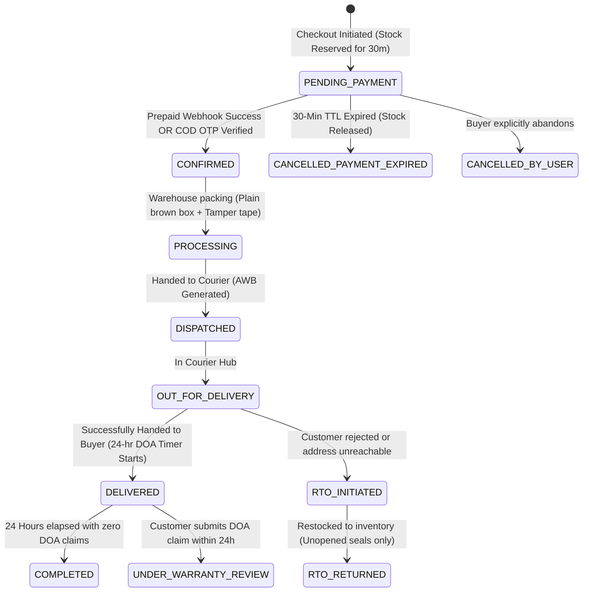
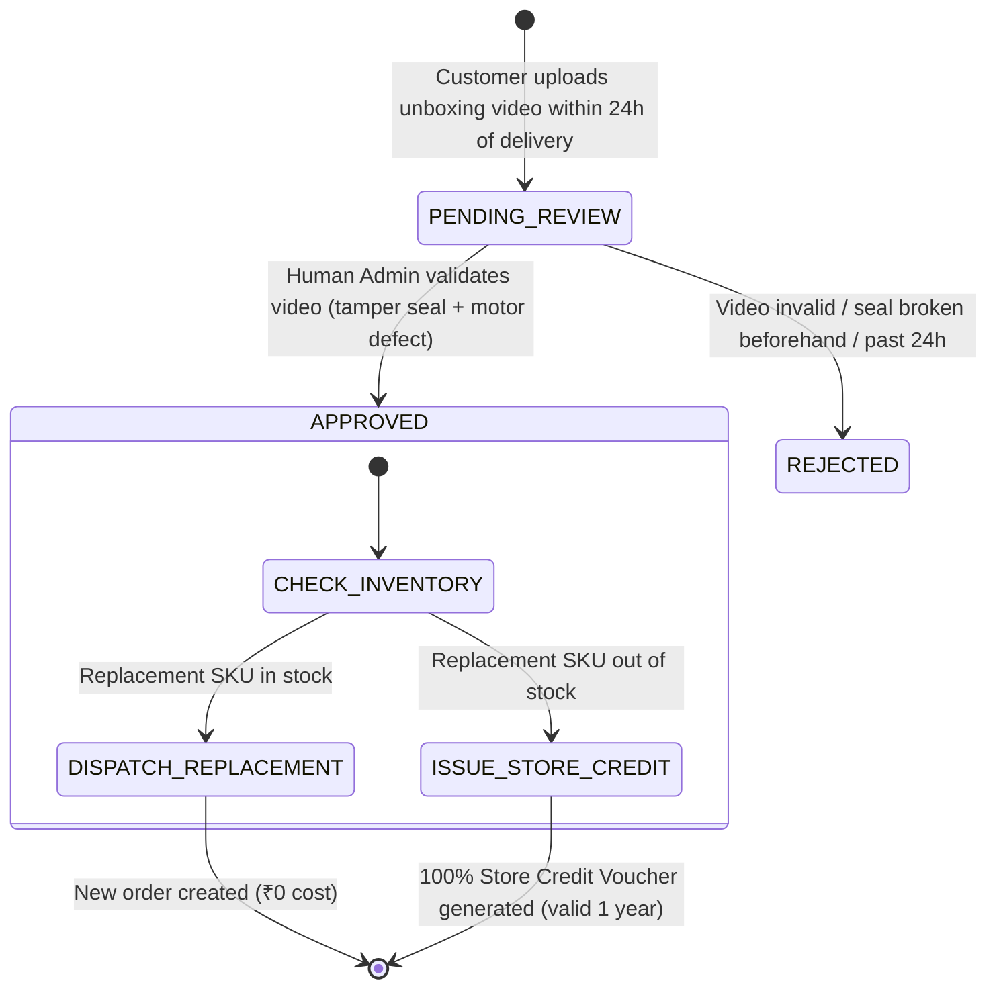

# 🗄️ Document 4: Database Design

**Project Name:** Aura Retail & Lifestyle (Discreet Adult Wellness & Intimate Care E-Commerce Marketplace)  
**Document Status:** Confirmed / Approved by User (Green Light on 2026-11-09)  
**Version:** 1.0.0  
**Date:** 2026-11-09  
**Author / Partner:** Planning & Technical Documentation Partner  

---

## 1. Purpose

Yeh document platform ka **Complete Database Design & Data Architecture Specification** hai. Iska maqsad data-modeling principles, relational entities, constraints, state machines, migration workflows, backup strategy, aur privacy/retention policies ko define karna hai. Is design ke approval ke baad Prisma schemas, migration scripts, aur database queries isi blueprint par implement hongi.

---

## 2. Existing Approved Context Used

Yeh database architecture approved documentation aur locked business rules par strictly based hai:
* [`docs/01_Master_Planning.md`](file:///c:/Users/20092/OneDrive/Desktop/Dev/Projects/Active/Black%20Dot%20ecosystem/eoc_system%20Products/ecomerce%20website%20{wellness%20toys}/docs/01_Master_Planning.md) *(Approved)*: V1 MVP scope, privacy-first principles, anti-RTO goals, aur neutral business identity.
* [`docs/02_Architecture.md`](file:///c:/Users/20092/OneDrive/Desktop/Dev/Projects/Active/Black%20Dot%20ecosystem/eoc_system%20Products/ecomerce%20website%20{wellness%20toys}/docs/02_Architecture.md) *(Approved)*: Hybrid data tier (PostgreSQL 16 + Redis 7), modular monolith domain isolation, pre-signed video uploads.
* [`docs/03_Tech_Stack.md`](file:///c:/Users/20092/OneDrive/Desktop/Dev/Projects/Active/Black%20Dot%20ecosystem/eoc_system%20Products/ecomerce%20website%20{wellness%20toys}/docs/03_Tech_Stack.md) *(Approved)*: PostgreSQL 16 + Prisma ORM declarative schema modeling.
* [`Feature/05_Business_Rules_and_Decisions.md`](file:///c:/Users/20092/OneDrive/Desktop/Dev/Projects/Active/Black%20Dot%20ecosystem/eoc_system%20Products/ecomerce%20website%20{wellness%20toys}/Feature/05_Business_Rules_and_Decisions.md):
  * **BR-01:** Mandatory DOB validation ensuring Customer Age ≥ 18 at registration/checkout.
  * **BR-02:** Multi-channel OTP verification before order transitions to `CONFIRMED`.
  * **BR-03 & BR-04:** ₹50 COD convenience surcharge & 5% prepaid discount.
  * **BR-05:** 30-minute stock reservation lock on pending payment.
  * **BR-06 & BR-08:** Invoices and courier AWBs locked to `"Aura Retail & Lifestyle"` ("Personal Grooming & Wellness Kits").
  * **BR-10, BR-11, BR-12, BR-14:** Non-return hygiene policy, 24-hr DOA claim window, unboxing video URI, and Store Credit voucher fallback.
* [`Feature/03_Roles_and_Permissions.md`](file:///c:/Users/20092/OneDrive/Desktop/Dev/Projects/Active/Black%20Dot%20ecosystem/eoc_system%20Products/ecomerce%20website%20{wellness%20toys}/Feature/03_Roles_and_Permissions.md): RBAC roles (`customer`, `support_agent`, `store_admin`, `super_admin`).

---

## 3. Decisions Table

| Decision ID | Area | Selected Design Decision | Status | Key Reason | Alternatives Considered |
| :--- | :--- | :--- | :--- | :--- | :--- |
| **DB-DEC-01** | **Primary Key Strategy** | **UUIDv7 (or CUID2)** | **Proposed** | Time-ordered unique IDs prevent sequential ID guessing (protecting order numbers & customer privacy) while maintaining B-tree index insertion performance. | Sequential BigInt / Auto-increment (exposes business volume), Random UUIDv4 (causes index fragmentation) |
| **DB-DEC-02** | **Monetary Representation** | **Integer in Smallest Currency Unit (Paise)** | **Proposed** | Prevents IEEE 754 floating-point rounding errors during ₹50 COD additions, 5% prepaid discounts, and GST tax splits. ₹2,499.00 = `249900`. | Floating-point (Float/Double), Decimal/Numeric (higher compute overhead) |
| **DB-DEC-03** | **Medical Specs Modeling** | **Hybrid Schema (Structured Columns + JSONB)** | **Proposed** | Common searchable fields (`isWaterproof`, `noiseLevelDb`, `materialType`) remain indexed relational columns; brand-specific medical certificates and battery specs go into `specs JSONB`. | 100% Normalized EAV pattern (slow joins), 100% Unstructured JSON (poor indexing) |
| **DB-DEC-04** | **18+ Age Enforcement** | **Database Check Constraint + Application Logic** | **Proposed** | Ensures no customer row can be persisted if `dateOfBirth` indicates age < 18 years on record creation. | Application-only validation (vulnerable to API bypass) |
| **DB-DEC-05** | **Deletion & Data Lifecycle** | **Soft Deletes on Products/Users; Hard Deletes on OTPs** | **Proposed** | Orders and financial audit trails require historical references; ephemeral OTPs and failed session carts are hard-deleted automatically. | Universal Hard Delete (breaks foreign key history), Universal Soft Delete (bloats DB with dead tokens) |
| **DB-DEC-06** | **Inventory Concurrency** | **Optimistic Locking via Version Field + Redis TTL** | **Proposed** | Fast reads on product catalog; 30-min reservation hold updates inventory row with version increment (`version = version + 1`) to eliminate overselling race conditions. | Pessimistic table locks (causes severe bottleneck during flash sales) |

---

## 4. Entity-Relationship (ER) Overview

System ko 6 primary domain clusters mein divide kiya gaya hai:
1. **Identity & RBAC:** `User`, `UserRole`, `OtpVerification`, `Address`
2. **Catalog & Medical Badges:** `Category`, `Product`, `ProductVariant`, `MedicalSafetyBadge`
3. **Inventory & Reservation:** `InventoryItem`, `StockReservation` (30-min hold engine)
4. **Orders & Transactions:** `Order`, `OrderItem`, `PaymentTransaction`
5. **Logistics & Neutral Fulfillment:** `Shipment`, `CourierWebhookLog`
6. **Warranty, Claims & Credit:** `WarrantyClaim`, `StoreCreditVoucher`, `StaffAuditLog`

---

## 5. Visual Entity-Relationship (ER) Diagram

```mermaid
erDiagram
    User ||--o{ Address : "has multiple"
    User ||--o{ Order : "places"
    User ||--o{ WarrantyClaim : "submits"
    User ||--o{ StoreCreditVoucher : "owns"
    User ||--o{ OtpVerification : "receives"
    User ||--o{ StaffAuditLog : "audited when staff views"

    Category ||--o{ Product : "contains"
    Product ||--|{ ProductVariant : "has variants"
    Product }o--o{ MedicalSafetyBadge : "displays badges"
    ProductVariant ||--|| InventoryItem : "tracks stock"
    ProductVariant ||--o{ StockReservation : "locked in"
    ProductVariant ||--o{ OrderItem : "ordered as"

    Order ||--|{ OrderItem : "contains items"
    Order ||--|{ PaymentTransaction : "paid via"
    Order ||--o| Shipment : "fulfilled by"
    Order ||--o{ StockReservation : "holds inventory for"
    Order ||--o{ WarrantyClaim : "subject of claim"

    WarrantyClaim ||--o| StoreCreditVoucher : "resolved via credit"
    Shipment ||--o{ CourierWebhookLog : "logs status events"

    User {
        string id PK "UUIDv7"
        string phone UK "Encrypted E.164"
        string email UK "Normalized lowercase"
        date dateOfBirth "Mandatory Age >= 18"
        enum role "CUSTOMER | SUPPORT | ADMIN | SUPERADMIN"
        boolean isAgeVerified "True on DOB check"
        timestamp createdAt
    }

    Address {
        string id PK "UUIDv7"
        string userId FK
        string fullName "Recipient Name"
        string addressLine1 "Street Address"
        string city "City"
        string state "State"
        string postalCode "6-digit Indian PIN"
        string deliveryInstructions "Neutral courier note"
        boolean isDefault
    }

    Product {
        string id PK "UUIDv7"
        string slug UK "SEO-optimized slug"
        string title "Product Name"
        string brand "Manufacturer / Brand"
        text description "Wellness & anatomical care copy"
        string materialType "Medical Grade Silicone / ABS"
        boolean isPhthalateFree "Body-safe cert"
        boolean isWaterproof "IPX7 certified"
        int noiseLevelDb "Noise decibel rating < 50"
        jsonb specs "Battery, motor modes, care guide"
        boolean isActive "Catalog visibility"
    }

    ProductVariant {
        string id PK "UUIDv7"
        string productId FK
        string sku UK "Unique Stock SKU"
        string color "Color / Aesthetic Variant"
        int pricePaise "Regular price in paise"
        int compareAtPricePaise "Original MRP in paise"
    }

    InventoryItem {
        string id PK "UUIDv7"
        string variantId FK "One-to-One"
        int availableStock "Available for new buyers"
        int reservedStock "In 30-min checkout hold"
        int lowStockThreshold "Default: 5"
        int version "Optimistic locking counter"
    }

    StockReservation {
        string id PK "UUIDv7"
        string orderId FK
        string variantId FK
        int quantity "Locked quantity"
        timestamp expiresAt "Now + 30 mins (BR-05)"
        enum status "ACTIVE | CONSUMED | EXPIRED | RELEASED"
    }

    Order {
        string id PK "UUIDv7"
        string orderNumber UK "AURA-YYYYMMDD-XXXX"
        string userId FK
        string shippingAddressId FK
        int subtotalPaise "Sum of item prices"
        int discountPaise "5% prepaid discount if applicable"
        int codFeePaise "Flat 5000 paise (₹50) if COD"
        int totalAmountPaise "Net payable in paise"
        enum paymentMethod "PREPAID_UPI | PREPAID_CARD | PREPAID_NB | COD"
        enum status "PENDING_PAYMENT | CONFIRMED | DISPATCHED | DELIVERED | CANCELLED"
        boolean isOtpVerified "Mandatory for confirmation"
        timestamp createdAt
    }

    OrderItem {
        string id PK "UUIDv7"
        string orderId FK
        string variantId FK
        string productTitleSnapshot "Immutable title"
        int unitPricePaise "Price at time of purchase"
        int quantity "Number of units"
    }

    PaymentTransaction {
        string id PK "UUIDv7"
        string orderId FK
        string gatewayName "Cashfree / PhonePe / Razorpay"
        string gatewayTransactionId UK "Gateway reference"
        string billingDescriptor "Aura Retail & Lifestyle (BR-06)"
        int amountPaise "Captured amount"
        enum status "INITIATED | SUCCESS | FAILED | REFUNDED"
        jsonb gatewayResponse "Raw webhook payload"
    }

    Shipment {
        string id PK "UUIDv7"
        string orderId FK "One-to-One"
        string awbNumber UK "Airway bill number"
        string courierPartner "Delhivery / Shiprocket"
        string senderDeclaredName "Aura Retail & Lifestyle (BR-08)"
        string packageDescription "Personal Grooming & Wellness Kits"
        timestamp dispatchedAt
        timestamp deliveredAt "Starts 24-hr DOA window"
        enum status "LABEL_CREATED | MANIFESTED | IN_TRANSIT | OUT_FOR_DELIVERY | DELIVERED | RTO"
    }

    WarrantyClaim {
        string id PK "UUIDv7"
        string orderId FK
        string userId FK
        string variantId FK
        string videoStorageUri "Direct S3/R2 signed upload"
        text defectDescription "Motor / battery issue notes"
        enum status "PENDING_REVIEW | APPROVED_REPLACEMENT | APPROVED_STORE_CREDIT | REJECTED"
        text adminReviewNotes "Human review findings (BR-13)"
        string reviewedByUserId FK "Admin / Support ID"
        timestamp submittedAt "Must be <= deliveredAt + 24h"
    }

    StoreCreditVoucher {
        string id PK "UUIDv7"
        string voucherCode UK "AURA-VOUCH-XXXX"
        string userId FK
        string claimId FK "Linked DOA claim"
        int balancePaise "100% value of defective SKU"
        timestamp expiresAt "Now + 365 days (BR-14)"
        boolean isRedeemed "False until consumed"
    }

    StaffAuditLog {
        string id PK "UUIDv7"
        string staffUserId FK "Support or Admin user"
        string action "VIEW_CUSTOMER_PII | APPROVE_CLAIM | REJECT_CLAIM"
        string targetEntity "Order | User | WarrantyClaim"
        string targetEntityId "UUID of entity accessed"
        string ipAddress "Access IP"
        timestamp timestamp
    }
```



---

## 6. Detailed Schema Modeling & Constraints

### A. Non-Negotiable Database Constraints

1. **Mandatory 18+ Age Constraint (BR-01):**
   ```sql
   -- Ensures customer is at least 18 years old at registration
   ALTER TABLE "User" 
   ADD CONSTRAINT "check_customer_age_18_plus" 
   CHECK (
     "role" != 'CUSTOMER' OR 
     "dateOfBirth" <= (CURRENT_DATE - INTERVAL '18 years')
   );
   ```

2. **Zero Negative Inventory Constraint:**
   ```sql
   -- Eliminates overselling at the database storage engine level
   ALTER TABLE "InventoryItem" 
   ADD CONSTRAINT "check_stock_non_negative" 
   CHECK ("availableStock" >= 0 AND "reservedStock" >= 0);
   ```

3. **24-Hour DOA Claim Window Integrity (BR-11):**
   * Application-layer and database trigger verification guarantees that `WarrantyClaim.submittedAt <= Shipment.deliveredAt + INTERVAL '24 hours'`.

4. **Immutable Billing & Shipping Descriptors (BR-06 & BR-08):**
   * `PaymentTransaction.billingDescriptor` default permanently set to `'Aura Retail & Lifestyle'`.
   * `Shipment.packageDescription` default permanently set to `'Personal Grooming & Wellness Kits'`.

---

## 7. Data Lifecycle & State Machines

### A. Order State Machine
An order strictly follows this state transition diagram:



---

### B. Warranty Claim & Store Credit State Machine



---

## 8. Database Migrations & Version Control Strategy

1. **Tooling:** `prisma migrate` standard workflow:
   * **Development:** `pnpm prisma migrate dev --name <descriptive_change>`
   * **Staging / Production:** `pnpm prisma migrate deploy` (executed during CI/CD build before app startup).
2. **Zero-Downtime Migration Policy:**
   * **Expanding vs Contracting:** Columns add karte waqt hamesha `nullable` ya with a default value introduce kiye jayenge.
   * **Renaming Columns:** Direct rename prohibited hai; pehle new column add hoga, dual-write enable hoga, data backfill hoga, aur phir old column drop hoga.
3. **Database Seed Script (`prisma/seed.ts`):**
   * Default medical safety badges: `100% Medical Grade Silicone`, `Phthalate-Free`, `IPX7 Waterproof`, `Sub-50dB Whisper Quiet`, `RoHS Certified`.
   * Default admin credentials (super admin) with required role seeding.

---

## 9. Backup, Data Retention & Privacy Plan

1. **Automated Daily Backups:**
   * Automated snapshot backups daily at 03:00 IST (low-traffic window) with 30-day point-in-time recovery (PITR) via Write-Ahead Logs (WAL).
2. **Customer PII Scrubbing Policy (Privacy-First):**
   * Adult wellness buyers often request session purges. While financial and tax order records must be retained for 7 years under Indian tax law, customer delivery phone numbers and physical addresses in the active user profile can be anonymized/scrupped upon customer request post-delivery completion (`COMPLETED` status).
3. **Audit Trail Protection:**
   * Customer Support Agents viewing customer addresses and phone numbers automatically trigger an immutable entry in `StaffAuditLog` (IP, Staff ID, Timestamp, Entity ID), preventing rogue data scraping.

---

## 10. Open Questions, Risks & Assumptions

### Open Questions (Database)
* [ ] **DB-OQ-01 (PIN Code Master Data):** Kya Indian 6-digit PIN codes ki validation ke liye pre-populated Indian Post Postal Code master table database mein embed karein ya third-party Postal PIN API (e.g., Postalpincode.in / Shiprocket API) use karein? *(Proposed: Static PostgreSQL Postal PIN table for instant offline validation).*
* [ ] **DB-OQ-02 (Video Metadata Storage):** Customer unboxing video metadata (Duration, file size, codec) ko `WarrantyClaim` table mein alag columns mein store karein ya JSONB metadata mein? *(Proposed: Dedicated columns for fileSize, durationSeconds, mimeType).*

### Database Risks & Mitigations
* **Risk (High Concurrent Checkout Contention):** Flash sales ya seasonal bundles ke waqt multiple users same limited-stock item cart mein hold karne ki koshish karein.
  * *Mitigation:* Redis distributed locks (`SET ... NX EX 1800`) handle first-line fast rejection; PostgreSQL optimistic locking (`version` field) ensures zero race conditions in database persistence.

---

## 11. Related Documents / Dependencies

Is Database Design document ke approve hone ke baad agla document sequence:
* `Document 05: Authentication & Authorization` *(Next in line - OTP flows, HttpOnly session tokens, RBAC gates)*
* `Document 06: Security Plan` *(PII encryption at rest, WAF, sanitization)*
* `Document 07: Third-party Services & Integrations` *(Payment, Logistics, Messaging APIs)*

---

## 12. Sources & Technical References

1. **PostgreSQL 16 Documentation (Constraints & JSONB Indexing):** https://www.postgresql.org/docs/16/ddl-constraints.html (Accessed: 2026-11).
2. **Prisma ORM Best Practices for Relational E-Commerce:** https://www.prisma.io/docs/guides/database/database-workflows (Accessed: 2026-11).
3. **Digital Personal Data Protection Act, 2023 (DPDP Act, India):** Guidelines regarding data minimization, purpose limitation, and consent withdrawal for e-commerce PII.

---

## 13. Review Checklist (Aapke Approval ke Liye Key Points)

Kripya is Database Design blueprint ko review karein aur green light ya changes ke liye feedback dein:

- [ ] **1. Entity Structure:** Kya `User`, `Product`, `InventoryItem`, `StockReservation`, `Order`, `Shipment`, aur `WarrantyClaim` ka relational structure approved hai?
- [ ] **2. Mandatory 18+ DB Constraint:** Kya database level par `CHECK ("dateOfBirth" <= CURRENT_DATE - INTERVAL '18 years')` enforcement approved hai?
- [ ] **3. Currency in Paise (Integers):** Kya financial accuracy ke liye sabhi prices paise (integers) mein store karne ka rule approved hai?
- [ ] **4. 30-Minute Reservation Model:** Kya `StockReservation` table aur optimistic locking model inventory protection ke liye approved hai?
- [ ] **5. Neutral Descriptor Defaults:** Kya `PaymentTransaction` aur `Shipment` tables mein default neutral descriptions (`"Aura Retail & Lifestyle"` / `"Personal Grooming & Wellness Kits"`) approved hain?
