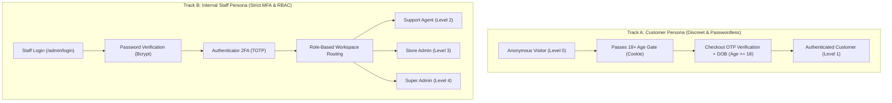
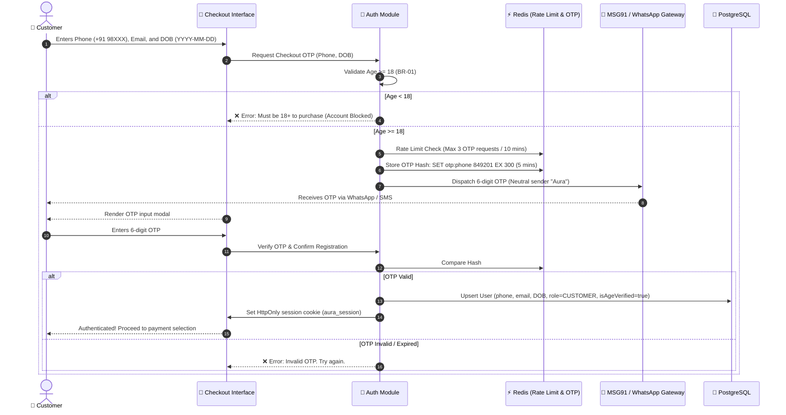
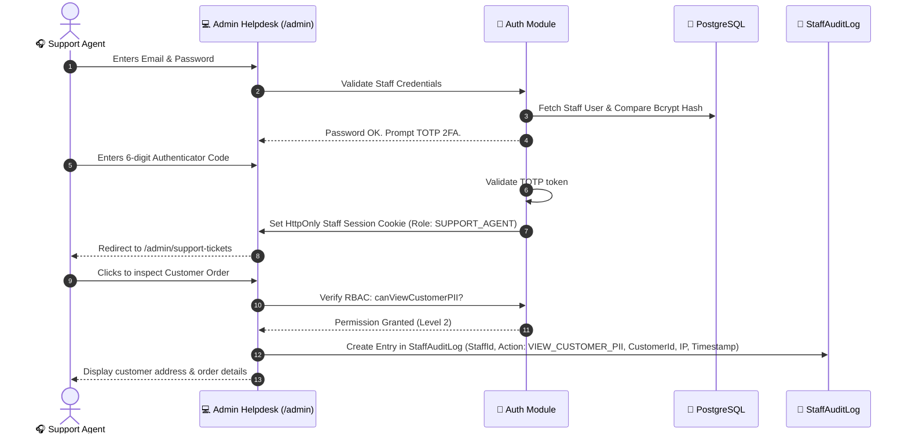

# 🔐 Document 5: Authentication & Authorization

**Project Name:** Aura Retail & Lifestyle (Discreet Adult Wellness & Intimate Care E-Commerce Marketplace)  
**Document Status:** Confirmed / Approved by User (Green Light on 2026-11-09)  
**Version:** 1.0.0  
**Date:** 2026-11-09  
**Author / Partner:** Planning & Technical Documentation Partner  

---

## 1. Purpose

Yeh document platform ke complete **Identity, Authentication, Session Management, aur Role-Based Access Control (RBAC)** architecture ko define karta hai. Sexual wellness e-commerce mein customer privacy aur discreet access sabse badi priority hain—users ko shared device par identity leak hone ka darr hota hai, jabki platform ko 18+ legal compliance aur staff access control maintain karna hota hai. Yeh document in dono aspects ko balance karta hai.

---

## 2. Existing Approved Context Used

Yeh authentication blueprint pehle ke approved documents par strictly based hai:
* [`docs/01_Master_Planning.md`](file:///c:/Users/20092/OneDrive/Desktop/Dev/Projects/Active/Black%20Dot%20ecosystem/eoc_system%20Products/ecomerce%20website%20{wellness%20toys}/docs/01_Master_Planning.md) *(Approved)*: Privacy-first brand promise, non-intrusive support, 18+ legal requirement.
* [`docs/02_Architecture.md`](file:///c:/Users/20092/OneDrive/Desktop/Dev/Projects/Active/Black%20Dot%20ecosystem/eoc_system%20Products/ecomerce%20website%20{wellness%20toys}/docs/02_Architecture.md) *(Approved)*: Next.js modular monolith auth module, Redis session & rate limit store.
* [`docs/03_Tech_Stack.md`](file:///c:/Users/20092/OneDrive/Desktop/Dev/Projects/Active/Black%20Dot%20ecosystem/eoc_system%20Products/ecomerce%20website%20{wellness%20toys}/docs/03_Tech_Stack.md) *(Approved)*: TypeScript, Node.js 20, `jose` JWT, `bcryptjs`, Redis session revocation.
* [`docs/04_Database_Design.md`](file:///c:/Users/20092/OneDrive/Desktop/Dev/Projects/Active/Black%20Dot%20ecosystem/eoc_system%20Products/ecomerce%20website%20{wellness%20toys}/docs/04_Database_Design.md) *(Approved)*: `User` table, `check_customer_age_18_plus` database constraint, `StaffAuditLog`.
* [`Feature/05_Business_Rules_and_Decisions.md`](file:///c:/Users/20092/OneDrive/Desktop/Dev/Projects/Active/Black%20Dot%20ecosystem/eoc_system%20Products/ecomerce%20website%20{wellness%20toys}/Feature/05_Business_Rules_and_Decisions.md):
  * **BR-01:** Mandatory DOB verification (Age ≥ 18).
  * **BR-02:** Multi-channel OTP verification for order confirmation.
  * **DEC-02:** Standard Account with verified identity over 100% anonymous guest checkout.
* [`Feature/03_Roles_and_Permissions.md`](file:///c:/Users/20092/OneDrive/Desktop/Dev/Projects/Active/Black%20Dot%20ecosystem/eoc_system%20Products/ecomerce%20website%20{wellness%20toys}/Feature/03_Roles_and_Permissions.md): RBAC matrix across 5 system roles.

---

## 3. Decisions Table

| Decision ID | Authentication Domain | Selected Decision | Status | Key Reason | Alternatives Considered |
| :--- | :--- | :--- | :--- | :--- | :--- |
| **AUTH-DEC-01** | **Customer Auth Mechanism** | **Passwordless Multi-Channel OTP (SMS/WhatsApp/Email)** | **Proposed** | Passwords create friction, get forgotten, and leak via autofill on shared devices. Fast 6-digit OTP ensures discreet, zero-credential friction while verifying real identity. | Password + Social Login (Google/FB rejected due to adult profiling fears) |
| **AUTH-DEC-02** | **Staff & Admin Auth** | **Email + Strong Password + Time-Based OTP (TOTP 2FA)** | **Proposed** | Store Admin and Support staff have access to sensitive customer PII and warranty videos; high-assurance MFA is mandatory. | Single-factor password, SMS OTP (vulnerable to SIM swapping) |
| **AUTH-DEC-03** | **Session Storage Strategy** | **Stateless Signed JWT in HttpOnly Cookie + Redis Revocation List** | **Proposed** | Stateless token verification offers high performance on edge/SSR pages; Redis revocation list allows instant logout on panic camouflage or suspicious activity. | Pure DB session queries (high latency), Pure stateless JWT (impossible to revoke instantly) |
| **AUTH-DEC-04** | **Guest-to-Customer Cart Merge** | **Ephemeral Guest Session Cookie Merged upon OTP Login** | **Proposed** | Visitors can browse and add items to cart anonymously without logging in; items automatically merge into authenticated account upon checkout OTP verification. | Forcing login before adding items to cart (destroys top-of-funnel conversion) |
| **AUTH-DEC-05** | **Privacy Session Purge ("Clean Exit")** | **1-Click Local Data & Cookie Flush in Footer** | **Proposed** | Empowers users on shared laptops or family tablets to purge cart, recently viewed items, and auth tokens in 1 click without leaving traces in browser storage. | Relying on user to manually clear browser cache |

---

## 4. User Identity & Persona Model

Platform mein do distinct user tracks hain:



---

## 5. Session Architecture & Token Lifecycle

### A. Token Structure & Cookies
Authentication sessions **Encrypted/Signed JSON Web Tokens (JWT)** ke through manage hoti hain using the `jose` library (HS256/RS256 algorithm).

* **Cookie Configuration:**
  ```typescript
  const sessionCookieOptions = {
    name: 'aura_session',
    httpOnly: true,          // JavaScript cannot read token (prevents XSS)
    secure: process.env.NODE_ENV === 'production', // Only transmitted over HTTPS
    sameSite: 'lax' as const, // Prevents CSRF while allowing navigation from links
    path: '/',
    maxAge: 60 * 60 * 24 * 30 // 30 Days sliding persistence for customers
  };
  ```

* **JWT Payload Claims:**
  ```json
  {
    "sub": "usr_01hq7x9z8k3p4m1",
    "role": "CUSTOMER",
    "phoneVerified": true,
    "isAgeVerified": true,
    "sessionId": "sess_98234abcf",
    "iat": 1731150000,
    "exp": 1733742000
  }
  ```

### B. Redis Revocation Engine
Chunki JWT stateless hota hai, instant logout ya compromise hone par token invalidate karne ke liye Redis use hota hai:
* Har token mein ek unique `sessionId` hoti hai.
* Jab user **"Logout"**, **"Panic Purge"**, ya Admin **"Suspend Account"** trigger karta hai:
  * Redis command: `SET blacklist:sess_98234abcf 1 EX 2592000` (TTL matches JWT expiry).
  * Next.js Middleware check karta hai: `EXISTS blacklist:<sessionId>`. Agar blacklisted hai, session immediately reject ho jati hai.

---

## 6. Granular Roles & Permissions (RBAC Matrix)

| Domain Resource | Specific Action | Anonymous (L0) | Customer (L1) | Support Agent (L2) | Store Admin (L3) | Super Admin (L4) |
| :--- | :--- | :---: | :---: | :---: | :---: | :---: |
| **Catalog & Discovery** | View Catalog, PDP, Blogs | ✅ | ✅ | ✅ | ✅ | ✅ |
| | Pass 18+ Age Gate | ✅ | ✅ | ✅ | ✅ | ✅ |
| | Trigger Panic Camouflage Mode | ✅ | ✅ | ✅ | ✅ | ✅ |
| | Take Toy Finder Quiz | ✅ | ✅ | ✅ | ✅ | ✅ |
| | Create / Edit Product Listings | ❌ | ❌ | ❌ | ✅ | ✅ |
| | Modify Stock / Thresholds | ❌ | ❌ | ❌ | ✅ | ✅ |
| **Identity & Account** | Request Multi-Channel OTP | ✅ | ✅ | ❌ | ❌ | ❌ |
| | Edit Own Profile & Addresses | ❌ | ✅ (Own) | ❌ | ❌ | ❌ |
| | View Customer PII (Audit Logged) | ❌ | ❌ | ✅ (Support) | ✅ (Ops) | ✅ |
| | Suspend / Deactivate User | ❌ | ❌ | ❌ | ✅ | ✅ |
| | Create Staff Accounts & Roles | ❌ | ❌ | ❌ | ❌ | ✅ |
| **Cart & Transactions** | Add Items to Ephemeral Cart | ✅ | ✅ | ❌ | ❌ | ❌ |
| | 30-Min Stock Reservation Hold | ❌ | ✅ (Own) | ❌ | ❌ | ❌ |
| | Place Order (Prepaid / ₹50 COD) | ❌ | ✅ (Own) | ❌ | ❌ | ❌ |
| | Cancel Order (Before Courier Handover)| ❌ | ✅ (Own) | ✅ | ✅ | ✅ |
| **Logistics & Ops** | Generate Neutral AWBs | ❌ | ❌ | ❌ | ✅ | ✅ |
| | Review COD High-Risk Orders | ❌ | ❌ | ❌ | ✅ | ✅ |
| **Warranty & Claims** | Submit 24-hr DOA Video Claim | ❌ | ✅ (Own) | ❌ | ❌ | ❌ |
| | Review & Approve Unboxing Video | ❌ | ❌ | ✅ | ✅ | ✅ |
| | Issue Store Credit Voucher | ❌ | ❌ | ✅ | ✅ | ✅ |
| **System & Financial** | View GMV / Business Dashboard | ❌ | ❌ | ❌ | ❌ | ✅ |
| | Configure Payment Gateway API Keys | ❌ | ❌ | ❌ | ❌ | ✅ |
| | Inspect Staff Audit Logs | ❌ | ❌ | ❌ | ❌ | ✅ |

---

## 7. Authentication User Flows (Sequence Diagrams)

### Flow 1: Customer Progressive Checkout & 18+ Verification Flow
Customer checkout ke waqt OTP submit karta hai, DOB validate hoti hai, aur account seamless background mein create/verify hota hai.



---

### Flow 2: Staff MFA Login & Audit-Logged PII Access
Support Agent login karta hai, 2FA verify karta hai, aur customer PII view karne par audit log create hota hai.



---

## 8. Account Lifecycle & Privacy Safeguards

### A. Progressive Creation to Privacy Purge

```mermaid
stateDiagram-v2
    [*] --> ANONYMOUS: Visitor lands on site
    ANONYMOUS --> AGE_VERIFIED: Confirms 18+ gate (Cookie stored)
    
    AGE_VERIFIED --> REGISTERED_CUSTOMER: Completes OTP + DOB verification at checkout
    
    state REGISTERED_CUSTOMER {
        [*] --> ACTIVE
        ACTIVE --> LOCAL_PURGED: User clicks "Clear Browsing Data" in footer
        LOCAL_PURGED --> ACTIVE: User re-authenticates via OTP
        ACTIVE --> SUSPENDED: Admin flags fraudulent RTO abuse
    }
    
    ACTIVE --> DELETED_SCRUBBED: Customer exercises Right-to-be-Forgotten (DPDP Act)
    DELETED_SCRUBBED --> [*]: PII scrubbed; financial audit records retained
```


1. **Local Privacy Purge ("Clean Exit Button"):**
   * Customer shared laptop par shopping ke baad footer mein **"Clear Browsing Data"** par click kar sakta hai.
   * Action: Browser localStorage (`aura_cart`, `recently_viewed`) wipe ho jata hai, session cookie expire kar di jati hai, aur client instantly neutral home page par redirect ho jata hai.
2. **Right to be Forgotten (DPDP Act 2023):**
   * Jab customer account deletion request karta hai:
     * `User.phone` aur `User.email` ko one-way cryptographic hash (`SHA-256`) se replace kiya jata hai.
     * Saved addresses delete ho jati hain.
     * Order history retained rehti hai for 7 years under Indian tax regulations, lekin un-linkable ban jati hai.

---

## 9. Major Security Constraints & Threat Protections

1. **Brute-Force & OTP Flooding Protection:**
   * OTP requests par strict Redis rate limiting: Max 3 OTP requests per phone/IP in 10 minutes.
   * OTP verification attempts: Max 5 incorrect attempts before OTP is invalidated and locked for 15 minutes.
2. **No Social Login Exposure:**
   * Google / Facebook social sign-in intentionally omit kiya gaya hai, taaki third-party ad networks customer ki intimate purchase history track na kar sakein.
3. **Session Fixation Prevention:**
   * Guest session se customer session me transition hone par session ID regenerate hoti hai.

---

## 10. Open Questions & Assumptions

### Open Questions (Auth)
* [ ] **AUTH-OQ-01 (Session Duration Policy):** Customer session cookie ka sliding window duration 30 days rakhein ya privacy reasons se har 7 days mein re-authentication mandate karein? *(Proposed: 30 days sliding cookie, with mandatory OTP re-verification before viewing saved delivery addresses).*
* [ ] **AUTH-OQ-02 (Staff 2FA Enrollment):** Support staff ke liye Google Authenticator/Authy TOTP apps use karein ya email-based 2FA code? *(Proposed: TOTP Authenticator app for zero reliance on external SMS/Email).*

---

## 11. Related Documents / Dependencies

Is Authentication & Authorization document ke approve hone ke baad agla document:
* `Document 06: Security Plan` *(Next in line - Threat modeling, encryption at rest, WAF, incident response)*

---

## 12. Sources & Technical References

1. **OWASP Authentication Cheat Sheet:** https://cheatsheetseries.owasp.org/cheatsheets/Authentication_Cheat_Sheet.html (Accessed: 2026-11).
2. **RFC 7519 (JSON Web Token - JWT) & RFC 6238 (TOTP):** Industry standard cryptographic specifications.
3. **India Digital Personal Data Protection (DPDP) Act, 2023:** Legal compliance for consent and data erasure.

---

## 13. Review Checklist (Aapke Approval ke Liye Key Points)

Kripya is Authentication & Authorization specification ko review karein aur green light ya changes ke liye feedback dein:

- [ ] **1. Passwordless Customer Auth:** Kya customers ke liye multi-channel OTP (SMS/WhatsApp/Email) model approved hai?
- [ ] **2. Mandatory DOB Validation:** Kya checkout OTP step par customer ki DOB validate karke Age ≥ 18 verify karne ka flow approved hai?
- [ ] **3. Staff MFA & Audit Trail:** Kya internal staff ke liye Password + TOTP 2FA aur customer PII access par automated `StaffAuditLog` approved hai?
- [ ] **4. Session Strategy:** Kya HttpOnly Secure Cookie (JWT) + Redis Blacklist revocation model approved hai?
- [ ] **5. Local Privacy Purge:** Kya footer mein 1-click "Clear Browsing Data" privacy exit feature approved hai?
