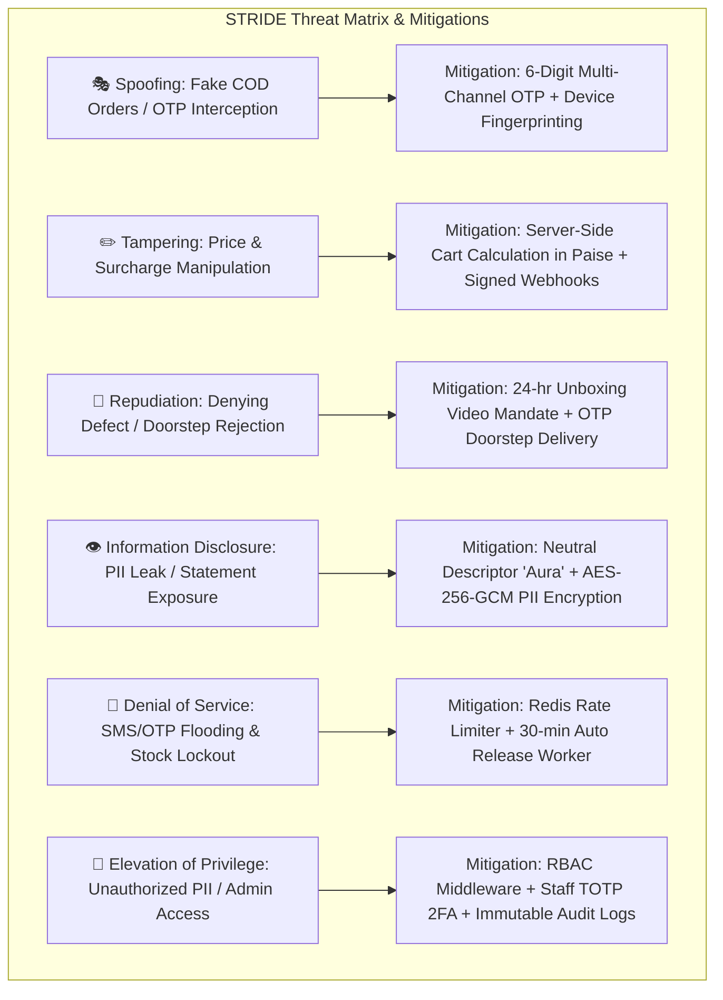
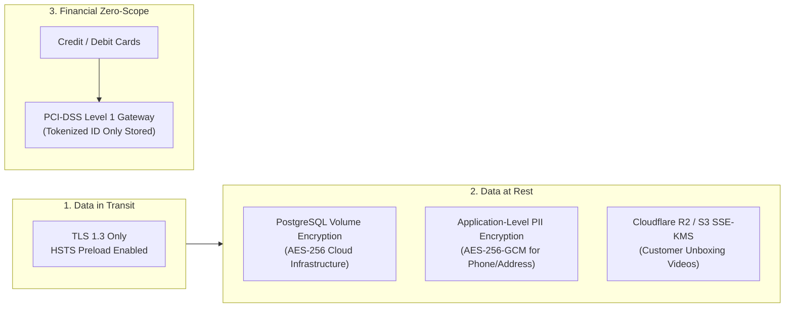
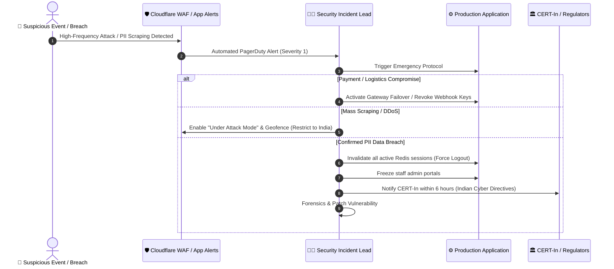

# 🛡️ Document 6: Security Plan

**Project Name:** Aura Retail & Lifestyle (Discreet Adult Wellness & Intimate Care E-Commerce Marketplace)  
**Document Status:** Confirmed / Approved by User (Green Light on 2026-11-09)  
**Version:** 1.0.0  
**Date:** 2026-11-09  
**Author / Partner:** Planning & Technical Documentation Partner  

---

## 1. Purpose

Yeh document platform ka **Comprehensive Security & Privacy Engineering Plan** hai. Intimate adult wellness marketplace mein user privacy aur system security sirf technical features nahi hain, balki product ka core value proposition hain. Ek chhota sa data leak ya statement disclosure customer ki personal life mein severe embarrassment aur legal repercussions cause kar sakta hai. Yeh document threat modeling, input validation, encryption, secret management, vulnerability governance, aur incident response protocols ko establish karta hai.

---

## 2. Existing Approved Context Used

Yeh security plan sabhi approved foundational documents par based hai:
* [`docs/01_Master_Planning.md`](file:///c:/Users/20092/OneDrive/Desktop/Dev/Projects/Active/Black%20Dot%20ecosystem/eoc_system%20Products/ecomerce%20website%20{wellness%20toys}/docs/01_Master_Planning.md) *(Approved)*: Privacy-first promise, brand neutrality ("Aura Retail & Lifestyle"), anti-RTO mechanics.
* [`docs/02_Architecture.md`](file:///c:/Users/20092/OneDrive/Desktop/Dev/Projects/Active/Black%20Dot%20ecosystem/eoc_system%20Products/ecomerce%20website%20{wellness%20toys}/docs/02_Architecture.md) *(Approved)*: Cloudflare edge boundary, pre-signed S3/R2 direct uploads, zero-network camouflage mode.
* [`docs/03_Tech_Stack.md`](file:///c:/Users/20092/OneDrive/Desktop/Dev/Projects/Active/Black%20Dot%20ecosystem/eoc_system%20Products/ecomerce%20website%20{wellness%20toys}/docs/03_Tech_Stack.md) *(Approved)*: TypeScript strict mode, Zod validation, Prisma ORM, Redis distributed locks.
* [`docs/04_Database_Design.md`](file:///c:/Users/20092/OneDrive/Desktop/Dev/Projects/Active/Black%20Dot%20ecosystem/eoc_system%20Products/ecomerce%20website%20{wellness%20toys}/docs/04_Database_Design.md) *(Approved)*: Database 18+ check constraint, `StaffAuditLog`, currency in paise, optimistic concurrency.
* [`docs/05_Authentication_and_Authorization.md`](file:///c:/Users/20092/OneDrive/Desktop/Dev/Projects/Active/Black%20Dot%20ecosystem/eoc_system%20Products/ecomerce%20website%20{wellness%20toys}/docs/05_Authentication_and_Authorization.md) *(Approved)*: Passwordless customer OTP, staff TOTP MFA, HttpOnly secure cookies, Redis session blacklist.

---

## 3. Decisions Table

| Decision ID | Security Domain | Selected Security Decision | Status | Key Reason | Alternatives Considered |
| :--- | :--- | :--- | :--- | :--- | :--- |
| **SEC-DEC-01** | **Field-Level PII Encryption** | **AES-256-GCM for Phone & Delivery Address** | **Proposed** | Database volume encryption ke alawa application-level encryption ensures karta hai ki raw SQL database dump leak hone par bhi customer ke contact details unreadable rahein. | Plain database storage with column permissions, Hashing (irreversible; shipping needs real address) |
| **SEC-DEC-02** | **Zero PCI Scope (Tokenization)** | **100% Hosted Fields / SDK Tokenization** | **Proposed** | Platform servers credit/debit card numbers ya CVVs ko kabhi touch, process, ya store nahi karenge; full payment processing RBI-licensed PCI-DSS Level 1 aggregators ke hands mein rahegi. | Custom card form handling (requires costly PCI-DSS Level 1 infrastructure audit) |
| **SEC-DEC-03** | **Webhook Cryptographic Verification** | **HMAC-SHA256 Signature Header Validation** | **Proposed** | Prevents fraudulent payment confirmation spoofing; har incoming webhook (Cashfree/Razorpay, Shiprocket) ka signature verify hone ke baad hi order status update hoga. | Secret query token, IP whitelisting alone |
| **SEC-DEC-04** | **Content Security Policy (CSP)** | **Strict Nonce-Based CSP + TLS 1.3 HSTS** | **Proposed** | Blocks malicious script injections (XSS), unauthorized keyloggers, and ad network trackers from injecting scripts into sensitive checkout forms. | Loose unsafe-inline CSP |
| **SEC-DEC-05** | **Pre-Signed S3 Upload Scoping** | **Strict 15-Min TTL + Exact Content-Type & Size Limits** | **Proposed** | Customer unboxing videos upload karne ke liye pre-signed URLs strictly restricted honge (`maxSize: 50MB`, `allowedTypes: video/mp4, video/quicktime`). | Public open S3 bucket upload endpoint |
| **SEC-DEC-06** | **Decoy Mode Memory Sanitation** | **Instant Audio/Video Mute & State Isolation** | **Proposed** | Panic camouflage activate hote hi running product video/audio instantly terminate hoga taaki sound leak na ho. | Visual-only camouflage without audio mute |

---

## 4. Threat Modeling (STRIDE Analysis)

Intimate wellness e-commerce ke attack surface ko analyze karne ke liye STRIDE methodology implement ki gayi hai:



---

## 5. Input Validation & Defense-in-Depth

### A. Zod Schema Boundary Validation
Har external data point (Server Actions, API route requests, webhook payloads) ko database ya business layer tak pahunchne se pehle Zod schema validate karega:

```typescript
// Example: Checkout Address & Age Validation Schema
export const CheckoutInputSchema = z.object({
  fullName: z.string().trim().min(2).max(100),
  phone: z.string().regex(/^\+91[6-9]\d{9}$/, 'Invalid Indian mobile number'),
  dateOfBirth: z.string().refine((dob) => {
    const age = differenceInYears(new Date(), new Date(dob));
    return age >= 18;
  }, { message: 'Must be 18 years or older' }),
  postalCode: z.string().regex(/^[1-9][0-9]{5}$/, 'Invalid Indian 6-digit PIN code'),
  addressLine1: z.string().trim().min(5).max(255),
  paymentMode: z.enum(['PREPAID_UPI', 'PREPAID_CARD', 'PREPAID_NB', 'COD'])
});
```

### B. Common Web Vulnerability Defenses
1. **Cross-Site Scripting (XSS):**
   * Next.js React JSX automatically encodes all output strings by default.
   * User-submitted rich text completely prohibited (plain text only).
   * Strict `Content-Security-Policy` header:
     ```http
     Content-Security-Policy: default-src 'self'; script-src 'self' 'nonce-...'; img-src 'self' data: https://*.r2.cloudflarestorage.com; connect-src 'self' https://api.cashfree.com https://*.shiprocket.in; frame-ancestors 'none';
     ```
2. **SQL Injection (SQLi):**
   * Prisma ORM parameterized queries use karta hai; dynamic raw string SQL execution strictly banned hai.
3. **Cross-Site Request Forgery (CSRF):**
   * Session cookies use `SameSite=Lax`. Server Actions include built-in Next.js CSRF host-header and origin token checks.
4. **Webhook Replay & Spoofing Attacks:**
   * Payment webhooks verify `X-Webhook-Signature` against `crypto.createHmac('sha256', WEBHOOK_SECRET)`.
   * Webhook payloads include a timestamp; requests older than 300 seconds are rejected to prevent replay attacks.

---

## 6. Data Protection & Cryptographic Architecture



1. **In-Transit Security:**
   * HTTPS strictly enforced; HTTP traffic 301 redirects to HTTPS at Cloudflare Edge.
   * `Strict-Transport-Security: max-age=63072000; includeSubDomains; preload` header active.
2. **Field-Level PII Encryption:**
   * Sensitive customer data (`User.phone`, `Address.addressLine1`, `Address.fullName`) database mein application-level key (`PII_ENCRYPTION_KEY`) se AES-256-GCM encrypt hokar store hoga.
   * Customer Support staff dashboard par data decrypt hokar tabhi display hoga jab unka role `SUPPORT_AGENT` ho, aur access automatically `StaffAuditLog` mein log ho jayega.
3. **PCI-DSS Zero Scope:**
   * Zero card numbers, expirations, ya CVVs platform database ya memory ko touch karenge. Payment forms Cashfree/Razorpay ke secure iframe ya direct UPI deep-links use karte hain.

---

## 7. Secrets Management & Environment Isolation

```
Environment Secret Governance:
├── Local Dev:     .env.local (gitignored; dummy mock credentials)
├── CI Pipeline:   GitHub Actions Encrypted Secrets (Automated testing keys)
├── Staging:       Environment secrets injected via secure hosting provider
└── Production:    AWS Secrets Manager / Cloudflare Secrets (Encrypted at rest)
```

* **Zero Hardcoded Secrets Policy:** Pre-commit hooks (`git-secrets` / `detect-secrets`) prevent accidental API key commits to GitHub.
* **Secret Rotation Schedule:**
  * JWT Signing Secrets: 90 days.
  * Payment Gateway Webhook Secrets: 180 days (or immediately upon staff departure).
  * Database Credentials: 90 days with automated connection pool rolling restarts.

---

## 8. Anti-Abuse, Rate-Limiting & Anti-Bot Protection

Redis-backed token bucket rate limiters implement kiye gaye hain:

| Protected Resource / Route | Rate Limit Threshold | Action on Breach |
| :--- | :--- | :--- |
| **OTP Request Route (`/api/v1/auth/otp/send`)** | 3 requests / 10 minutes per IP/Phone | 429 Too Many Requests (15-min cooldown) |
| **OTP Verification Route (`/api/v1/auth/otp/verify`)**| 5 attempts / 5 minutes per Phone | Invalidate OTP; lock phone number for 15 mins |
| **Checkout Order Submission (`/api/v1/checkout`)** | 5 submissions / 15 minutes per User | Prevent scripted bulk cart lockouts |
| **AI Wellness Chatbot (`/api/v1/ai/chat`)** | 20 messages / hour per IP/User | Friendly rate-limit prompt advising email support |
| **Global Storefront Browsing** | 120 requests / minute per IP | Cloudflare managed challenge / captcha |

---

## 9. Dependency & Vulnerability Governance

1. **Automated CI Security Scans:**
   * Har Pull Request par `pnpm audit --audit-level=high` execute hoga.
   * High ya Critical vulnerability aane par build aur deployment automatically block ho jayegi.
2. **Automated Security Patching:**
   * GitHub Dependabot configured to submit automated PRs for minor/patch security updates.
3. **Container & Node Security:**
   * Production Docker images base image `node:20-alpine` use karengi with a non-root user (`USER node`) to prevent container escape exploits.

---

## 10. Security Incident Response Plan (SIRT)

Agla diagram security breach hone par triage aur emergency protocol ko summarize karta hai:



* **Emergency Camouflage Kill-Switch:** Super Admin single-click command se poori website ko temporary maintenance/lifestyle mode mein switch kar sakta hai agar zero-day exploit detect ho.

---

## 11. Open Questions, Risks & Assumptions

### Open Questions (Security)
* [ ] **SEC-OQ-01 (Geographic IP Geofencing):** Platform sirf India ke buyers ko serve karta hai. Kya production Cloudflare WAF par India ke bahar ke traffic ko browse-only allow karein aur checkout/OTP routes par strictly restrict karein? *(Proposed: Restrict OTP and Checkout endpoints strictly to Indian IP ranges to eliminate international bot fraud).*
* [ ] **SEC-OQ-02 (Staff Session Timeout):** Support staff dashboard sessions ko 2 ghante ke inactivity ke baad auto-logout karein ya 8 ghante (shift length)? *(Proposed: 2 hours idle timeout for staff security).*

### Security Risks & Mitigations
* **Risk (Staff Data Exfiltration):** Disgruntled support employee customer contact details scrape kar le.
  * *Mitigation:* Rate limiting on customer PII views (Max 30 customer profiles/hour per agent) + immutable `StaffAuditLog` with immediate alerts on anomalous viewing spikes.

---

## 12. Related Documents / Dependencies

Is Security Plan document ke approve hone ke baad agla document:
* `Document 07: Third-party Services & Integrations` *(Next in line - Payment, Logistics, Messaging, Storage Adapters & Failure Modes)*

---

## 13. Sources & Compliance References

1. **OWASP Top 10 Web Application Security Risks (2021/2026):** https://owasp.org/Top10/ (Accessed: 2026-11).
2. **PCI-DSS v4.0 Standard Requirements (Payment Card Industry):** https://www.pcisecuritystandards.org/ (Accessed: 2026-11).
3. **Indian Computer Emergency Response Team (CERT-In) Cyber Security Directions (2022):** Mandatory 6-hour cybersecurity incident reporting norms.
4. **Digital Personal Data Protection Act, 2023 (DPDP Act, India):** Reasonable security safeguards for personal data protection.

---

## 14. Review Checklist (Aapke Approval ke Liye Key Points)

Kripya is Security Plan ko review karein aur green light ya feedback dein:

- [ ] **1. Field-Level PII Encryption:** Kya customer phone numbers aur addresses ke liye AES-256-GCM application-level encryption approved hai?
- [ ] **2. Zero PCI Scope:** Kya payment tokenization model (zero credit card storage on our servers) approved hai?
- [ ] **3. Webhook Cryptographic Verification:** Kya HMAC-SHA256 signature verification payment aur courier webhooks ke liye approved hai?
- [ ] **4. Rate Limiting Strategy:** Kya OTP routes par 3 requests/10 min aur Chatbot par 20 messages/hour ke limits approved hain?
- [ ] **5. Incident Response & Geofencing:** Kya India-focused IP geofencing (checkout/OTP protection) aur CERT-In compliant incident plan approved hai?
