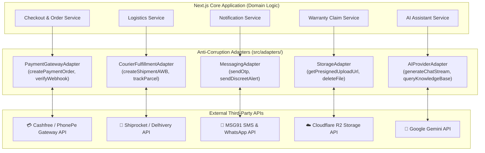
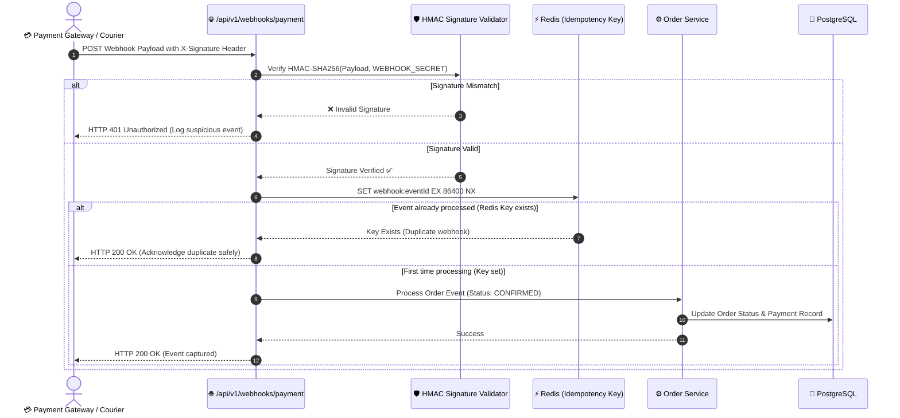

# 🔌 Document 7: Third-Party Services & Integrations

**Project Name:** Aura Retail & Lifestyle (Discreet Adult Wellness & Intimate Care E-Commerce Marketplace)  
**Document Status:** Confirmed / Approved by User (Green Light on 2026-11-09)  
**Version:** 1.0.0  
**Date:** 2026-11-09  
**Author / Partner:** Planning & Technical Documentation Partner  

---

## 1. Purpose

Yeh document platform ke sabhi **External Services, Third-Party APIs, aur Integration Adapters** ki complete specification define karta hai. E-commerce system payment gateways, logistics partners, SMS/WhatsApp providers, cloud storage, aur AI APIs par depend karta hai. Sensitive adult wellness domain mein in external integrations ke saath **zero privacy disclosure** (neutral descriptors) aur **resilient failure handling** (circuit breakers & fallbacks) ensure karna non-negotiable hai.

---

## 2. Existing Approved Context Used

Yeh integration plan pehle ke approved documents aur rules par strictly based hai:
* [`docs/01_Master_Planning.md`](file:///c:/Users/20092/OneDrive/Desktop/Dev/Projects/Active/Black%20Dot%20ecosystem/eoc_system%20Products/ecomerce%20website%20{wellness%20toys}/docs/01_Master_Planning.md) *(Approved)*: V1 boundaries, neutral identity ("Aura Retail & Lifestyle"), anti-RTO mechanisms.
* [`docs/02_Architecture.md`](file:///c:/Users/20092/OneDrive/Desktop/Dev/Projects/Active/Black%20Dot%20ecosystem/eoc_system%20Products/ecomerce%20website%20{wellness%20toys}/docs/02_Architecture.md) *(Approved)*: Decoupled Anti-Corruption Service Adapters (`adapters/` layer).
* [`docs/03_Tech_Stack.md`](file:///c:/Users/20092/OneDrive/Desktop/Dev/Projects/Active/Black%20Dot%20ecosystem/eoc_system%20Products/ecomerce%20website%20{wellness%20toys}/docs/03_Tech_Stack.md) *(Approved)*: Node.js 20 native fetch with timeouts, AWS SDK v3, Vercel AI SDK.
* [`docs/04_Database_Design.md`](file:///c:/Users/20092/OneDrive/Desktop/Dev/Projects/Active/Black%20Dot%20ecosystem/eoc_system%20Products/ecomerce%20website%20{wellness%20toys}/docs/04_Database_Design.md) *(Approved)*: `PaymentTransaction`, `Shipment`, `CourierWebhookLog`, currency in paise.
* [`docs/05_Authentication_and_Authorization.md`](file:///c:/Users/20092/OneDrive/Desktop/Dev/Projects/Active/Black%20Dot%20ecosystem/eoc_system%20Products/ecomerce%20website%20{wellness%20toys}/docs/05_Authentication_and_Authorization.md) *(Approved)*: Multi-channel OTP delivery via WhatsApp/SMS/Email.
* [`docs/06_Security_Plan.md`](file:///c:/Users/20092/OneDrive/Desktop/Dev/Projects/Active/Black%20Dot%20ecosystem/eoc_system%20Products/ecomerce%20website%20{wellness%20toys}/docs/06_Security_Plan.md) *(Approved)*: HMAC-SHA256 signature verification, pre-signed upload scoping, zero PCI storage.
* [`Feature/05_Business_Rules_and_Decisions.md`](file:///c:/Users/20092/OneDrive/Desktop/Dev/Projects/Active/Black%20Dot%20ecosystem/eoc_system%20Products/ecomerce%20website%20{wellness%20toys}/Feature/05_Business_Rules_and_Decisions.md):
  * **BR-06:** Neutral billing statement permanently locked to **"Aura Retail & Lifestyle"**.
  * **BR-08:** Logistics labels permanently declare sender as **"Aura Retail & Lifestyle"** and items as **"Personal Grooming & Wellness Kits"**.
  * **BR-16:** Zero unsolicited outbound phone calling.

---

## 3. Decisions Table

| Decision ID | Integration Domain | Selected Primary Service | Status | Key Reason | Alternatives Considered |
| :--- | :--- | :--- | :--- | :--- | :--- |
| **INT-DEC-01** | **Payment Gateway** | **Cashfree Payments (Primary) + PhonePe PG (Failover)** | **Proposed** | High acceptance for Indian D2C wellness/massagers, instant UPI Intent deep-linking, neutral statement support, and low merchant onboarding friction. | Razorpay (strict high-risk underwriting), Stripe India (limited UPI penetration) |
| **INT-DEC-02** | **Logistics & 3PL** | **Shiprocket API (Aggregator with Delhivery Priority)** | **Proposed** | Multi-carrier reach across 24,000+ Indian PIN codes, neutral AWB label generation, automated courier tracking webhooks, and reverse logistics handling. | Direct Delhivery API (limited backup carriers), BlueDart API |
| **INT-DEC-03** | **OTP & Transactional SMS/WhatsApp** | **MSG91 (with WhatsApp Business API)** | **Proposed** | Indian DLT-compliant SMS routing + instant WhatsApp OTP fallback (>95% delivery rate in Tier-1/2), with strict neutral sender IDs (`AURA`). | Twilio (expensive in India), Gupshup |
| **INT-DEC-04** | **Transactional Email** | **Resend (backed by AWS SES infrastructure)** | **Proposed** | Developer-friendly React Email templates, 99.9% inbox deliverability, instant webhooks, and clean neutral domain branding (`orders@auralifestyle.in`). | SendGrid, Mailchimp Transactional |
| **INT-DEC-05** | **Cloud Object Storage** | **Cloudflare R2 (S3-Compatible API)** | **Proposed** | Zero egress bandwidth fees (crucial for support staff reviewing 50MB unboxing defect videos), high durability, and native Cloudflare edge integration. | AWS S3 Standard (high egress transfer costs) |
| **INT-DEC-06** | **AI Wellness Assistant** | **Google Gemini 1.5 Flash (via Vercel AI SDK)** | **Proposed** | Ultra-low latency (<400ms TTFT), cost-effective high context window for detailed medical/care knowledge bases, and built-in safety filters. | OpenAI GPT-4o-mini, Anthropic Claude 3 Haiku |

---

## 4. Anti-Corruption Architecture (The Adapter Pattern)

Sabhi third-party services core application se **Anti-Corruption Layer (ACL)** ke zariye decoupled hain:



---

## 5. Detailed Service Specifications & Failure Behaviors

### A. Payment Gateway (Cashfree Payments / PhonePe)

* **Purpose:** Process prepaid orders (UPI deep-links, Cards, NetBanking) with instant confirmation and automated refunds.
* **Neutral Data Exchanged:**
  ```json
  {
    "order_id": "AURA-20261109-8812",
    "order_amount": 2374.05,
    "order_currency": "INR",
    "customer_details": {
      "customer_id": "usr_01hq7x9z",
      "customer_phone": "+919876543210",
      "customer_email": "customer@gmail.com"
    },
    "order_meta": {
      "return_url": "https://auralifestyle.in/checkout/confirmation?order_id=AURA-20261109-8812",
      "notify_url": "https://auralifestyle.in/api/v1/webhooks/payment"
    }
  }
  ```
  *(Zero product names or intimate keywords are ever transmitted to the payment gateway).*
* **Billing Statement Guarantee (BR-06):** Merchant account name registered and displayed as **"Aura Retail & Lifestyle"**.
* **Failure & Timeout Behavior:**
  * If payment fails or drops: Stock remains locked for 30 minutes (`BR-05`). User is shown a 1-click retry modal with options to **"Try Another UPI App"** or **"Switch to Cash on Delivery (Flat ₹50 Fee)"**.
  * If webhook is delayed: Client polling checks payment status via server API every 3 seconds for up to 30 seconds before showing "Payment Processing" holding state.

---

### B. 3PL Logistics & Courier (Shiprocket API / Delhivery)

* **Purpose:** Automated Airway Bill (AWB) generation, courier allocation, label printing, and tracking webhooks.
* **Neutral Shipping Label Enforcement (BR-08):**
  * **Sender Name:** `Aura Retail & Lifestyle`
  * **Declared Item Category:** `Personal Grooming & Wellness Kits`
  * **Customs / HSN Description:** Neutral grooming/lifestyle HSN code.
  * **Zero Exterior Logos:** Standard plain brown corrugated box instructions embedded in dispatch manifest.
* **Delivery Instructions Note:** Pre-printed courier delivery instruction: *"Confidential delivery. Do not disclose parcel contents. Call customer only upon reaching gate."*
* **Failure Behavior:**
  * If Shiprocket API is unreachable during checkout: Order is confirmed and queued in `ShipmentQueue` (PostgreSQL); BullMQ worker retries AWB creation every 10 minutes.
  * If courier delivery fails / customer rejects: Webhook triggers `RTO_INITIATED`; customer support is notified via email to check for address errors.

---

### C. Multi-Channel Messaging & OTP (MSG91 / WhatsApp Business)

* **Purpose:** Time-sensitive 6-digit OTP delivery for login and COD verification, plus neutral order status notifications.
* **Data Transmitted:** Customer Phone (`E.164`), 6-digit OTP, Order Number, Tracking Link.
* **Channel Routing & Fallback Flow:**
  ```
  Step 1: Attempt WhatsApp Business Message (Cost: ~₹0.35, Delivery Rate: >98%)
          └── If not delivered in 15 seconds:
  Step 2: Fallback to High-Priority Transactional SMS via MSG91 (Cost: ~₹0.18)
          └── If undelivered:
  Step 3: Secondary Fallback to Email OTP via Resend
  ```
* **Neutral SMS Template (DLT Approved):**
  > *"Your Aura Lifestyle verification code is 491823. Valid for 5 minutes. Do not share this OTP with anyone."*

---

### D. Transactional Email Service (Resend / AWS SES)

* **Purpose:** Order confirmation receipts, shipping tracking links, 24-hr warranty claim status updates, and store credit voucher delivery.
* **Sender Identity:** `Aura Orders <orders@auralifestyle.in>`
* **Privacy Standard:** Email subjects strictly avoid explicit terms (e.g. *"Your Aura Lifestyle Order #8812 is Confirmed"*, *"Update on Your Aura Care Ticket"*).
* **Failure Behavior:** Resend provides automatic retry; failed emails are logged in `StaffAuditLog` for support visibility.

---

### E. Cloud Object Storage (Cloudflare R2 / S3 API)

* **Purpose:** High-resolution product images (public CDN) + customer 24-hr unboxing warranty videos (private pre-signed access).
* **Storage Architecture:**
  * `public-assets/`: Cloudflare CDN cached product photography, certification badges, and decoy lifestyle blog assets.
  * `private-warranty-claims/`: Encrypted bucket for customer unboxing defect videos.
* **Pre-Signed Upload Security:**
  * Node.js server generates a Pre-Signed PUT URL valid for exactly 15 minutes.
  * Enforced HTTP headers: `Content-Length <= 52428800` (50MB) and `Content-Type: video/mp4, video/quicktime`.
  * Support staff view videos via short-lived (5-minute) pre-signed GET URLs. Zero public access.

---

### F. AI Wellness Assistant (Google Gemini 1.5 Flash via Vercel AI SDK)

* **Purpose:** 24/7 empathetic, non-judgmental customer guidance on silicone toy care, anatomy-friendly sizing, and hygiene FAQs.
* **Guardrails & Disclaimers (BR-17):**
  * System prompt forces a prominent medical disclaimer on any health, pain, or symptom queries.
  * Model strictly refuses diagnostic advice and routes users to professional healthcare providers or email support (`support@auralifestyle.in`).
* **Failure Behavior:** If the Gemini API experiences downtime or rate limits, the UI gracefully falls back to static Curated Care FAQs with a direct email ticket submission form.

---

## 6. End-to-End Webhook Security & Idempotency

External webhooks (Payment Gateway & Courier) ko safely process karne ke liye idempotency aur cryptographic verification architecture enforce kiya gaya hai:



---

## 7. Cost, Quota & Availability Assumptions

| Service | Estimated Cost Tier (V1 Pilot) | Availability SLA | Quota / Rate Limits |
| :--- | :--- | :--- | :--- |
| **Cashfree Payments** | ~1.85% for UPI / NetBanking / Cards; ₹0 setup fee | 99.95% uptime | 500 API calls / minute |
| **Shiprocket** | Pay-as-you-go per parcel (~₹60–₹110 / 500g across India) | 99.9% uptime | Standard shipment API rate limits |
| **MSG91 (SMS & WhatsApp)** | WhatsApp: ~₹0.35 / msg; SMS: ~₹0.18 / msg | 99.9% uptime | 1,000 TPS on transactional route |
| **Resend (Email)** | Free tier (3,000 emails/mo) -> Pro tier ($20/mo) | 99.99% uptime | 100 emails / second |
| **Cloudflare R2** | Free tier (10GB/mo) + $0.015/GB storage (Zero egress fee) | 99.99% uptime | Unlimited egress bandwidth |
| **Gemini 1.5 Flash** | ~$0.075 / 1M input tokens, $0.30 / 1M output tokens | 99.9% uptime | 1,000 RPM (Requests Per Minute) |

---

## 8. Open Questions, Risks & Assumptions

### Open Questions (Integrations)
* [ ] **INT-OQ-01 (Courier Return Verification):** RTO parcels ke case mein courier warehouse return confirmation webhook milne par kya automated unboxing audit ticket trigger hona chahiye taaki seal tampering verify ho sake? *(Proposed: Yes, automatic warehouse ticket generation upon RTO delivery).*
* [ ] **INT-OQ-02 (WhatsApp Business BSP):** MSG91 WhatsApp BSP use karein ya direct Meta Cloud API? *(Proposed: MSG91 WhatsApp BSP for unified Indian billing, DLT compliance, and SMS failover).*

### Integration Risks & Mitigations
* **Risk (Payment Aggregator Downtime):** Primary payment gateway down hone par checkout fail ho sakta hai.
  * *Mitigation:* Dual gateway adapter architecture: agar Cashfree 3 consecutive checkout failures return kare, checkout engine automatically secondary gateway (PhonePe PG) par switch ho jayega.

---

## 9. Related Documents / Dependencies

Is Third-party Integrations document ke approve hone ke baad agla document sequence:
* `Document 08: Folder Structure & Coding Standards` *(Next in line - Repository structure, naming, linting, code organization)*
* `Document 09: Environments` *(Local, Staging, Production configurations)*

---

## 10. Sources & Technical References

1. **Cashfree Payments API Documentation:** https://docs.cashfree.com/docs (Accessed: 2026-11).
2. **Shiprocket API & Webhook Specifications:** https://apidocs.shiprocket.in/ (Accessed: 2026-11).
3. **MSG91 DLT & WhatsApp API Guide:** https://docs.msg91.com/ (Accessed: 2026-11).
4. **Resend Email & React Email Architecture:** https://resend.com/docs (Accessed: 2026-11).
5. **Cloudflare R2 Storage S3 API Documentation:** https://developers.cloudflare.com/r2/ (Accessed: 2026-11).
6. **Google Gemini API & Vercel AI SDK:** https://ai.google.dev/docs | https://sdk.vercel.ai/docs (Accessed: 2026-11).

---

## 11. Review Checklist (Aapke Approval ke Liye Key Points)

Kripya is Third-Party Services & Integrations blueprint ko review karein aur green light ya feedback dein:

- [ ] **1. Service Selection:** Kya Cashfree (PG), Shiprocket (Logistics), MSG91 (WhatsApp/SMS), Resend (Email), Cloudflare R2 (Storage), aur Gemini (AI) ki primary choices approved hain?
- [ ] **2. Neutral Data Isolation:** Kya sabhi external APIs ke saath neutral descriptors ("Aura Retail & Lifestyle" / "Personal Grooming & Wellness Kits") aur zero intimate keyword transmission approved hai?
- [ ] **3. Webhook Idempotency & HMAC:** Kya HMAC-SHA256 signature verification aur Redis-based duplicate webhook prevention approved hai?
- [ ] **4. Multi-Channel OTP Fallback:** Kya WhatsApp primary -> SMS secondary -> Email fallback OTP delivery chain approved hai?
- [ ] **5. Resilient Failover & 30-Min Hold:** Kya payment fail hone par 30-min stock hold aur COD switch fallback approved hai?
