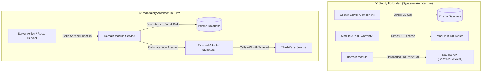

# 📁 Document 8: Folder Structure & Coding Standards

**Project Name:** Aura Retail & Lifestyle (Discreet Adult Wellness & Intimate Care E-Commerce Marketplace)  
**Document Status:** Confirmed / Approved by User (Green Light on 2026-11-09)  
**Version:** 1.0.0  
**Date:** 2026-11-09  
**Author / Partner:** Planning & Technical Documentation Partner  

---

## 1. Purpose

Yeh document platform ka **Repository Architecture, Folder Layout, aur Engineering Standards Blueprint** hai. Iska maqsad codebase ko ek clean, modular, aur maintainable format mein organize karna hai taaki multiple developers ya automated agents bina confusion, circular dependencies, ya code duplication ke kaam kar sakein. Is document ke rules naming conventions, linting/formatting, error handling, aur architectural boundaries ko enforce karte hain.

---

## 2. Existing Approved Context Used

Yeh coding standard blueprint sabhi approved documents par strictly based hai:
* [`docs/01_Master_Planning.md`](file:///c:/Users/20092/OneDrive/Desktop/Dev/Projects/Active/Black%20Dot%20ecosystem/eoc_system%20Products/ecomerce%20website%20{wellness%20toys}/docs/01_Master_Planning.md) *(Approved)*: V1 MVP boundaries, modular monolith design, privacy-first principles.
* [`docs/02_Architecture.md`](file:///c:/Users/20092/OneDrive/Desktop/Dev/Projects/Active/Black%20Dot%20ecosystem/eoc_system%20Products/ecomerce%20website%20{wellness%20toys}/docs/02_Architecture.md) *(Approved)*: Modular Monolith pattern (`modules/`, `adapters/`, `app/` separation).
* [`docs/03_Tech_Stack.md`](file:///c:/Users/20092/OneDrive/Desktop/Dev/Projects/Active/Black%20Dot%20ecosystem/eoc_system%20Products/ecomerce%20website%20{wellness%20toys}/docs/03_Tech_Stack.md) *(Approved)*: Next.js 15 (App Router), TypeScript 5.x, Tailwind CSS, Shadcn UI, Prisma ORM, Zod, Vitest.
* [`docs/04_Database_Design.md`](file:///c:/Users/20092/OneDrive/Desktop/Dev/Projects/Active/Black%20Dot%20ecosystem/eoc_system%20Products/ecomerce%20website%20{wellness%20toys}/docs/04_Database_Design.md) *(Approved)*: Prisma schema conventions, optimistic inventory locking, currency in paise.
* [`docs/05_Authentication_and_Authorization.md`](file:///c:/Users/20092/OneDrive/Desktop/Dev/Projects/Active/Black%20Dot%20ecosystem/eoc_system%20Products/ecomerce%20website%20{wellness%20toys}/docs/05_Authentication_and_Authorization.md) *(Approved)*: RBAC role hierarchy, Next.js auth middleware.
* [`docs/06_Security_Plan.md`](file:///c:/Users/20092/OneDrive/Desktop/Dev/Projects/Active/Black%20Dot%20ecosystem/eoc_system%20Products/ecomerce%20website%20{wellness%20toys}/docs/06_Security_Plan.md) *(Approved)*: Field-level AES-256-GCM encryption, Zod schema validation boundaries.
* [`docs/07_Third_Party_Services_and_Integrations.md`](file:///c:/Users/20092/OneDrive/Desktop/Dev/Projects/Active/Black%20Dot%20ecosystem/eoc_system%20Products/ecomerce%20website%20{wellness%20toys}/docs/07_Third_Party_Services_and_Integrations.md) *(Approved)*: Decoupled Anti-Corruption adapters (`adapters/payment`, `adapters/courier`, etc.).

---

## 3. Decisions Table

| Decision ID | Area | Selected Engineering Decision | Status | Key Reason | Alternatives Considered |
| :--- | :--- | :--- | :--- | :--- | :--- |
| **CODE-DEC-01** | **Code Organization Pattern** | **Feature-Driven Domain Modules (`src/modules/`)** | **Proposed** | Code grouped by business domains (e.g. `catalog`, `checkout`, `warranty`) rather than technical layers (e.g. `controllers`, `services`). Eliminates cross-file hopping and circular imports. | Traditional Layered Architecture (`controllers/`, `models/`, `views/`) |
| **CODE-DEC-02** | **Route Grouping Strategy** | **App Router Route Groups: `(storefront)`, `(admin)`, `(support)`** | **Proposed** | Separates customer-facing layouts from back-office dashboards without affecting clean, customer-facing URLs. | Subdomain routing, flat routing hierarchy |
| **CODE-DEC-03** | **Data Access Layer Boundary** | **Strict Service-Level Encapsulation** | **Proposed** | UI components and Server Actions cannot call `prisma` directly; all DB interactions must pass through module-exported service functions to preserve validation and audit logging. | Direct Prisma calls inside UI Server Components |
| **CODE-DEC-04** | **File Naming Conventions** | **kebab-case for Files; PascalCase for React Components** | **Proposed** | Universal cross-platform Git compatibility (prevents Windows/Linux case sensitivity issues) while following React component standards. | camelCase file naming, snake_case |
| **CODE-DEC-05** | **Zero Unhandled Errors & Logging** | **Structured JSON Logger (Pino / Custom Console Logger)** | **Proposed** | Ensures all production logs are machine-readable, include request/trace IDs, and automatically mask customer PII (phone, email, address). | Plain `console.log` statements |

---

## 4. Proposed Repository Layout

```
aura-marketplace/
├── .github/                      # CI/CD Workflows & PR Templates
│   └── workflows/
│       ├── ci.yml                # Lint, Typecheck, Test, Build verification
│       └── deploy.yml            # Production deployment pipeline
├── docs/                         # Approved Architecture & Technical Documents (1 to 15)
│   ├── 01_Master_Planning.md
│   ├── 02_Architecture.md
│   ├── 03_Tech_Stack.md
│   ├── 04_Database_Design.md
│   ├── 05_Authentication_and_Authorization.md
│   ├── 06_Security_Plan.md
│   ├── 07_Third_Party_Services_and_Integrations.md
│   └── 08_Folder_Structure_and_Coding_Standards.md
├── prisma/                       # Database Schema & Migrations
│   ├── migrations/               # Version-controlled SQL migration history
│   ├── schema.prisma             # Declarative database model specification
│   └── seed.ts                   # Seed script (Roles, Medical Badges, Admin user)
├── public/                       # Static Assets (Images, Favicons, Decoy assets)
│   ├── icons/                    # Neutral SVG icons
│   └── decoy/                    # Static assets for Camouflage Mode (Lifestyle blog)
├── src/
│   ├── adapters/                 # Anti-Corruption Adapters (External Integrations)
│   │   ├── courier/              # Shiprocket / Delhivery fulfillment adapter
│   │   │   ├── shiprocket.adapter.ts
│   │   │   └── courier.interface.ts
│   │   ├── messaging/            # MSG91 SMS/WhatsApp & Resend email adapter
│   │   │   ├── msg91.adapter.ts
│   │   │   ├── resend.adapter.ts
│   │   │   └── messaging.interface.ts
│   │   ├── payment/              # Cashfree & PhonePe payment gateway adapter
│   │   │   ├── cashfree.adapter.ts
│   │   │   ├── phonepe.adapter.ts
│   │   │   └── payment.interface.ts
│   │   └── storage/              # Cloudflare R2 / S3 pre-signed storage adapter
│   │       ├── r2.adapter.ts
│   │       └── storage.interface.ts
│   ├── app/                      # Next.js 15 App Router
│   │   ├── (storefront)/         # Customer & Public Storefront Layout
│   │   │   ├── layout.tsx        # Storefront Root Layout (Header, Panic Button, Footer)
│   │   │   ├── page.tsx          # Home / Landing Page
│   │   │   ├── catalog/          # Catalog & Filtering (PLP)
│   │   │   │   ├── page.tsx
│   │   │   │   └── [category]/page.tsx
│   │   │   ├── product/          # Product Detail Page (PDP)
│   │   │   │   └── [slug]/page.tsx
│   │   │   ├── quiz/             # Interactive 3-Question Toy Finder Quiz
│   │   │   │   └── page.tsx
│   │   │   ├── cart/             # Slide-over & Cart Page
│   │   │   │   └── page.tsx
│   │   │   ├── checkout/         # Dual Checkout & OTP Verification Page
│   │   │   │   └── page.tsx
│   │   │   ├── account/          # Customer Dashboard & Order Tracking
│   │   │   │   ├── page.tsx
│   │   │   │   └── warranty-claim/page.tsx
│   │   │   └── guides/           # SEO Wellness Articles & Buying Guides
│   │   │       └── [slug]/page.tsx
│   │   ├── (admin)/              # Protected Store Admin & Super Admin Dashboard
│   │   │   ├── layout.tsx        # Admin Sidebar Layout & RBAC Guard
│   │   │   ├── admin/
│   │   │   │   ├── dashboard/page.tsx
│   │   │   │   ├── products/page.tsx
│   │   │   │   ├── inventory/page.tsx
│   │   │   │   └── orders/page.tsx
│   │   ├── (support)/            # Customer Support Specialist Portal
│   │   │   ├── layout.tsx        # Support Workspace Layout
│   │   │   └── support/
│   │   │       ├── tickets/page.tsx
│   │   │       └── warranty-claims/page.tsx
│   │   ├── api/v1/               # Public & External API Route Handlers
│   │   │   ├── auth/otp/route.ts
│   │   │   ├── webhooks/
│   │   │   │   ├── payment/route.ts
│   │   │   │   └── courier/route.ts
│   │   │   └── ai/chat/route.ts
│   │   ├── global-error.tsx      # Root fallback error UI
│   │   └── not-found.tsx         # 404 page
│   ├── components/               # Presentation & UI Components
│   │   ├── ui/                   # Primitive headless UI components (Shadcn/Radix)
│   │   │   ├── button.tsx
│   │   │   ├── dialog.tsx        # Age Gate Modal
│   │   │   ├── input.tsx
│   │   │   └── sheet.tsx         # Cart Drawer
│   │   ├── layout/               # Header, Footer, MobileNav, DecoyBanner
│   │   ├── privacy/              # PanicButton.tsx, DiscreetCamouflageModal.tsx
│   │   └── shared/               # MedicalBadge.tsx, PriceDisplay.tsx, RatingBadge.tsx
│   ├── config/                   # Global Configuration & Environment Parsers
│   │   ├── site.config.ts        # Neutral brand constants ("Aura Retail & Lifestyle")
│   │   └── env.ts                # Zod-validated process.env config
│   ├── lib/                      # Core Singletons & Low-Level Utilities
│   │   ├── prisma.ts             # Global Prisma Client instance with connection pooling
│   │   ├── redis.ts              # Redis / ioredis connection instance
│   │   ├── crypto.ts             # AES-256-GCM PII encryption/decryption utilities
│   │   ├── logger.ts             # Masked structured JSON logger
│   │   └── utils.ts              # ClassName merger (clsx + tailwind-merge)
│   ├── modules/                  # Isolated Feature & Domain Slices
│   │   ├── auth/                 # OTP generation, Session JWT, DOB validation
│   │   │   ├── auth.service.ts
│   │   │   ├── auth.schemas.ts
│   │   │   └── auth.types.ts
│   │   ├── catalog/              # Products, Badges, Categories, Care Guides
│   │   │   ├── catalog.service.ts
│   │   │   └── catalog.schemas.ts
│   │   ├── cart/                 # Cart calculations, Bundle discounts
│   │   │   └── cart.service.ts
│   │   ├── inventory/            # 30-min stock reservation lock engine
│   │   │   ├── reservation.service.ts
│   │   │   └── reservation.worker.ts
│   │   ├── checkout/             # Anti-RTO rules (₹50 COD, 5% Prepaid discount)
│   │   │   ├── checkout.service.ts
│   │   │   └── checkout.schemas.ts
│   │   ├── orders/               # Order state machine & Invoicing
│   │   │   └── order.service.ts
│   │   ├── warranty/             # 24-hr DOA unboxing video claim engine
│   │   │   ├── warranty.service.ts
│   │   │   └── warranty.schemas.ts
│   │   └── ai-assistant/         # RAG pipeline, Medical disclaimer guardrails
│   │       ├── ai.service.ts
│   │       └── knowledge-base.ts
│   ├── middleware.ts             # Next.js Root Security, RBAC & 18+ Cookie Gate
│   └── types/                    # Shared TypeScript interfaces & declarations
│       └── index.ts
├── tests/                        # Automated Test Suites
│   ├── unit/                     # Domain service & calculation tests (Vitest)
│   ├── integration/              # Database & Adapter integration tests
│   └── e2e/                      # Playwright end-to-end tests (Checkout, Panic Button)
├── .env.example                  # Sanitized environment variable template
├── .eslintrc.json                # Strict TypeScript linting rules
├── .prettierrc                   # Formatting configuration
├── docker-compose.yml            # Local PostgreSQL 16 & Redis 7 containers
├── next.config.ts                # Next.js headers, image domains, CSP config
├── package.json
├── pnpm-lock.yaml
├── tailwind.config.ts            # Theme colors (clinical luxury wellness palette)
└── tsconfig.json                 # Strict TypeScript configuration
```

---

## 5. Naming Conventions

Consistent naming rules ensure instant predictability across code:

| Element Type | Convention | Example |
| :--- | :--- | :--- |
| **Directories** | `kebab-case` | `src/modules/ai-assistant`, `src/components/ui` |
| **Files (Non-Component)** | `kebab-case.suffix.ts` | `auth.service.ts`, `checkout.schemas.ts`, `prisma.ts` |
| **React Component Files** | `PascalCase.tsx` | `PanicButton.tsx`, `MedicalBadge.tsx`, `AgeGateModal.tsx` |
| **Next.js App Router Files** | Framework conventions | `page.tsx`, `layout.tsx`, `loading.tsx`, `route.ts` |
| **Variables & Functions** | `camelCase` | `calculatePrepaidDiscount()`, `availableStock`, `isAgeVerified` |
| **Interfaces & Types** | `PascalCase` | `OrderRecord`, `MedicalSafetyBadge`, `PaymentWebhookPayload` |
| **Enums** | `UPPER_SNAKE_CASE` | `OrderStatus.CONFIRMED`, `PaymentMethod.PREPAID_UPI` |
| **Database Tables (Prisma)**| `PascalCase` | `model User {}`, `model OrderItem {}` |
| **Database Columns** | `camelCase` | `unitPricePaise`, `dateOfBirth`, `billingDescriptor` |
| **API Endpoints** | `kebab-case` pluralized | `/api/v1/auth/otp/send`, `/api/v1/warranty-claims` |

---

## 6. Formatting & Linting Governance

1. **Prettier Standards (`.prettierrc`):**
   ```json
   {
     "semi": true,
     "singleQuote": true,
     "tabWidth": 2,
     "trailingComma": "es5",
     "printWidth": 100,
     "plugins": ["prettier-plugin-tailwindcss"]
   }
   ```
2. **ESLint Rules (`.eslintrc.json`):**
   * `@typescript-eslint/no-explicit-any`: **Error** (Prevents bypass of TypeScript strict safety).
   * `@typescript-eslint/explicit-function-return-type`: **Warn** on exported services.
   * `no-console`: **Error** (Forces developers to use `logger.info()` / `logger.error()`).
3. **Tailwind Class Sorting:**
   * Automatic class ordering via `prettier-plugin-tailwindcss` to maintain consistent CSS utility sequences.

---

## 7. Architectural Rules & Separation of Concerns

Har developer aur contributor ke liye yeh 5 non-negotiable coding rules hain:



1. **Rule 1 (No Direct Prisma in UI):** Page components aur Server Actions direct `prisma.order.findMany()` call nahi kar sakte. Unhe hamesha `orderService.getOrdersForUser(userId)` call karna hoga.
2. **Rule 2 (Domain Encapsulation):** Ek domain module doosre domain module ke database tables ko modify nahi kar sakta. (e.g. `warranty.service.ts` ko stock restore karna ho, toh woh `inventoryService.releaseStock()` call karega, direct `InventoryItem` SQL update nahi).
3. **Rule 3 (External API Isolation):** Domain code ke andar third-party API keys ya raw HTTP calls strictly prohibited hain. Sabhi calls `adapters/` ke zariye generic interfaces implement karke hongi.
4. **Rule 4 (Amounts in Paise):** Codebase mein kabhi bhi prices ko floating point rupees mein store ya calculate nahi kiya jayega. `priceInPaise = Math.round(rupees * 100)`.
5. **Rule 5 (PII Masking in Logs):** Logger wrapper customer phone numbers, addresses, ya full names ko production logs mein mask karega (e.g. `+91 98*****210`).

---

## 8. Error Handling & Structured Logging Standards

### A. Custom Domain Error Hierarchy
Application specific error handling ke liye structured error classes use honge:

```typescript
// src/lib/errors.ts
export class AppError extends Error {
  constructor(
    public override message: string,
    public statusCode: number = 400,
    public code: string = 'BAD_REQUEST',
    public details?: unknown
  ) {
    super(message);
    this.name = this.constructor.name;
  }
}

export class AgeVerificationError extends AppError {
  constructor(message = 'Customer must be 18 years or older') {
    super(message, 403, 'AGE_RESTRICTION_FAILED');
  }
}

export class StockReservationError extends AppError {
  constructor(message = 'Item is no longer available in stock') {
    super(message, 409, 'STOCK_UNAVAILABLE');
  }
}
```

### B. Masked Structured Logging
```typescript
// src/lib/logger.ts
import pino from 'pino';

export const logger = pino({
  level: process.env.LOG_LEVEL || 'info',
  redact: {
    paths: ['phone', 'email', 'address', 'password', 'otp', '*.token'],
    censor: '[CONFIDENTIAL_PII]'
  }
});
```

---

## 9. Documentation Conventions

1. **JSDoc Standards:** Har exported public domain function ke upar clear description, `@param`, `@returns`, aur `@throws` tag mandatory hai.
2. **Architecture Decision Records (ADRs):** Aage chal kar koi bhi core design ya architecture decision change hota hai, toh use `docs/` ke decision log mein reason aur timestamp ke saath document kiya jayega.

---

## 10. Open Questions, Risks & Assumptions

### Open Questions (Coding Standards)
* [ ] **CODE-OQ-01 (API Route vs Server Actions):** Kya public storefront checkout operations strictly Next.js Server Actions se run karein, aur `/api/v1/` routes ko sirf external webhooks aur AI streaming ke liye reserve karein? *(Proposed: Yes, Server Actions for all storefront mutations to eliminate unnecessary API routes).*
* [ ] **CODE-OQ-02 (Component Library Customization):** Shadcn components ko `src/components/ui/` mein install karte waqt CSS variables use karein ya raw Tailwind color classes? *(Proposed: CSS variables for smooth light/dark and camouflage mode theming).*

---

## 11. Related Documents / Dependencies

Is Folder Structure & Coding Standards document ke approve hone ke baad agla document sequence:
* `Document 09: Environments` *(Next in line - Local, Staging, Production configurations & Secrets)*
* `Document 10: Git & Version Control Strategy`

---

## 12. Sources & Technical References

1. **Next.js App Router Project Organization & Architecture:** https://nextjs.org/docs/app/building-your-application/routing/colocation (Accessed: 2026-11).
2. **Domain-Driven Design (DDD) & Clean Hexagonal Architecture:** Principles for bounded contexts and anti-corruption adapters.
3. **TypeScript Official Style Guide & Strict Mode:** https://www.typescriptlang.org/tsconfig (Accessed: 2026-11).

---

## 13. Review Checklist (Aapke Approval ke Liye Key Points)

Kripya is Folder Structure & Coding Standards blueprint ko review karein aur green light ya changes ke liye feedback dein:

- [ ] **1. Repository Layout:** Kya `src/modules/` (domain slices), `src/adapters/` (external APIs), aur `src/app/` (route groups) ka folder structure approved hai?
- [ ] **2. Route Groups:** Kya `(storefront)`, `(admin)`, aur `(support)` ka route grouping separation approved hai?
- [ ] **3. Architectural Rules:** Kya Rule 1 se Rule 5 (No direct Prisma in UI, Module encapsulation, Adapter isolation, Currency in paise, PII masking) approved hain?
- [ ] **4. Naming Conventions:** Kya `kebab-case` files aur `PascalCase` React components ki convention approved hai?
- [ ] **5. Error Handling & Masked Logging:** Kya structured domain error classes aur PII redaction logging standard approved hai?
