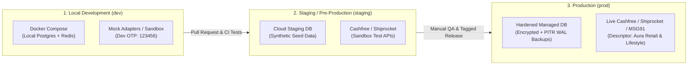

# 🌐 Document 9: Environments

**Project Name:** Aura Retail & Lifestyle (Discreet Adult Wellness & Intimate Care E-Commerce Marketplace)  
**Document Status:** Confirmed / Approved by User (Green Light on 2026-11-09)  
**Version:** 1.0.0  
**Date:** 2026-11-09  
**Author / Partner:** Planning & Technical Documentation Partner  

---

## 1. Purpose

Yeh document platform ke sabhi **Execution Environments (Local, Staging, Production)**, unki configuration governance, environment variable validation, mocking strategies, aur data separation policies ko define karta hai. Production mein real money transactions, Indian payment gateway compliances, aur customer PII hoti hai; isliye production secrets aur live credentials ko development/test environments se strictly isolate karna mandatory hai.

---

## 2. Existing Approved Context Used

Yeh environments plan pehle ke approved documents par strictly based hai:
* [`docs/01_Master_Planning.md`](file:///c:/Users/20092/OneDrive/Desktop/Dev/Projects/Active/Black%20Dot%20ecosystem/eoc_system%20Products/ecomerce%20website%20{wellness%20toys}/docs/01_Master_Planning.md) *(Approved)*: V1 boundaries, neutral identity ("Aura Retail & Lifestyle"), anti-RTO rules.
* [`docs/02_Architecture.md`](file:///c:/Users/20092/OneDrive/Desktop/Dev/Projects/Active/Black%20Dot%20ecosystem/eoc_system%20Products/ecomerce%20website%20{wellness%20toys}/docs/02_Architecture.md) *(Approved)*: Modular monolith architecture, Cloudflare edge, hybrid data tier.
* [`docs/03_Tech_Stack.md`](file:///c:/Users/20092/OneDrive/Desktop/Dev/Projects/Active/Black%20Dot%20ecosystem/eoc_system%20Products/ecomerce%20website%20{wellness%20toys}/docs/03_Tech_Stack.md) *(Approved)*: TypeScript 5.x, Node 20 LTS, PostgreSQL 16, Redis 7, Zod environment validation.
* [`docs/06_Security_Plan.md`](file:///c:/Users/20092/OneDrive/Desktop/Dev/Projects/Active/Black%20Dot%20ecosystem/eoc_system%20Products/ecomerce%20website%20{wellness%20toys}/docs/06_Security_Plan.md) *(Approved)*: AES-256-GCM PII encryption, secret management, zero PCI scope.
* [`docs/07_Third_Party_Services_and_Integrations.md`](file:///c:/Users/20092/OneDrive/Desktop/Dev/Projects/Active/Black%20Dot%20ecosystem/eoc_system%20Products/ecomerce%20website%20{wellness%20toys}/docs/07_Third_Party_Services_and_Integrations.md) *(Approved)*: Cashfree/PhonePe PG, Shiprocket, MSG91, Resend, Cloudflare R2.
* [`docs/08_Folder_Structure_and_Coding_Standards.md`](file:///c:/Users/20092/OneDrive/Desktop/Dev/Projects/Active/Black%20Dot%20ecosystem/eoc_system%20Products/ecomerce%20website%20{wellness%20toys}/docs/08_Folder_Structure_and_Coding_Standards.md) *(Approved)*: `src/config/env.ts` centralized parser, `docker-compose.yml`.

---

## 3. Decisions Table

| Decision ID | Environment Domain | Selected Decision | Status | Key Reason | Alternatives Considered |
| :--- | :--- | :--- | :--- | :--- | :--- |
| **ENV-DEC-01** | **Three-Tier Environment Topology** | **Local (`dev`) ➔ Staging (`staging`) ➔ Production (`prod`)** | **Proposed** | Industry standard separating local rapid iteration, full sandbox integration verification, and hardened live customer traffic. | 2-tier (Dev to Prod directly - high risk for payment/RTO bugs) |
| **ENV-DEC-02** | **Fail-Fast Environment Validation** | **Strict Zod Runtime Validation at Build & Startup (`src/config/env.ts`)** | **Proposed** | Prevents runtime production crashes if any critical API key, database URI, or webhook secret is missing or misformatted. | Manual `process.env` lookups scattered across files |
| **ENV-DEC-03** | **Local Infrastructure Containerization** | **Docker Compose (PostgreSQL 16 + Redis 7)** | **Proposed** | 1-command reproducible local environment for developers without installing system-level PostgreSQL/Redis services. | Cloud-hosted shared dev databases (causes race conditions between devs) |
| **ENV-DEC-04** | **Staging Data Sanitization** | **Synthetic / Masked Seed Data Only (Zero Production PII)** | **Proposed** | Real customer intimate wellness purchases, phone numbers, and addresses are strictly prohibited from being cloned into staging environments. | Cloning production DB to staging (severe DPDP privacy violation) |
| **ENV-DEC-05** | **Third-Party Sandbox Isolation** | **Complete Sandbox API Keys for Staging; Mock Adapters for Local** | **Proposed** | Prevents real money charges, fake AWB bookings with couriers, or unintended live SMS dispatches during development and testing. | Using live accounts with ₹1 test payments |

---

## 4. Environment Comparison Matrix



| Parameter | Local (`development`) | Staging (`staging`) | Production (`production`) |
| :--- | :--- | :--- | :--- |
| **Base URL** | `http://localhost:3000` | `https://staging.auralifestyle.in` | `https://auralifestyle.in` |
| **Database** | Docker Compose PostgreSQL 16 (`localhost:5432`) | Cloud PostgreSQL (Staging instance) | High-Availability Managed PostgreSQL 16 (AWS RDS / Supabase Pro) |
| **Cache & Queue** | Docker Compose Redis 7 (`localhost:6379`) | Cloud Managed Redis (Staging cluster) | Dedicated High-Memory Managed Redis 7 (Upstash / AWS ElastiCache) |
| **Object Storage** | Local filesystem / MinIO OR Cloudflare R2 Dev Bucket | Cloudflare R2 Staging Bucket (`aura-staging-media`) | Cloudflare R2 Production Bucket (`aura-prod-media`) |
| **Payment Gateway** | Cashfree Sandbox Simulator | Cashfree / PhonePe Test Sandbox | Live Cashfree (Descriptor: *"Aura Retail & Lifestyle"*) |
| **3PL Logistics** | Mock Courier Adapter (Simulated AWB generation) | Shiprocket Staging Sandbox API | Live Shiprocket API with Delhivery Priority Routing |
| **SMS & WhatsApp** | Mock logger (Prints OTP to terminal / Fixed `123456`) | MSG91 Staging / Whitelisted Test Mobile Numbers | Live MSG91 & WhatsApp Business API (Sender: `AURA`) |
| **Transactional Email** | In-memory / Console preview | Resend Test API (Delivers to dev inbox) | Live Resend API with verified DKIM, SPF & DMARC domain |
| **AI Assistant** | Google Gemini 1.5 Flash (Dev API Key) | Google Gemini 1.5 Flash (Staging API Key) | Google Gemini 1.5 Flash (Production Key + Rate Limits) |
| **Debug & Logs** | Pretty-printed local console logs (`DEBUG` level) | Structured JSON (`INFO` level) | Masked Structured JSON (`WARN/ERROR` to Sentry/CloudWatch) |

---

## 5. Environment Variable Governance & Schema Parser

Sabhi environment variables ko single centralized file [`src/config/env.ts`](file:///c:/Users/20092/OneDrive/Desktop/Dev/Projects/Active/Black%20Dot%20ecosystem/eoc_system%20Products/ecomerce%20website%20{wellness%20toys}/src/config/env.ts) mein Zod schema ke zariye parse kiya jata hai. Agar koi zaroori secret missing ya invalid ho, toh application build ya startup stage par hi crash ho jayegi:

```typescript
// src/config/env.ts
import { z } from 'zod';

const envSchema = z.object({
  // Runtime & Environment
  NODE_ENV: z.enum(['development', 'test', 'staging', 'production']).default('development'),
  NEXT_PUBLIC_APP_URL: z.string().url(),
  PORT: z.coerce.number().default(3000),

  // Database & Caching
  DATABASE_URL: z.string().min(1, 'DATABASE_URL is required'),
  REDIS_URL: z.string().min(1, 'REDIS_URL is required'),

  // Cryptographic Secrets
  JWT_SECRET: z.string().min(32, 'JWT_SECRET must be at least 32 characters'),
  PII_ENCRYPTION_KEY: z.string().length(64, 'PII_ENCRYPTION_KEY must be a 32-byte hex string (64 chars)'),

  // Payment Gateway (Cashfree)
  CASHFREE_APP_ID: z.string().min(1),
  CASHFREE_SECRET_KEY: z.string().min(1),
  CASHFREE_WEBHOOK_SECRET: z.string().min(1),
  CASHFREE_MODE: z.enum(['TEST', 'PROD']).default('TEST'),

  // 3PL Logistics (Shiprocket)
  SHIPROCKET_EMAIL: z.string().email(),
  SHIPROCKET_PASSWORD: z.string().min(1),
  SHIPROCKET_WEBHOOK_TOKEN: z.string().min(1),

  // Messaging (MSG91 / WhatsApp)
  MSG91_AUTH_KEY: z.string().min(1),
  MSG91_OTP_TEMPLATE_ID: z.string().min(1),

  // Email (Resend)
  RESEND_API_KEY: z.string().startsWith('re_'),

  // Cloudflare R2 Storage
  R2_ACCOUNT_ID: z.string().min(1),
  R2_ACCESS_KEY_ID: z.string().min(1),
  R2_SECRET_ACCESS_KEY: z.string().min(1),
  R2_BUCKET_NAME: z.string().min(1),

  // AI Provider (Gemini)
  GEMINI_API_KEY: z.string().min(1),
});

export const env = envSchema.parse(process.env);
```

---

## 6. Local Development Setup Specification

Local developer onboarding ko seamless banane ke liye project root par `docker-compose.yml` aur `.env.example` standardize kiye gaye hain:

### A. Local Docker Compose (`docker-compose.yml`)
```yaml
version: '3.8'

services:
  postgres:
    image: postgres:16-alpine
    container_name: aura_dev_postgres
    restart: always
    environment:
      POSTGRES_USER: aura_dev
      POSTGRES_PASSWORD: aura_dev_password
      POSTGRES_DB: aura_marketplace_dev
    ports:
      - '5432:5432'
    volumes:
      - postgres_data:/var/lib/postgresql/data

  redis:
    image: redis:7-alpine
    container_name: aura_dev_redis
    restart: always
    ports:
      - '6379:6379'
    volumes:
      - redis_data:/data

volumes:
  postgres_data:
  redis_data:
```

### B. Developer Quickstart Protocol
1. Repository clone karein: `git clone <repo-url>`
2. Dependencies install karein: `pnpm install`
3. Environment template copy karein: `cp .env.example .env.local`
4. Local containers start karein: `docker compose up -d`
5. Database migrations aur seed execute karein: `pnpm prisma migrate dev && pnpm prisma db seed`
6. Development server run karein: `pnpm dev` (Runs on `http://localhost:3000`)

---

## 7. Secrets Governance & Access Separation

1. **Principle of Least Privilege (PoLP):**
   * Development team ke paas production database credentials ya customer PII ka direct access strictly prohibited hai.
   * Production secrets cloud secret manager (AWS Secrets Manager / Vercel Environment Variables) mein encrypted store hote hain aur CI/CD deployment ke time inject hote hain.
2. **Local Credential Protection:**
   * `.env`, `.env.local`, aur `.env.production` files `.gitignore` mein locked hain.
   * Pre-commit git hooks commit history mein kisi bhi leaked API key ko block karte hain.
3. **Secret Rotation Protocol:**
   * Payment Webhook secrets aur JWT keys har 90 days par rotate hongi, with a 24-hour overlapping grace period for active customer sessions.

---

## 8. Open Questions, Risks & Assumptions

### Open Questions (Environments)
* [ ] **ENV-OQ-01 (Staging Infrastructure Hosting):** Staging environment ko Vercel Preview Deployments par host karein ya persistent container cluster (e.g. Railway / AWS ECS) par? *(Proposed: Vercel Preview deployments for PR reviews, with a persistent staging branch deployment for webhook testing).*
* [ ] **ENV-OQ-02 (Local S3 Storage Emulation):** Local development mein unboxing video upload testing ke liye direct Cloudflare R2 Dev bucket use karein ya local MinIO container? *(Proposed: Cloudflare R2 Dev bucket with sandbox bucket credentials for authentic pre-signed URL behavior).*

### Environmental Risks & Mitigations
* **Risk (Accidental Live Transaction in Staging):** Developer accidentally staging mein live payment gateway credentials dal de.
  * *Mitigation:* Zod schema validation rules ensure karte hain ki agar `NODE_ENV !== 'production'`, toh `CASHFREE_MODE` must strictly be `'TEST'`.

---

## 9. Related Documents / Dependencies

Is Environments document ke approve hone ke baad agla document sequence:
* `Document 10: Git & Version Control Strategy` *(Next in line - Branches, PR reviews, release tags, hotfix protocols)*
* `Document 11: Performance & Scalability`

---

## 10. Sources & Technical References

1. **The Twelve-Factor App (III. Config - Store config in the environment):** https://12factor.net/config (Accessed: 2026-11).
2. **Next.js Environment Variables Documentation:** https://nextjs.org/docs/app/building-your-application/configuring/environment-variables (Accessed: 2026-11).
3. **Zod Runtime Configuration Parsing Patterns:** https://zod.dev/ (Accessed: 2026-11).

---

## 11. Review Checklist (Aapke Approval ke Liye Key Points)

Kripya is Environments blueprint ko review karein aur green light ya feedback dein:

- [ ] **1. Three-Tier Topology:** Kya Local (`dev`), Staging (`staging`), aur Production (`prod`) ka 3-tier lifecycle approved hai?
- [ ] **2. Fail-Fast Zod Schema:** Kya `src/config/env.ts` mein Zod schema validation se missing keys par build/startup fail karne ka rule approved hai?
- [ ] **3. Local Containerization:** Kya PostgreSQL 16 aur Redis 7 ke liye `docker-compose.yml` local setup approved hai?
- [ ] **4. Staging Data Isolation:** Kya staging mein real customer PII clone na karne aur synthetic/masked seed data use karne ka privacy rule approved hai?
- [ ] **5. Sandbox Isolation:** Kya staging mein test credentials aur production mein locked `"Aura Retail & Lifestyle"` credentials ka separation approved hai?
