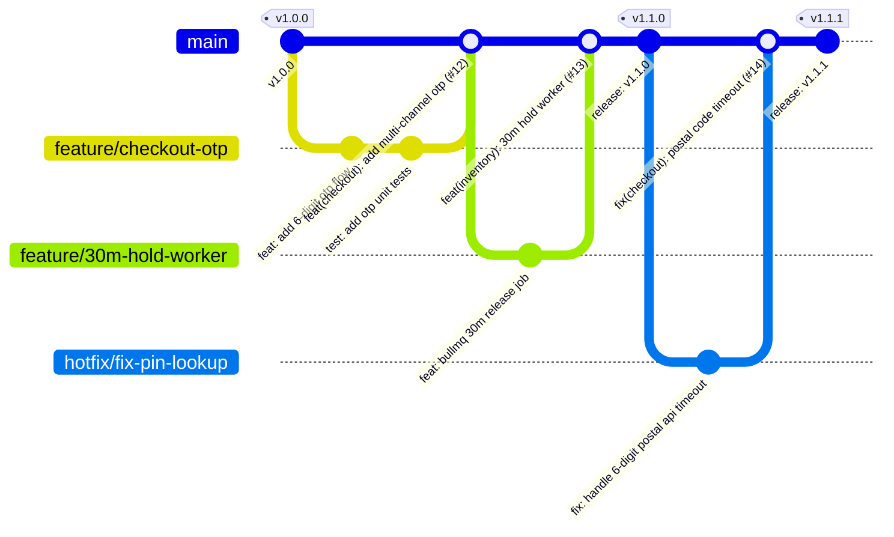
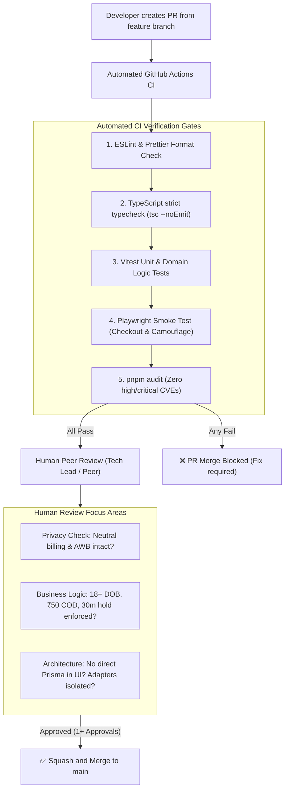

# 🌿 Document 10: Git & Version Control Strategy

**Project Name:** Aura Retail & Lifestyle (Discreet Adult Wellness & Intimate Care E-Commerce Marketplace)  
**Document Status:** Confirmed / Approved by User (Green Light on 2026-11-09)  
**Version:** 1.0.0  
**Date:** 2026-11-09  
**Author / Partner:** Planning & Technical Documentation Partner  

---

## 1. Purpose

Yeh document platform ka **Git & Version Control Governance Blueprint** hai. E-commerce application mein financial payments, automated courier bookings, aur customer privacy engine involve hote hain; isliye uncontrolled code merges ya accidental regression bugs business ko severe financial aur reputation loss de sakte hain. Yeh document branching strategy, Conventional Commits, Pull Request (PR) review gates, semantic release tagging, aur database migration versioning ke rules establish karta hai.

---

## 2. Existing Approved Context Used

Yeh Git strategy blueprint sabhi approved architectural aur engineering documents par strictly based hai:
* [`docs/01_Master_Planning.md`](file:///c:/Users/20092/OneDrive/Desktop/Dev/Projects/Active/Black%20Dot%20ecosystem/eoc_system%20Products/ecomerce%20website%20{wellness%20toys}/docs/01_Master_Planning.md) *(Approved)*: V1 boundaries, neutral identity ("Aura Retail & Lifestyle"), anti-RTO rules.
* [`docs/02_Architecture.md`](file:///c:/Users/20092/OneDrive/Desktop/Dev/Projects/Active/Black%20Dot%20ecosystem/eoc_system%20Products/ecomerce%20website%20{wellness%20toys}/docs/02_Architecture.md) *(Approved)*: Modular monolith architecture, domain isolation.
* [`docs/03_Tech_Stack.md`](file:///c:/Users/20092/OneDrive/Desktop/Dev/Projects/Active/Black%20Dot%20ecosystem/eoc_system%20Products/ecomerce%20website%20{wellness%20toys}/docs/03_Tech_Stack.md) *(Approved)*: TypeScript 5.x, ESLint, Prettier, Vitest, Playwright.
* [`docs/04_Database_Design.md`](file:///c:/Users/20092/OneDrive/Desktop/Dev/Projects/Active/Black%20Dot%20ecosystem/eoc_system%20Products/ecomerce%20website%20{wellness%20toys}/docs/04_Database_Design.md) *(Approved)*: Prisma schema migration history, zero-downtime column rollout.
* [`docs/08_Folder_Structure_and_Coding_Standards.md`](file:///c:/Users/20092/OneDrive/Desktop/Dev/Projects/Active/Black%20Dot%20ecosystem/eoc_system%20Products/ecomerce%20website%20{wellness%20toys}/docs/08_Folder_Structure_and_Coding_Standards.md) *(Approved)*: Domain module organization, strict service encapsulation.
* [`docs/09_Environments.md`](file:///c:/Users/20092/OneDrive/Desktop/Dev/Projects/Active/Black%20Dot%20ecosystem/eoc_system%20Products/ecomerce%20website%20{wellness%20toys}/docs/09_Environments.md) *(Approved)*: Local (`dev`), Staging (`staging`), Production (`prod`) environments.

---

## 3. Decisions Table

| Decision ID | Git & VCS Domain | Selected Decision | Status | Key Reason | Alternatives Considered |
| :--- | :--- | :--- | :--- | :--- | :--- |
| **GIT-DEC-01** | **Branching Workflow** | **Trunk-Based Development with Short-Lived Feature Branches** | **Proposed** | High developer velocity, eliminates painful long-lived merge conflicts, and pairs seamlessly with automated CI/CD and preview deployments. | GitFlow (complex release branches, merge overhead), Pure Trunk (committing directly to main - high risk) |
| **GIT-DEC-02** | **Merge Strategy** | **Squash and Merge to `main`** | **Proposed** | Keeps the primary `main` branch git history clean, readable, and 100% bisectable (`git bisect`) with 1 commit per completed feature/fix. | Rebase and Merge (clutters history with WIP commits), Merge Commits (creates messy non-linear git graph) |
| **GIT-DEC-03** | **Commit Specification** | **Conventional Commits 1.0.0 (`commitlint` Enforced)** | **Proposed** | Standardizes commit syntax, enables automated changelog generation, and forces clear intent (e.g. `feat(checkout): add flat 50 cod surcharge`). | Free-form unformatted commit messages |
| **GIT-DEC-04** | **Release Versioning** | **Semantic Versioning (SemVer 2.0.0) with Git Tags (`vX.Y.Z`)** | **Proposed** | Clear communication of breaking changes (Major), new capabilities (Minor), and bug fixes (Patch); triggers automated production releases. | Date-based versioning (CalVer), Commit SHA releases |
| **GIT-DEC-05** | **Pre-Commit Enforcement** | **Husky + Lint-Staged + Git-Secrets** | **Proposed** | Prevents bad code, unformatted CSS, and accidental secret key leaks (Stripe/Cashfree keys) from ever entering the git repository history. | Relying on developer discipline alone |

---

## 4. Branching Strategy & Lifecycle

Platform **Trunk-Based Development** model follow karta hai:



### A. Branch Hierarchy & Naming Conventions
1. **`main` (Protected Production Branch):**
   * Single source of truth. Always deployable and healthy.
   * Direct push is permanently locked. Code enters only via approved Pull Request.
2. **Feature Branches (`feature/<ticket-or-scope>-<short-description>`):**
   * Created off the latest `main`.
   * Lifetime: Short-lived (typically 1 to 3 days).
   * Examples: `feature/quiz-recommendations`, `feature/anti-rto-surcharge`.
3. **Bugfix Branches (`fix/<issue-id>-<description>`):**
   * Normal non-emergency bug fixes merged into `main`.
   * Example: `fix/video-upload-progress-indicator`.
4. **Emergency Hotfix Branches (`hotfix/<vX.Y.Z>-<description>`):**
   * Critical production emergency fixes (e.g. payment gateway webhook downtime).
   * Branched directly off the latest production release tag, tested, and merged into `main` with an immediate patch tag (`v1.0.1`).

---

## 5. Commit Message Standard (Conventional Commits)

Commit messages strict **Conventional Commits v1.0.0** syntax follow karenge:

```
<type>(<optional scope>): <description>

[optional body explaining WHY this change was made]

[optional footer(s) referencing ADR or issue ticket]
```

### Allowed Commit Types:
* `feat`: A new feature for the user or system (e.g. `feat(cart): add 30-min reservation hold countdown`).
* `fix`: A bug fix for the user or system (e.g. `fix(checkout): apply 5% prepaid discount capping at ₹150`).
* `docs`: Documentation changes only (e.g. `docs(architecture): update data flow sequence diagram`).
* `style`: Formatting, missing semicolons, Tailwind class ordering (no code logic change).
* `refactor`: Code change that neither fixes a bug nor adds a feature.
* `perf`: Code change that improves performance (e.g. `perf(catalog): optimize Schema.org JSON-LD generation`).
* `test`: Adding or correcting tests (Vitest / Playwright).
* `chore`: Maintenance tasks, dependency updates, configuration tweaks.

### Mandatory Commit Rules:
1. Subject line lowercase mein hoga and imperative mood use karega (*"add"*, not *"added"* or *"adds"*).
2. Subject line ke aakhir mein koi period/dot (`.`) nahi hoga.
3. Character length: Subject line `< 72 characters`.

---

## 6. Pull Request (PR) & Code Review Guidelines



### Pull Request Checklist (PR Template)
Har PR description mein developer ko yeh 5 verification points confirm karne honge:
- [ ] **1. Automated Tests:** Unit tests pass locally aur naye domain logic ke liye tests added hain.
- [ ] **2. Privacy Guarantee:** Neutral descriptors (*"Aura Retail & Lifestyle"* / *"Personal Grooming & Wellness Kits"*) intact hain; koi intimate product name external logs ya billing mein leak nahi ho raha.
- [ ] **3. Architectural Boundaries:** Page UI components direct Prisma access nahi kar rahe; sabhi data calls module services ke zariye hain.
- [ ] **4. Database Migrations:** Agar schema change hui hai, toh non-breaking SQL migration file committed hai.
- [ ] **5. Zero Secrets Committed:** Koi real API secret, token, ya `.env` file commit nahi hui hai.

---

## 7. Database Migration & Schema Change Practices in Git

1. **Immutable Migrations:**
   * Ek baar jab migration file `prisma/migrations/` mein commit ho jaye aur team ke saath share ho jaye, use **kabhi edit ya delete nahi kiya jayega**.
   * Koi bhi correction nayi sequential migration file banakar kiya jayega.
2. **Two-Phase Schema Evolution (Zero-Downtime):**
   * **Phase 1 (Expand):** Naya column add karein (as `nullable` ya with default value). Application code update karein to write to new column.
   * **Phase 2 (Contract):** Old column deprecate karein aur data backfill ke baad separate PR mein safe drop karein.
3. **Migration Review Gate:**
   * PRs jisme `prisma/schema.prisma` ya migration SQL files shamil hon, unhe Tech Lead ka explicit review aur approval mandatory hoga.

---

## 8. Release Tagging & Semantic Versioning (SemVer 2.0.0)

Production deployments git release tags ke zariye trigger honge using `vMAJOR.MINOR.PATCH`:

* **`MAJOR` (e.g. v2.0.0):** Breaking architectural changes (e.g. moving from direct inventory to multi-vendor marketplace, major database redesign).
* **`MINOR` (e.g. v1.1.0):** New backward-compatible features (e.g. launching Verified Buyer Reviews, adding new Starter Bundle quiz logic).
* **`PATCH` (e.g. v1.0.1):** Backward-compatible bug fixes and security hotfixes (e.g. fixing delivery webhook timing, rate limiter adjustment).

**Automated Changelog:** Release tags GitHub Actions workflow trigger karte hain jo Conventional Commits ko analyze karke automated release notes generate karta hai.

---

## 9. Pre-Commit Hooks & Automation Architecture

Repository root par **Husky** aur **lint-staged** configure kiya gaya hai:

```json
// package.json (lint-staged configuration)
{
  "lint-staged": {
    "*.{ts,tsx}": [
      "prettier --write",
      "eslint --fix",
      "vitest related --run"
    ],
    "*.{json,md,yml}": [
      "prettier --write"
    ]
  }
}
```

* **Pre-commit hook:** Formats staged files with Prettier, runs ESLint, executes relevant Vitest unit tests, aur `git-secrets` scan run karke API keys block karta hai.
* **Commit-msg hook:** Commit message ko Conventional Commits syntax ke against validate karta hai (`commitlint -E HUSKY_GIT_PARAMS`).

---

## 10. Open Questions, Risks & Assumptions

### Open Questions (Git Strategy)
* [ ] **GIT-OQ-01 (Automated Release PRs):** Release process ko automate karne ke liye **Changesets** ya **Release Please** bot integrate karein jo automatically PRs merge hone par changelog PR banata hai? *(Proposed: Release Please bot for automated SemVer tagging and changelog generation).*
* [ ] **GIT-OQ-02 (Preview Environment TTL):** Feature PRs ke ephemeral Vercel preview environments ko kitne time tak active rakhein? *(Proposed: Automatically destroyed when PR is closed or merged).*

---

## 11. Related Documents / Dependencies

Is Git & Version Control Strategy document ke approve hone ke baad agla document sequence:
* `Document 11: Performance & Scalability` *(Next in line - Expected traffic, bottlenecks, scale-up path, caching)*
* `Document 12: Testing Strategy`

---

## 12. Sources & Technical References

1. **Conventional Commits v1.0.0 Specification:** https://www.conventionalcommits.org/ (Accessed: 2026-11).
2. **Semantic Versioning 2.0.0 (SemVer):** https://semver.org/ (Accessed: 2026-11).
3. **Trunk-Based Development Best Practices:** https://trunkbaseddevelopment.com/ (Accessed: 2026-11).
4. **GitHub Flow & Protected Branch Rules:** https://docs.github.com/en/get-started/using-github/github-flow (Accessed: 2026-11).

---

## 13. Review Checklist (Aapke Approval ke Liye Key Points)

Kripya is Git & Version Control blueprint ko review karein aur green light ya feedback dein:

- [ ] **1. Trunk-Based Development:** Kya `main` branch protection aur short-lived feature branches ka workflow approved hai?
- [ ] **2. Squash and Merge:** Kya git history clean aur bisectable rakhne ke liye Squash & Merge policy approved hai?
- [ ] **3. Conventional Commits:** Kya `feat`, `fix`, `docs`, `refactor` commit linting rules approved hain?
- [ ] **4. PR Quality & Privacy Gates:** Kya PR checklist mein neutral descriptors verification aur zero direct Prisma access verification approved hai?
- [ ] **5. SemVer & Release Tagging:** Kya `vMAJOR.MINOR.PATCH` release tagging aur immutable migration rules approved hain?
