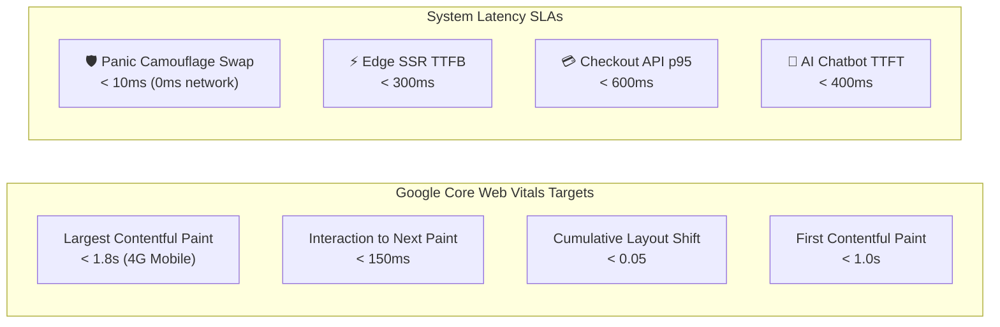
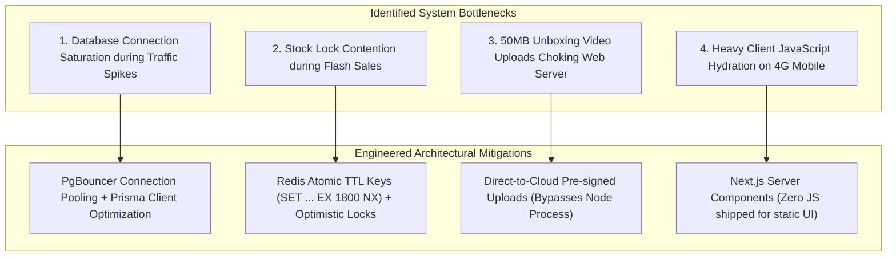
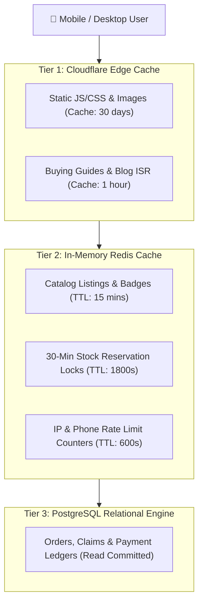
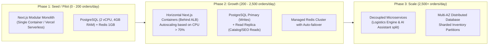

# ⚡ Document 11: Performance & Scalability

**Project Name:** Aura Retail & Lifestyle (Discreet Adult Wellness & Intimate Care E-Commerce Marketplace)  
**Document Status:** Confirmed / Approved by User (Green Light on 2026-11-09)  
**Version:** 1.0.0  
**Date:** 2026-11-09  
**Author / Partner:** Planning & Technical Documentation Partner  

---

## 1. Purpose

Yeh document platform ke **Performance Benchmarks, Expected Usage Profiles, System Bottlenecks, aur Scale-Up Engineering Roadmap** ko define karta hai. Sexual wellness e-commerce mein do extreme performance requirements hoti hain:
1. **Zero-Latency Privacy Panic Exit:** "Quick Exit" panic button ko bina kisi network delay ke (< 10ms) instant disguise render karna hota hai agar user ke kamre mein koi aa jaye.
2. **SEO & Mobile Web Vitals:** Chunki adult wellness par paid search ads banned hain, organic Google search rankings ke liye sub-2-second Largest Contentful Paint (LCP) aur Google Core Web Vitals score > 90 achieve karna mandatory hai.

---

## 2. Existing Approved Context Used

Yeh performance blueprint sabhi approved foundational architectural decisions par based hai:
* [`docs/01_Master_Planning.md`](file:///c:/Users/20092/OneDrive/Desktop/Dev/Projects/Active/Black%20Dot%20ecosystem/eoc_system%20Products/ecomerce%20website%20{wellness%20toys}/docs/01_Master_Planning.md) *(Approved)*: Organic search acquisition goals, 30-min stock reservation lock, anti-RTO rules.
* [`docs/02_Architecture.md`](file:///c:/Users/20092/OneDrive/Desktop/Dev/Projects/Active/Black%20Dot%20ecosystem/eoc_system%20Products/ecomerce%20website%20{wellness%20toys}/docs/02_Architecture.md) *(Approved)*: Modular monolith, hybrid rendering model (ISR for blogs, SSR for PDPs, CSR for camouflage), pre-signed direct-to-cloud uploads.
* [`docs/03_Tech_Stack.md`](file:///c:/Users/20092/OneDrive/Desktop/Dev/Projects/Active/Black%20Dot%20ecosystem/eoc_system%20Products/ecomerce%20website%20{wellness%20toys}/docs/03_Tech_Stack.md) *(Approved)*: Next.js 15, PostgreSQL 16, Redis 7, BullMQ, Tailwind CSS (<15KB purged).
* [`docs/04_Database_Design.md`](file:///c:/Users/20092/OneDrive/Desktop/Dev/Projects/Active/Black%20Dot%20ecosystem/eoc_system%20Products/ecomerce%20website%20{wellness%20toys}/docs/04_Database_Design.md) *(Approved)*: Optimistic locking on `InventoryItem`, B-tree indexed UUIDv7 keys.
* [`docs/07_Third_Party_Services_and_Integrations.md`](file:///c:/Users/20092/OneDrive/Desktop/Dev/Projects/Active/Black%20Dot%20ecosystem/eoc_system%20Products/ecomerce%20website%20{wellness%20toys}/docs/07_Third_Party_Services_and_Integrations.md) *(Approved)*: Cloudflare R2 zero-egress video storage, Cashfree UPI intent, Gemini streaming.

---

## 3. Decisions Table

| Decision ID | Performance Domain | Selected Decision | Status | Key Reason | Alternatives Considered |
| :--- | :--- | :--- | :--- | :--- | :--- |
| **PERF-DEC-01** | **Panic Button Latency SLA** | **< 10ms Client-Side Decoy Swap (Zero Network Fetch)** | **Proposed** | Decoy lifestyle blog DOM payload is pre-inlined on page load; clicking panic button executes pure client state swap with zero HTTP latency. | Server redirect (200-500ms lag exposes user to screen peeking) |
| **PERF-DEC-02** | **Core Web Vitals Standard** | **LCP < 1.8s, INP < 150ms, CLS < 0.05 on Indian 4G Mobile** | **Proposed** | High Google search rank is the primary customer acquisition funnel; passing Core Web Vitals guarantees maximum organic reach. | Standard desktop benchmarks (unrealistic for Indian mobile users) |
| **PERF-DEC-03** | **Database Connection Scaling** | **PgBouncer Connection Pooling (Transaction Mode)** | **Proposed** | Prevents PostgreSQL connection exhaustion during concurrent traffic spikes from Next.js serverless/container instances. | Direct unpooled database connections |
| **PERF-DEC-04** | **Inventory Concurrency Engine** | **Atomic Redis Decrement + PostgreSQL Optimistic Version Check** | **Proposed** | Handles high-concurrency 30-min stock reservations in memory in < 2ms without holding long-lived database row locks. | Database `SELECT FOR UPDATE` table-wide locks (creates severe database lag) |
| **PERF-DEC-05** | **Media Delivery Architecture** | **Next.js Image (`next/image`) with WebP/AVIF at Edge** | **Proposed** | Compresses high-res wellness product photos into responsive modern formats, reducing image payload by 70%+. | Raw uncompressed JPEG/PNG delivery |

---

## 4. Expected Usage Profile & Traffic Assumptions

E-commerce traffic heavily read-dominant hota hai:

```
Traffic Model Breakdown:
├── Read-to-Write Ratio:     95 : 5 (95% browsing/content reads, 5% cart/checkout writes)
├── V1 Pilot Phase:          25,000 monthly visitors (~800 visits/day, ~50 orders/day)
├── Peak Concurrent Users:   ~500 CCU normal; ~3,000 CCU during promotional drops
├── Growth Phase (Year 1):   250,000+ monthly visitors (~1,000 orders/day)
└── Average Session Time:    4.5 minutes (Users carefully review anatomy care guides & medical specs)
```

---

## 5. Quantitative Performance Goals & SLAs



| Metric | Target SLA | Measurement Method | Failure Consequence |
| :--- | :--- | :--- | :--- |
| **Discreet Camouflage Trigger** | **< 10ms** | Client-side performance mark | Customer privacy breach if someone peeks at screen |
| **Largest Contentful Paint (LCP)**| **< 1.8 seconds** | Lighthouse CI / Real User Monitoring | Google search rank drops; higher bounce rate |
| **Server-Side Render (SSR) TTFB** | **< 300 ms** | Cloudflare Edge Analytics | Slow initial page rendering |
| **Interactive Toy Finder Quiz** | **< 50 ms per step**| In-memory state transition | User drops off before completing recommendations |
| **Checkout API Response (p95)** | **< 600 ms** | APM trace / Server Action timer | Cart abandonment during payment transition |
| **AI Chatbot Time to First Token** | **< 400 ms** | Vercel AI SDK streaming event | Stalled customer service experience |

---

## 6. Critical System Bottlenecks & Architectural Mitigations



1. **Database Connection Saturation:**
   * **Problem:** Har SSR request par naya database connection open hone se PostgreSQL limit exceed ho sakti hai.
   * **Mitigation:** PgBouncer connection pooler transaction pooling mode mein deploy hoga (`max_client_conn = 1000`, `default_pool_size = 25`).
2. **Stock Reservation Contention:**
   * **Problem:** Flash sale ke dauran multiple buyers same SKU ko simultaneously hold karne ki koshish karte hain.
   * **Mitigation:** Redis atomic execution (`SET stock:sku_id:hold customer_id EX 1800 NX`). Sirf first customer ko lock milta hai; baaki customers ko database touch kiye bina instant memory response mil jata hai.
3. **Heavy Media Uploads & Downloads:**
   * **Problem:** Customer 50MB unboxing videos upload karte hain; support staff unhe review karta hai. Node.js server se file stream karne par CPU/Memory choke ho sakti hai.
   * **Mitigation:** Pre-signed URLs browser ko direct Cloudflare R2 bucket se connect karte hain; Node.js process sirf metadata capture karta hai.

---

## 7. Multi-Tier Caching Topology



* **Cache Invalidation Policy:** Jab Store Admin catalog mein price ya product specifications update karta hai, Next.js `revalidatePath('/catalog')` aur `revalidateTag('product-[id]')` trigger hota hai, jo edge cache ko selectively refresh karta hai.

---

## 8. Horizontal & Vertical Scale-Up Roadmap

Platform ki growth ke mutabiq clear 3-phase scaling architecture:



---

## 9. Testing & Benchmarking Protocol

1. **Load Testing via k6:**
   * Scenario: 3,000 Virtual Users (VUs) ramp up over 5 minutes.
   * Target: 95% of checkout requests complete in `< 600ms` with zero overselling errors.
2. **Automated Core Web Vitals CI:**
   * Google Lighthouse CI GitHub Actions pipeline mein run hoga; agar PR mobile performance score `< 90` drop karta hai, build flag ho jayegi.

---

## 10. Open Questions, Risks & Assumptions

### Open Questions (Performance)
* [ ] **PERF-OQ-01 (Database Read Replica Timing):** Read Replica V1 pilot stage mein deploy karein ya jab daily orders 300 cross karein? *(Proposed: Start with single high-spec PostgreSQL instance with PgBouncer; introduce Read Replica at 300 orders/day to keep initial infra costs low).*
* [ ] **PERF-OQ-02 (Edge Server Actions):** Kya Server Actions ko Cloudflare Edge runtime par execute karein ya Node.js runtime par? *(Proposed: Node.js runtime for full Prisma connection pooling stability).*

---

## 11. Related Documents / Dependencies

Is Performance & Scalability document ke approve hone ke baad agla document sequence:
* `Document 12: Testing Strategy` *(Next in line - Unit, Integration, E2E, Load, Contract Tests)*
* `Document 13: Deployment & DevOps Plan`

---

## 12. Sources & Technical References

1. **Google Core Web Vitals Documentation (LCP, INP, CLS):** https://web.dev/explore/learn-core-web-vitals (Accessed: 2026-11).
2. **PostgreSQL Concurrency & PgBouncer Performance Guide:** https://www.pgbouncer.org/features.html (Accessed: 2026-11).
3. **Redis High-Throughput Locking Patterns (Redlock & SET NX):** https://redis.io/docs/manual/patterns/distributed-locks/ (Accessed: 2026-11).
4. **Next.js Image Optimization Architecture:** https://nextjs.org/docs/app/building-your-application/optimizing/images (Accessed: 2026-11).

---

## 13. Review Checklist (Aapke Approval ke Liye Key Points)

Kripya is Performance & Scalability blueprint ko review karein aur green light ya feedback dein:

- [ ] **1. Panic Button Latency:** Kya < 10ms zero-network client camouflage latency target approved hai?
- [ ] **2. Core Web Vitals Targets:** Kya mobile LCP < 1.8s, INP < 150ms, CLS < 0.05 targets approved hain?
- [ ] **3. Concurrency Handling:** Kya Redis atomic key hold (`SET ... NX EX 1800`) + PostgreSQL optimistic locking model approved hai?
- [ ] **4. PgBouncer Connection Pooling:** Kya database connection saturation se bachne ke liye PgBouncer architecture approved hai?
- [ ] **5. Scaling Roadmap:** Kya Phase 1 (Single Monolith) se Phase 2 (Read Replicas & Auto-scaled containers) ka roadmap approved hai?
