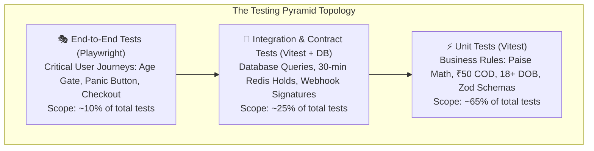
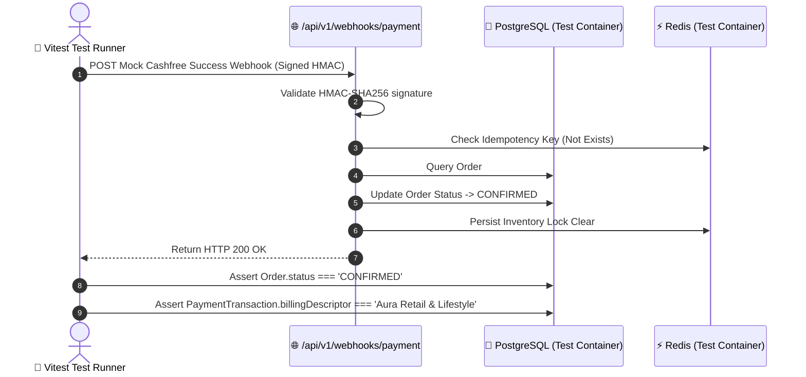
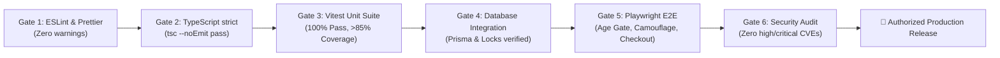

# 🧪 Document 12: Testing Strategy

**Project Name:** Aura Retail & Lifestyle (Discreet Adult Wellness & Intimate Care E-Commerce Marketplace)  
**Document Status:** Confirmed / Approved by User (Green Light on 2026-11-09)  
**Version:** 1.0.0  
**Date:** 2026-11-09  
**Author / Partner:** Planning & Technical Documentation Partner  

---

## 1. Purpose

Yeh document platform ka **End-to-End Quality Assurance & Testing Engineering Strategy** hai. Sexual wellness e-commerce mein software bugs sirf user inconvenience nahi create karte, balki financial leakage (overselling, wrong COD fees), legal non-compliance (under-18 sales), ya privacy breaches (panic button failure, statement disclosure) cause kar sakte hain. Yeh document test pyramid, coverage priorities, test data isolation, API contract tests, aur mandatory production release criteria ko define karta hai.

---

## 2. Existing Approved Context Used

Yeh testing strategy sabhi approved technical aur business blueprints par strictly based hai:
* [`docs/01_Master_Planning.md`](file:///c:/Users/20092/OneDrive/Desktop/Dev/Projects/Active/Black%20Dot%20ecosystem/eoc_system%20Products/ecomerce%20website%20{wellness%20toys}/docs/01_Master_Planning.md) *(Approved)*: V1 boundaries, anti-RTO rules, neutral descriptor promise.
* [`docs/02_Architecture.md`](file:///c:/Users/20092/OneDrive/Desktop/Dev/Projects/Active/Black%20Dot%20ecosystem/eoc_system%20Products/ecomerce%20website%20{wellness%20toys}/docs/02_Architecture.md) *(Approved)*: Modular monolith, 30-min stock hold engine, 0ms decoy camouflage, pre-signed video uploads.
* [`docs/03_Tech_Stack.md`](file:///c:/Users/20092/OneDrive/Desktop/Dev/Projects/Active/Black%20Dot%20ecosystem/eoc_system%20Products/ecomerce%20website%20{wellness%20toys}/docs/03_Tech_Stack.md) *(Approved)*: TypeScript 5.x, Vitest, Playwright, Prisma ORM, BullMQ, Redis 7.
* [`docs/04_Database_Design.md`](file:///c:/Users/20092/OneDrive/Desktop/Dev/Projects/Active/Black%20Dot%20ecosystem/eoc_system%20Products/ecomerce%20website%20{wellness%20toys}/docs/04_Database_Design.md) *(Approved)*: Currency in paise, database 18+ check constraint, optimistic inventory locking.
* [`docs/05_Authentication_and_Authorization.md`](file:///c:/Users/20092/OneDrive/Desktop/Dev/Projects/Active/Black%20Dot%20ecosystem/eoc_system%20Products/ecomerce%20website%20{wellness%20toys}/docs/05_Authentication_and_Authorization.md) *(Approved)*: Passwordless OTP authentication, staff TOTP 2FA, staff audit logs.
* [`docs/06_Security_Plan.md`](file:///c:/Users/20092/OneDrive/Desktop/Dev/Projects/Active/Black%20Dot%20ecosystem/eoc_system%20Products/ecomerce%20website%20{wellness%20toys}/docs/06_Security_Plan.md) *(Approved)*: HMAC-SHA256 webhook signature verification, AES-256 PII encryption.
* [`docs/11_Performance_and_Scalability.md`](file:///c:/Users/20092/OneDrive/Desktop/Dev/Projects/Active/Black%20Dot%20ecosystem/eoc_system%20Products/ecomerce%20website%20{wellness%20toys}/docs/11_Performance_and_Scalability.md) *(Approved)*: Panic button < 10ms latency SLA, 3,000 CCU flash sale concurrency.

---

## 3. Decisions Table

| Decision ID | Testing Domain | Selected Decision | Status | Key Reason | Alternatives Considered |
| :--- | :--- | :--- | :--- | :--- | :--- |
| **TEST-DEC-01** | **Unit & Integration Runner** | **Vitest** | **Proposed** | Native TypeScript support, instant ESM execution, Vitest Workspace support, and 5x faster execution than Jest in Next.js projects. | Jest (slower compile times, complex ESM/TS config) |
| **TEST-DEC-02** | **End-to-End (E2E) Framework** | **Playwright** | **Proposed** | Multi-browser engine (Chromium, WebKit/iOS Safari, Firefox), mobile viewport emulation, and built-in tracing for visual regression. | Cypress (limited multi-tab/mobile Safari support), Selenium |
| **TEST-DEC-03** | **Database Integration Testing** | **Ephemeral Test Database (via Docker / Testcontainers)** | **Proposed** | Tests execute against a real PostgreSQL 16 engine rather than SQLite mocks, guaranteeing Prisma migration and constraint accuracy. | Mocking Prisma queries (hides SQL syntax & constraint errors) |
| **TEST-DEC-04** | **Load & Stress Tooling** | **k6 (JavaScript-based Load Scripts)** | **Proposed** | High-concurrency load generation testing 3,000 CCU simultaneous cart holds and webhook bursts with minimal CPU footprint. | Apache JMeter (heavy GUI, high resource usage), Artillery |
| **TEST-DEC-05** | **Zero-Tolerance Release Gate** | **Mandatory 100% Pass on Core Flows + >85% Domain Coverage** | **Proposed** | Any failure in 18+ DOB verification, ₹50 COD calculation, or Panic button instant swap permanently blocks deployment. | Soft warnings on test failures |

---

## 4. The Testing Pyramid

Platform ka quality assurance testing pyramid structure follow karta hai:



---

## 5. Risk-Weighted Coverage Matrix & Priorities

| Domain Module | Critical Test Cases | Target Coverage | Test Level | Priority |
| :--- | :--- | :--- | :--- | :--- |
| **Anti-RTO & Pricing** | • Flat ₹50 COD surcharge added to order subtotal.<br>• Instant 5% prepaid discount capped at ₹150.<br>• Exact integer paise calculations (no floating point bugs). | **> 95%** | Unit & Integration | **P0 (Critical)** |
| **18+ Compliance** | • Date of birth check rejects age < 18 at registration/checkout.<br>• Database constraint throws error on under-18 insert.<br>• 18+ age gate modal redirects under-18 to Google. | **100%** | Unit & E2E | **P0 (Critical)** |
| **Panic Camouflage** | • Floating button instantly renders decoy blog DOM in < 10ms.<br>• Video/Audio elements immediately muted.<br>• Tab title and favicon swapped to neutral lifestyle blog. | **100%** | E2E (Playwright) | **P0 (Critical)** |
| **Inventory & Holds** | • 30-min reservation lock prevents double-booking same SKU.<br>• BullMQ worker releases unpaid stock at minute 30:01.<br>• Optimistic concurrency prevents negative inventory. | **> 90%** | Integration & Load (k6) | **P0 (Critical)** |
| **Neutral Identity** | • Bank statement descriptor permanently matches `"Aura Retail & Lifestyle"`.<br>• Courier label description matches `"Personal Grooming & Wellness Kits"`.<br>• Zero product names in outbound SMS/WhatsApp alerts. | **100%** | Unit & Integration | **P0 (Critical)** |
| **24-Hr DOA Claims** | • Claim submission allowed if `<= 24h` of courier delivery webhook.<br>• Claim locked with helpful support message if `> 24h`.<br>• Pre-signed URL generates strictly for video formats (<50MB). | **> 85%** | Integration & E2E | **P1 (High)** |
| **AI Wellness Bot** | • Medical disclaimer triggered on health/pain queries.<br>• Model refuses diagnostic advice.<br>• Rate limiting kicks in at 20 messages/hour. | **> 80%** | Integration & Contract | **P1 (High)** |

---

## 6. Detailed Test Level Specifications

### A. Unit Testing (Vitest)
Unit tests pure functions aur domain rules ko test karte hain bina external network calls ke:

```typescript
// tests/unit/checkout/pricing.test.ts
import { describe, it, expect } from 'vitest';
import { calculateOrderTotals } from '@/modules/checkout/checkout.service';

describe('Anti-RTO Pricing Calculation (Paise)', () => {
  it('should apply flat 5000 paise (₹50) surcharge on COD orders', () => {
    const subtotalPaise = 249900; // ₹2,499.00
    const totals = calculateOrderTotals({ subtotalPaise, paymentMode: 'COD' });
    
    expect(totals.codFeePaise).toBe(5000);
    expect(totals.discountPaise).toBe(0);
    expect(totals.totalAmountPaise).toBe(254900); // ₹2,549.00
  });

  it('should apply 5% discount capped at 15000 paise (₹150) on Prepaid orders', () => {
    const subtotalPaise = 400000; // ₹4,000.00 (5% = ₹200 -> capped at ₹150)
    const totals = calculateOrderTotals({ subtotalPaise, paymentMode: 'PREPAID_UPI' });
    
    expect(totals.discountPaise).toBe(15000); // ₹150 cap enforced
    expect(totals.codFeePaise).toBe(0);
    expect(totals.totalAmountPaise).toBe(385000);
  });
});
```

---

### B. Integration & Webhook Contract Testing
Integration tests real database aur Redis ke saath contract aur state verify karte hain:



---

### C. End-to-End (E2E) Browser Testing (Playwright)
Playwright real mobile/desktop browser viewports mein customer critical journeys test karta hai:

```typescript
// tests/e2e/privacy/panic-button.spec.ts
import { test, expect } from '@playwright/test';

test.describe('Zero-Latency Panic Button (Discreet Camouflage)', () => {
  test('clicking panic button instantly hides adult wellness catalog', async ({ page }) => {
    await page.goto('/product/whisper-quiet-wand-massager');
    
    // Assert user is on product page
    await expect(page.locator('h1')).toContainText('Wand Massager');

    // Click floating Panic Button
    const panicButton = page.locator('[data-testid="panic-button"]');
    await panicButton.click();

    // Verify 0ms Camouflage Swap: Adult DOM is completely replaced
    await expect(page.locator('h1')).toContainText('Everyday Minimalist: Healthy Habits');
    await expect(page.locator('[data-testid="product-price"]')).not.toBeVisible();
    
    // Verify Browser Tab Title disguise
    await expect(page).toHaveTitle(/Everyday Minimalist/);
  });
});
```

---

## 7. Test Data Management & Privacy Sanitation

1. **Zero Production PII Rule:** Test suites mein kabhi bhi real customer phone numbers, addresses, ya unboxing videos use nahi honge.
2. **Factory Generation Pattern:**
   * `tests/factories/user.factory.ts`: Generates synthetic 18+ adult users with randomized phone numbers (`+9199999XXXXX`).
   * `tests/factories/product.factory.ts`: Generates test catalog items with verified medical-grade silicone specs.
3. **Database Clean-Up (Teardown):**
   * Integration test suites isolated PostgreSQL schemas use karte hain jo test execution ke baad truncate ho jate hain (`prisma.$executeRawUnsafe('TRUNCATE ... CASCADE')`).

---

## 8. Performance & Load Testing Protocol (k6)

1. **High-Concurrency Flash Sale Simulation:**
   * Script simulates **3,000 Virtual Users (VUs)** attempting to purchase a limited inventory SKU (100 units).
   * **Verification Criteria:**
     * Exactly 100 successful 30-min reservations created.
     * Zero negative inventory in `InventoryItem.availableStock`.
     * 2,900 users receive graceful *"Item currently reserved"* notice in `< 50ms`.
     * Zero database connection pool timeouts.

---

## 9. Quality Gates & Production Release Criteria

Production deployment tabhi trigger hoga jab GitHub Actions CI mein yeh 6 gates **100% Green** pass hon:



---

## 10. Open Questions, Risks & Assumptions

### Open Questions (Testing)
* [ ] **TEST-OQ-01 (Visual Regression Testing):** Camouflage blog aur medical product badges ke layout regression ko verify karne ke liye kya Playwright Visual Snapshots (`expect(page).toHaveScreenshot()`) CI pipeline mein add karein? *(Proposed: Yes, for Camouflage mode and PDP medical badges).*
* [ ] **TEST-OQ-02 (SMS/WhatsApp Gateway Mocking):** CI automated test runs mein MSG91/WhatsApp APIs ko mock HTTP server (MSW - Mock Service Worker) se intercept karein? *(Proposed: Yes, MSW to eliminate external third-party API dependencies during CI).*

---

## 11. Related Documents / Dependencies

Is Testing Strategy document ke approve hone ke baad agla document sequence:
* `Document 13: Deployment & DevOps Plan` *(Next in line - Build, release, hosting, rollback, recovery)*
* `Document 14: Monitoring & Logging`

---

## 12. Sources & Technical References

1. **Martin Fowler: The Practical Test Pyramid:** https://martinfowler.com/articles/practical-test-pyramid.html (Accessed: 2026-11).
2. **Playwright Official Documentation (E2E & Mobile Viewport Emulation):** https://playwright.dev/docs/intro (Accessed: 2026-11).
3. **Vitest Official Guide:** https://vitest.dev/guide/ (Accessed: 2026-11).
4. **k6 Load Testing Documentation:** https://k6.io/docs/ (Accessed: 2026-11).

---

## 13. Review Checklist (Aapke Approval ke Liye Key Points)

Kripya is Testing Strategy blueprint ko review karein aur green light ya feedback dein:

- [ ] **1. Test Frameworks:** Kya **Vitest** (Unit/Integration) aur **Playwright** (E2E) ka selection approved hai?
- [ ] **2. P0 Coverage Priorities:** Kya Anti-RTO pricing (paise math), 18+ Age Gate, Panic Camouflage (<10ms), aur 30-min inventory holds par 100% testing priority approved hai?
- [ ] **3. Real PostgreSQL Integration Testing:** Kya mocks ke bajaye Docker/Testcontainers ke through real PostgreSQL engine testing approved hai?
- [ ] **4. Flash Sale Concurrency Test:** Kya k6 ke zariye 3,000 CCU simultaneous reservation test protocol approved hai?
- [ ] **5. Zero-Tolerance Release Gates:** Kya sabhi 6 gates pass hone par hi production deployment trigger karne ka rule approved hai?
