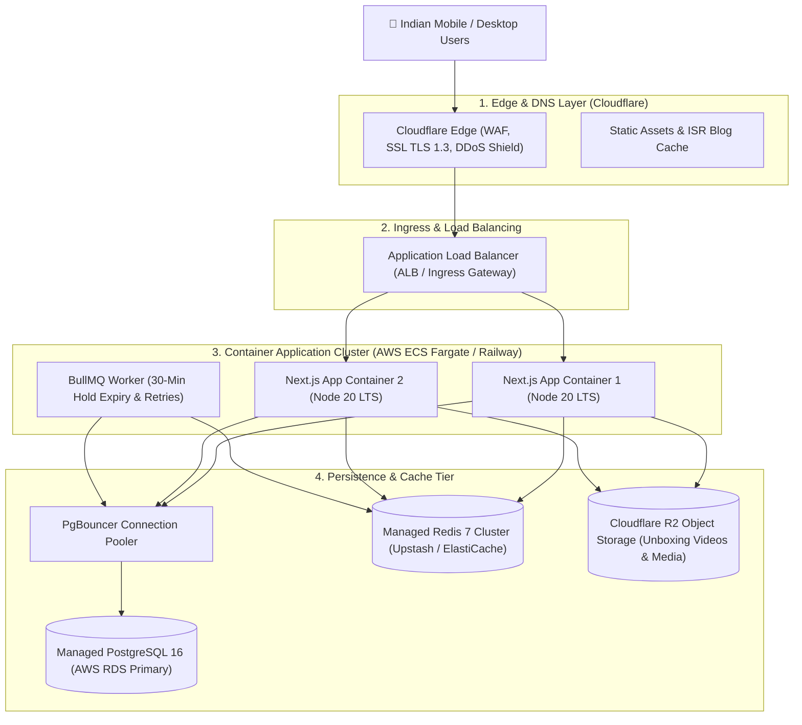
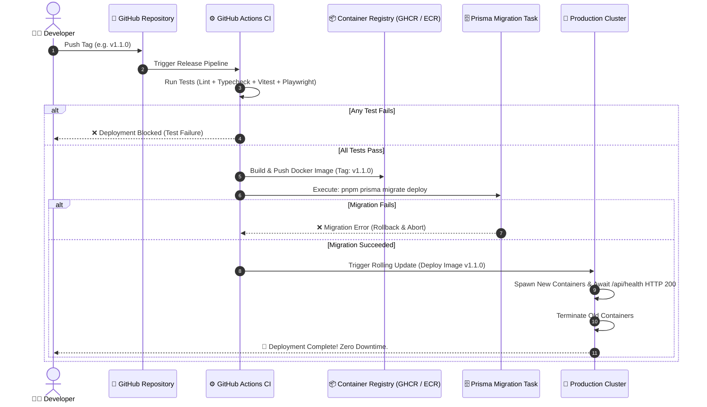
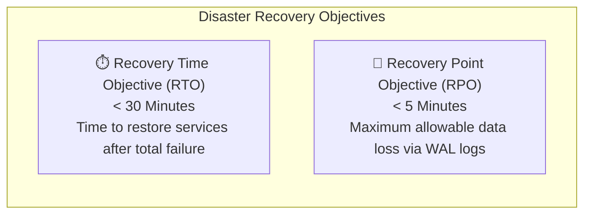

# 🚀 Document 13: Deployment & DevOps Plan

**Project Name:** Aura Retail & Lifestyle (Discreet Adult Wellness & Intimate Care E-Commerce Marketplace)  
**Document Status:** Confirmed / Approved by User (Green Light on 2026-11-09)  
**Version:** 1.0.0  
**Date:** 2026-11-09  
**Author / Partner:** Planning & Technical Documentation Partner  

---

## 1. Purpose

Yeh document platform ke complete **Build, Release, Deployment, Hosting Infrastructure, aur Disaster Recovery Operations** ko define karta hai. E-commerce application mein deployment downtime ka matlab direct GMV loss aur active checkouts ka drop hona hota hai. Sensitive adult wellness domain mein zero-downtime rolling deployments, automated database migrations, aur rapid 1-click rollback mechanisms establish karna non-negotiable hai.

---

## 2. Existing Approved Context Used

Yeh DevOps blueprint sabhi approved foundational documents par based hai:
* [`docs/01_Master_Planning.md`](file:///c:/Users/20092/OneDrive/Desktop/Dev/Projects/Active/Black%20Dot%20ecosystem/eoc_system%20Products/ecomerce%20website%20{wellness%20toys}/docs/01_Master_Planning.md) *(Approved)*: V1 boundaries, privacy-first principles, neutral branding.
* [`docs/02_Architecture.md`](file:///c:/Users/20092/OneDrive/Desktop/Dev/Projects/Active/Black%20Dot%20ecosystem/eoc_system%20Products/ecomerce%20website%20{wellness%20toys}/docs/02_Architecture.md) *(Approved)*: Modular monolith, Cloudflare edge, hybrid data tier.
* [`docs/03_Tech_Stack.md`](file:///c:/Users/20092/OneDrive/Desktop/Dev/Projects/Active/Black%20Dot%20ecosystem/eoc_system%20Products/ecomerce%20website%20{wellness%20toys}/docs/03_Tech_Stack.md) *(Approved)*: Node.js 20 LTS, PostgreSQL 16, Redis 7, BullMQ worker, Docker.
* [`docs/04_Database_Design.md`](file:///c:/Users/20092/OneDrive/Desktop/Dev/Projects/Active/Black%20Dot%20ecosystem/eoc_system%20Products/ecomerce%20website%20{wellness%20toys}/docs/04_Database_Design.md) *(Approved)*: `prisma migrate deploy`, automated WAL backups.
* [`docs/09_Environments.md`](file:///c:/Users/20092/OneDrive/Desktop/Dev/Projects/Active/Black%20Dot%20ecosystem/eoc_system%20Products/ecomerce%20website%20{wellness%20toys}/docs/09_Environments.md) *(Approved)*: Local, Staging, Production configurations.
* [`docs/10_Git_and_Version_Control_Strategy.md`](file:///c:/Users/20092/OneDrive/Desktop/Dev/Projects/Active/Black%20Dot%20ecosystem/eoc_system%20Products/ecomerce%20website%20{wellness%20toys}/docs/10_Git_and_Version_Control_Strategy.md) *(Approved)*: Release tags (`vX.Y.Z`) triggering production deployment.
* [`docs/11_Performance_and_Scalability.md`](file:///c:/Users/20092/OneDrive/Desktop/Dev/Projects/Active/Black%20Dot%20ecosystem/eoc_system%20Products/ecomerce%20website%20{wellness%20toys}/docs/11_Performance_and_Scalability.md) *(Approved)*: PgBouncer connection pooling, horizontal scaling roadmap.
* [`docs/12_Testing_Strategy.md`](file:///c:/Users/20092/OneDrive/Desktop/Dev/Projects/Active/Black%20Dot%20ecosystem/eoc_system%20Products/ecomerce%20website%20{wellness%20toys}/docs/12_Testing_Strategy.md) *(Approved)*: 6 CI quality release gates.

---

## 3. Decisions Table

| Decision ID | DevOps Domain | Selected Decision | Status | Key Reason | Alternatives Considered |
| :--- | :--- | :--- | :--- | :--- | :--- |
| **OPS-DEC-01** | **Application Hosting Topology** | **Containerized Node.js on AWS ECS (Fargate) / Railway** | **Proposed** | Persistent container environment enables stable background BullMQ workers (for the 30-min hold release worker), steady PgBouncer connections, and zero serverless cold-start latency. | Serverless Lambda/Vercel alone (background workers and WebSockets/BullMQ require separate infra) |
| **OPS-DEC-02** | **Container Build Architecture** | **Multi-Stage Docker Build (<150MB Alpine Image)** | **Proposed** | Separates dependency installation and build compilation from the minimal production runtime, producing ultra-lightweight, secure images running as non-root user `node`. | Single-stage heavy Ubuntu Dockerfile (bloated 1GB+ image) |
| **OPS-DEC-03** | **Zero-Downtime Deployment** | **Rolling Update with Health Check Probes (`/api/health`)** | **Proposed** | Traffic is redirected to newly spawned containers only after the health check returns HTTP 200, guaranteeing zero dropped active customer checkouts during releases. | In-place server restart (causes 30-60s downtime for buyers) |
| **OPS-DEC-04** | **Database Migration Timing** | **Pre-Deployment Migration Job (`prisma migrate deploy`)** | **Proposed** | Database schema migrations run as an isolated one-off task before new containers receive customer traffic; if migration fails, the deployment halts immediately. | Migrating inside application startup code (causes race conditions across multiple containers) |
| **OPS-DEC-05** | **Edge & DNS Protection** | **Cloudflare Pro (TLS 1.3, WAF, Bot Fight, Edge Caching)** | **Proposed** | India-focused edge routing, automatic SSL renewal, DDoS mitigation, and edge caching for high-speed SEO buying guides. | AWS CloudFront alone, Direct origin exposure |

---

## 4. Production Hosting Architecture



---

## 5. Multi-Stage Dockerfile Specification

Minimal production Docker image specification:

```dockerfile
# Stage 1: Dependencies
FROM node:20-alpine AS deps
RUN apk add --no-cache libc6-compat
WORKDIR /app
COPY package.json pnpm-lock.yaml ./
RUN npm install -g pnpm && pnpm install --frozen-lockfile

# Stage 2: Builder
FROM node:20-alpine AS builder
WORKDIR /app
COPY --from=deps /app/node_modules ./node_modules
COPY . .
ENV NEXT_TELEMETRY_DISABLED=1
ENV NODE_ENV=production
RUN npx prisma generate
RUN npm install -g pnpm && pnpm build

# Stage 3: Production Runner
FROM node:20-alpine AS runner
WORKDIR /app
ENV NODE_ENV=production
ENV NEXT_TELEMETRY_DISABLED=1
RUN addgroup --system --gid 1001 nodejs
RUN adduser --system --uid 1001 nextjs

COPY --from=builder /app/public ./public
COPY --from=builder --chown=nextjs:nodejs /app/.next/standalone ./
COPY --from=builder --chown=nextjs:nodejs /app/.next/static ./.next/static
COPY --from=builder /app/prisma ./prisma

USER nextjs
EXPOSE 3000
ENV PORT=3000
ENV HOSTNAME="0.0.0.0"

CMD ["node", "server.js"]
```

---

## 6. Continuous Integration & Continuous Deployment (CI/CD)



---

## 7. Zero-Downtime Rolling Update & Health Checks

1. **Health Check Endpoint (`/api/health`):**
   * Verifies database connectivity (`SELECT 1`) and Redis ping.
   * Returns `HTTP 200 OK` (`status: "healthy"`) if all core subsystems are operational.
2. **Rolling Update Mechanics:**
   * Container 2 tabhi terminate hoga jab Naya Container 1 health check pass karke load balancer traffic accept karna shuru kar chuka ho.
   * Active checkout sessions dropped nahi hoti hain kyunki session tokens HttpOnly cookies aur Redis mein persist rehti hain.

---

## 8. Rollback Procedures & Disaster Recovery

### A. One-Click Application Rollback
Agar production release ke baad koi unexpected regression bug detect hota hai:
1. GitHub Actions ya Cloud Console mein 1-click **"Rollback Release"** trigger kiya jata hai.
2. Load balancer traffic ko immediately previous stable Docker container image tag (e.g. `v1.0.0`) par shift kar diya jata hai.
3. Execution time: `< 2 minutes`.

### B. Database Backward Compatibility Principle
Chunki database changes two-phase expand-and-contract policy follow karte hain, new columns `nullable` ya with default values add kiye jate hain. Iska matlab: agar application previous version par rollback hoti hai, toh old application code new database schema ke saath seamlessly kaam karta rehta hai.

### C. Disaster Recovery Objectives (DR / BCP)



* **Automated Daily Backups:** Automated full snapshot har raat 03:00 IST par create hoti hai with 30-day point-in-time recovery (PITR) via Write-Ahead Logs (WAL).
* **Multi-AZ Availability:** Managed PostgreSQL and Redis clusters run across multiple Availability Zones with automated master failover.

---

## 9. Open Questions, Risks & Assumptions

### Open Questions (DevOps)
* [ ] **OPS-OQ-01 (Deployment Target Finalization):** Production containers ko **Railway Team Plan** par run karein (fast, zero DevOps overhead) ya direct **AWS ECS Fargate** par? *(Proposed: Start with Railway for V1 speed; migrate to AWS ECS if infrastructure requirements exceed $1,000/mo).*
* [ ] **OPS-OQ-02 (BullMQ Separate Container):** BullMQ background worker ko web application container ke saath chalayein ya separate dedicated worker container mein? *(Proposed: Dedicated worker container in production to isolate background job spikes from web traffic).*

---

## 10. Related Documents / Dependencies

Is Deployment & DevOps Plan document ke approve hone ke baad agla document sequence:
* `Document 14: Monitoring & Logging` *(Next in line - Metrics, logs, alerting, privacy-aware tracing)*
* `Document 15: API Design`

---

## 11. Sources & Technical References

1. **Next.js Standalone Docker Deployment Guide:** https://nextjs.org/docs/app/building-your-application/deploying#docker-image (Accessed: 2026-11).
2. **Prisma Migrate in Production CI/CD:** https://www.prisma.io/docs/guides/deployment/deploy-database-changes-with-prisma-migrate (Accessed: 2026-11).
3. **AWS ECS Fargate Architecture & Health Checks:** https://docs.aws.amazon.com/AmazonECS/latest/developerguide/task_definition_parameters.html#container_definition_healthcheck (Accessed: 2026-11).

---

## 12. Review Checklist (Aapke Approval ke Liye Key Points)

Kripya is Deployment & DevOps blueprint ko review karein aur green light ya feedback dein:

- [ ] **1. Containerized Hosting:** Kya Node.js 20 LTS standalone container (AWS ECS / Railway) + PgBouncer + Redis hosting architecture approved hai?
- [ ] **2. Multi-Stage Dockerfile:** Kya non-root `nextjs` user aur <150MB Alpine production container specification approved hai?
- [ ] **3. Pre-Deployment Migrations:** Kya release pipeline mein container traffic shift hone se pehle isolated `prisma migrate deploy` execution approved hai?
- [ ] **4. Zero-Downtime Rolling Updates:** Kya `/api/health` probes ke zariye rolling updates aur 1-click container rollback approved hai?
- [ ] **5. Disaster Recovery Targets:** Kya RTO < 30 minutes aur RPO < 5 minutes (WAL point-in-time recovery) approved hai?
