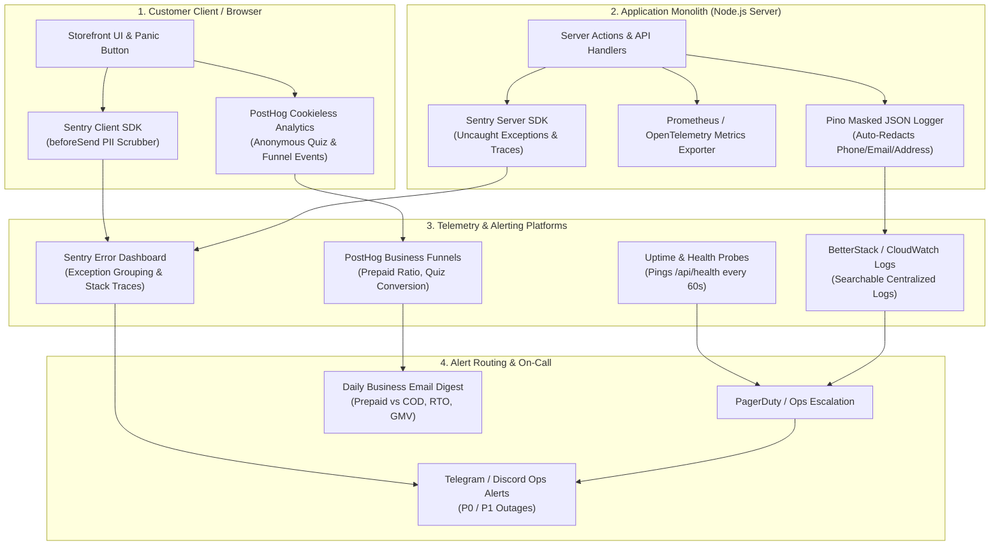
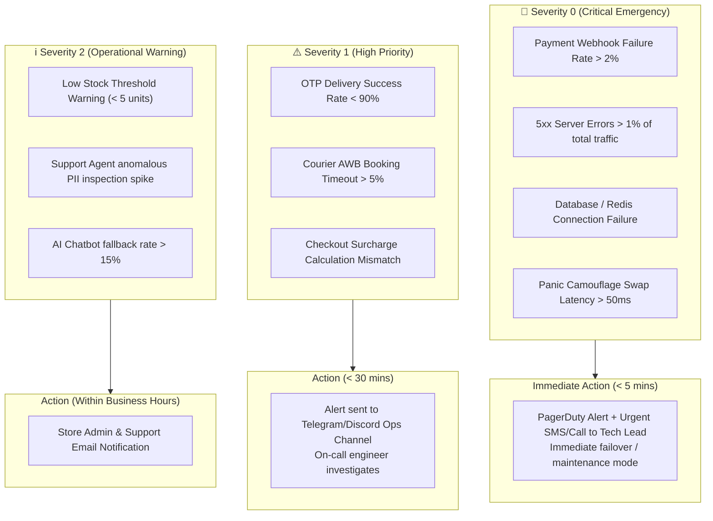

# 📊 Document 14: Monitoring & Logging

**Project Name:** Aura Retail & Lifestyle (Discreet Adult Wellness & Intimate Care E-Commerce Marketplace)  
**Document Status:** Confirmed / Approved by User (Green Light on 2026-11-09)  
**Version:** 1.0.0  
**Date:** 2026-11-09  
**Author / Partner:** Planning & Technical Documentation Partner  

---

## 1. Purpose

Yeh document platform ke **Observability Architecture, Application Metrics, Masked Structured Logging, Incident Alerting, aur Operational Ownership** ko define karta hai. Sexual wellness e-commerce mein traditional monitoring se aage badhkar **Privacy-Aware Observability** implement karna hota hai: system health aur payment funnels ko 24/7 track karna zaroori hai, lekin log streams ya error tracking tools (Sentry/Datadog) mein customer ki intimate browsing history ya contact details leak hona strictly zero-tolerance violation hai.

---

## 2. Existing Approved Context Used

Yeh observability blueprint sabhi approved foundational documents par based hai:
* [`docs/01_Master_Planning.md`](file:///c:/Users/20092/OneDrive/Desktop/Dev/Projects/Active/Black%20Dot%20ecosystem/eoc_system%20Products/ecomerce%20website%20{wellness%20toys}/docs/01_Master_Planning.md) *(Approved)*: KPIs (Prepaid > 80%, COD RTO < 8%, AOV ₹2,500+), brand neutrality promise.
* [`docs/02_Architecture.md`](file:///c:/Users/20092/OneDrive/Desktop/Dev/Projects/Active/Black%20Dot%20ecosystem/eoc_system%20Products/ecomerce%20website%20{wellness%20toys}/docs/02_Architecture.md) *(Approved)*: 30-min stock reservation lock, zero-network camouflage engine.
* [`docs/04_Database_Design.md`](file:///c:/Users/20092/OneDrive/Desktop/Dev/Projects/Active/Black%20Dot%20ecosystem/eoc_system%20Products/ecomerce%20website%20{wellness%20toys}/docs/04_Database_Design.md) *(Approved)*: `StaffAuditLog` tracking internal PII inspections.
* [`docs/06_Security_Plan.md`](file:///c:/Users/20092/OneDrive/Desktop/Dev/Projects/Active/Black%20Dot%20ecosystem/eoc_system%20Products/ecomerce%20website%20{wellness%20toys}/docs/06_Security_Plan.md) *(Approved)*: SIRT incident response protocol, rate limit logging.
* [`docs/07_Third_Party_Services_and_Integrations.md`](file:///c:/Users/20092/OneDrive/Desktop/Dev/Projects/Active/Black%20Dot%20ecosystem/eoc_system%20Products/ecomerce%20website%20{wellness%20toys}/docs/07_Third_Party_Services_and_Integrations.md) *(Approved)*: Payment/courier webhook idempotency tracking.
* [`docs/08_Folder_Structure_and_Coding_Standards.md`](file:///c:/Users/20092/OneDrive/Desktop/Dev/Projects/Active/Black%20Dot%20ecosystem/eoc_system%20Products/ecomerce%20website%20{wellness%20toys}/docs/08_Folder_Structure_and_Coding_Standards.md) *(Approved)*: Masked Pino JSON logger (`src/lib/logger.ts`).
* [`docs/11_Performance_and_Scalability.md`](file:///c:/Users/20092/OneDrive/Desktop/Dev/Projects/Active/Black%20Dot%20ecosystem/eoc_system%20Products/ecomerce%20website%20{wellness%20toys}/docs/11_Performance_and_Scalability.md) *(Approved)*: Panic button < 10ms latency SLA, PgBouncer pool saturation.
* [`docs/13_Deployment_and_DevOps_Plan.md`](file:///c:/Users/20092/OneDrive/Desktop/Dev/Projects/Active/Black%20Dot%20ecosystem/eoc_system%20Products/ecomerce%20website%20{wellness%20toys}/docs/13_Deployment_and_DevOps_Plan.md) *(Approved)*: `/api/health` probe, container cluster architecture.

---

## 3. Decisions Table

| Decision ID | Observability Domain | Selected Decision | Status | Key Reason | Alternatives Considered |
| :--- | :--- | :--- | :--- | :--- | :--- |
| **MON-DEC-01** | **Error Tracking Platform** | **Sentry (with Strict Server & Client PII Scrubber)** | **Proposed** | Real-time exception capture, release tracking, breadcrumbs, and Next.js App Router support with built-in data scrubbing hooks. | Rollbar, Bugsnag, Custom error DB logging |
| **MON-DEC-02** | **Centralized Log Aggregator** | **BetterStack Logs (or AWS CloudWatch Logs)** | **Proposed** | High-throughput structured JSON log ingestion, fast live tailing, 30-day retention, and automated PII masking compliance. | Datadog (extremely expensive for early-stage), Self-hosted ELK (high maintenance) |
| **MON-DEC-03** | **Zero-PII Error Scrubbing** | **Mandatory `beforeSend` Sanitization Hook** | **Proposed** | Intercepts all outgoing Sentry error events to strip cookies, IP addresses, customer phone numbers, and delivery addresses. | Relying on default Sentry filters (often leaks query params) |
| **MON-DEC-04** | **Business Telemetry Pipeline** | **Internal PostgreSQL Aggregations + PostHog (Cookieless EU/Cloud)** | **Proposed** | Tracks critical business conversion funnels (Quiz to Cart, Prepaid vs COD ratio) without sharing intimate buyer profiles with Google/Meta ad trackers. | Google Analytics 4 (Google ad profiling risks customer privacy) |
| **MON-DEC-05** | **On-Call Alerting Escalation** | **PagerDuty / BetterStack Uptime linked to Discord/Telegram & SMS** | **Proposed** | Multi-channel alert escalation ensuring P0 payment/checkout failures alert the engineering lead in < 2 minutes 24/7. | Email-only alerting (too slow for active checkout outages) |

---

## 4. Observability Architecture Overview



---

## 5. Metrics Framework (Golden Signals & Business KPIs)

### A. The 4 Golden Signals (SRE Standards)
1. **Latency:**
   * Storefront SSR LCP: `< 1.8s` (Target p95: `< 2.2s`).
   * Checkout API Response: `< 400ms` (Target p95: `< 600ms`).
   * Panic Camouflage Swap: `< 10ms` (Client-side custom performance mark).
2. **Traffic:**
   * Active HTTP Requests Per Second (RPS).
   * Active concurrent users (CCU) browsing catalog and taking the Toy Finder Quiz.
3. **Errors:**
   * HTTP 5xx Server Error Rate: `< 0.05%` of total traffic.
   * Payment Gateway Webhook Failure Rate: `< 0.1%`.
4. **Saturation:**
   * PgBouncer Connection Pool Saturation: `< 75%` utilized.
   * Redis Memory Usage: `< 70%` allocated capacity.
   * Node.js Container CPU / Memory: `< 70%` average.

### B. E-Commerce & Privacy Business Metrics
* **Prepaid Payment Ratio:** Target `> 80%` (Monitored in real-time; drops below 75% trigger marketing review).
* **COD Return-to-Origin (RTO) Rate:** Target `< 8%` (Tracked weekly via courier delivery webhooks).
* **30-Minute Reservation Hold Expiry Rate:** Percentage of carts where stock hold expired unpaid (identifies checkout drop-off friction).
* **Toy Finder Quiz Completion & Conversion:** Funnel step analysis from Quiz Start ➔ Completion ➔ 1-Click Add-to-Cart.
* **Staff PII Access Frequency:** Monitored via `StaffAuditLog` (Alerts triggered if a single support agent views >30 customer addresses in an hour).

---

## 6. Structured Logging & PII Redaction Protocol

Logs are output in machine-readable JSON format with correlation/request IDs:

```json
{
  "level": "info",
  "time": 1731154800000,
  "pid": 12,
  "hostname": "aura-app-prod-7f89b",
  "reqId": "req_01hq88a91z4",
  "module": "checkout",
  "event": "ORDER_CONFIRMED",
  "orderNumber": "AURA-20261109-8812",
  "totalAmountPaise": 237405,
  "paymentMethod": "PREPAID_UPI",
  "billingDescriptor": "Aura Retail & Lifestyle",
  "customerPhone": "+91 98*****210",
  "shippingAddress": "[CONFIDENTIAL_PII_REDACTED]"
}
```

### Mandatory Redaction Rules:
1. `customerPhone`: Masked to show only country code and last 3 digits (`+91 98*****210`).
2. `customerEmail`: Masked (`c****r@gmail.com`).
3. `shippingAddress` & `fullName`: Completely redacted (`[CONFIDENTIAL_PII]`).
4. `videoStorageUri`: Video file S3 keys are masked in general application logs.
5. `passwords`, `otp`, `authTokens`: Strictly filtered at the Pino logger stream level.

---

## 7. Error Tracking & Sentry Data Sanitization

Sentry configuration ensures that no customer PII reaches external error tracking servers:

```typescript
// sentry.client.config.ts & sentry.server.config.ts
import * as Sentry from '@sentry/nextjs';

Sentry.init({
  dsn: process.env.NEXT_PUBLIC_SENTRY_DSN,
  environment: process.env.NODE_ENV,
  tracesSampleRate: 0.1, // Sample 10% of transactions for performance
  beforeSend(event) {
    // 1. Strip sensitive request headers
    if (event.request?.headers) {
      delete event.request.headers['cookie'];
      delete event.request.headers['authorization'];
      delete event.request.headers['x-forwarded-for'];
    }

    // 2. Redact IP Address & User PII
    if (event.user) {
      delete event.user.ip_address;
      delete event.user.email;
      delete event.user.username;
    }

    // 3. Scrub sensitive query parameters
    if (event.request?.url) {
      const url = new URL(event.request.url);
      url.searchParams.delete('phone');
      url.searchParams.delete('token');
      url.searchParams.delete('otp');
      event.request.url = url.toString();
    }

    return event;
  }
});
```

---

## 8. Alerting Matrix & On-Call Escalation Matrix



---

## 9. Operational Ownership & Log Retention

| Telemetry Data | Retention Period | Storage Location | Operational Owner | Compliance Standard |
| :--- | :--- | :--- | :--- | :--- |
| **Application Debug Logs** | 7 Days | BetterStack / CloudWatch | Engineering Lead | Storage optimization |
| **Application Error Logs** | 30 Days | BetterStack & Sentry | On-Call Engineer | Bug triage |
| **Staff Audit Logs (`StaffAuditLog`)** | 1 Year | PostgreSQL (Encrypted) | Security & Platform Owner | DPDP Act Audit |
| **Financial & Tax Ledgers** | 7 Years | PostgreSQL (Immutable) | Finance & Executive Admin | Indian Companies / GST Act |
| **Customer Unboxing Videos** | 90 Days post-resolution | Cloudflare R2 | Customer Support Lead | Auto-deleted after 90 days |

---

## 10. Open Questions, Risks & Assumptions

### Open Questions (Observability)
* [ ] **MON-OQ-01 (Log Provider Selection):** Centralized logging ke liye **BetterStack Logs** (developer-friendly, affordable) use karein ya native **AWS CloudWatch Logs**? *(Proposed: BetterStack Logs for modern UI, live tailing, and instant Slack/Telegram alerting).*
* [ ] **MON-OQ-02 (RUM Privacy Impact):** Real User Monitoring (RUM) mein session replay (e.g. Sentry Session Replay) enable karein ya completely disable rakhein? *(Proposed: Completely disable session replay on customer-facing storefront to eliminate any chance of recording sensitive user browsing actions; enable only on Admin dashboard).*

---

## 11. Related Documents / Dependencies

Is Monitoring & Logging document ke approve hone ke baad final document sequence:
* `Document 15: API Design` *(Final technical specification in the series)*

---

## 12. Sources & Technical References

1. **Google Site Reliability Engineering (SRE) Book (Monitoring Distributed Systems):** https://sre.google/sre-book/monitoring-distributed-systems/ (Accessed: 2026-11).
2. **Sentry Best Practices for Sensitive Data Scrubbing:** https://docs.sentry.io/platforms/javascript/guides/nextjs/data-management/sensitive-data/ (Accessed: 2026-11).
3. **OpenTelemetry Logging & Tracing Standards:** https://opentelemetry.io/docs/ (Accessed: 2026-11).

---

## 13. Review Checklist (Aapke Approval ke Liye Key Points)

Kripya is Monitoring & Logging blueprint ko review karein aur green light ya feedback dein:

- [ ] **1. Observability Stack:** Kya **Sentry** (Error tracking with PII scrubbing), **BetterStack Logs** (Structured logging), aur **PostHog Cookieless** (Business analytics) approved hain?
- [ ] **2. Zero-PII Logging Standard:** Kya customer phone, email, address, aur video URIs ko production logs aur Sentry payloads se mask karne ka rule approved hai?
- [ ] **3. P0 Severity Triggers:** Kya payment webhook failure (>2%), 5xx errors (>1%), aur panic button latency degradation par instant PagerDuty alert approved hai?
- [ ] **4. Business Metrics:** Kya Prepaid ratio (>80%), COD RTO (<8%), aur 30-min hold expiry tracking targets approved hain?
- [ ] **5. Session Replay Ban:** Kya customer storefront par privacy protect karne ke liye session replays ko permanently disable rakhne ka decision approved hai?
