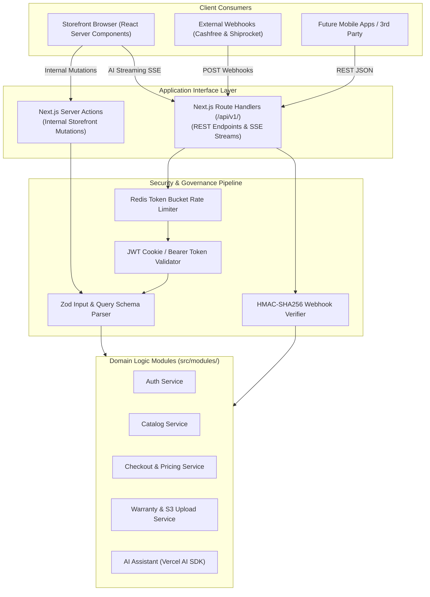
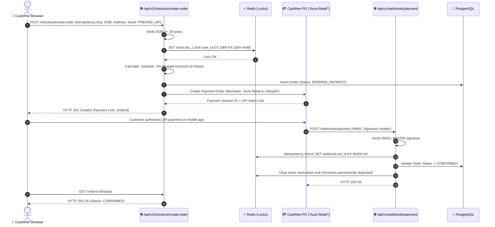

# 🌐 Document 15: API Design

**Project Name:** Aura Retail & Lifestyle (Discreet Adult Wellness & Intimate Care E-Commerce Marketplace)  
**Document Status:** Confirmed / Approved by User (Green Light on 2026-11-09)  
**Version:** 1.0.0  
**Date:** 2026-11-09  
**Author / Partner:** Planning & Technical Documentation Partner  

---

## 1. Purpose

Yeh document platform ka **Complete API Architecture & Interface Design Specification** hai. Iska maqsad REST vs GraphQL ke architectural decision, `/api/v1` versioning policy, standardized JSON request/response envelopes, error contracts, authentication expectations, rate-limiting principles, aur approved V1 feature endpoints ko formalize karna hai. Yeh API design frontend-backend communication, third-party webhooks, aur future mobile applications ke liye unified contract serve karta hai.

---

## 2. Existing Approved Context Used

Yeh API specification sabhi pehle ke approved documents par strictly based hai:
* [`docs/01_Master_Planning.md`](file:///c:/Users/20092/OneDrive/Desktop/Dev/Projects/Active/Black%20Dot%20ecosystem/eoc_system%20Products/ecomerce%20website%20{wellness%20toys}/docs/01_Master_Planning.md) *(Approved)*: V1 MVP feature boundaries, anti-RTO rules, neutral descriptor guarantee.
* [`docs/02_Architecture.md`](file:///c:/Users/20092/OneDrive/Desktop/Dev/Projects/Active/Black%20Dot%20ecosystem/eoc_system%20Products/ecomerce%20website%20{wellness%20toys}/docs/02_Architecture.md) *(Approved)*: Modular monolith, 30-min stock hold engine, pre-signed video uploads.
* [`docs/03_Tech_Stack.md`](file:///c:/Users/20092/OneDrive/Desktop/Dev/Projects/Active/Black%20Dot%20ecosystem/eoc_system%20Products/ecomerce%20website%20{wellness%20toys}/docs/03_Tech_Stack.md) *(Approved)*: TypeScript 5, Next.js 15 App Router, Zod validation, Vercel AI SDK.
* [`docs/04_Database_Design.md`](file:///c:/Users/20092/OneDrive/Desktop/Dev/Projects/Active/Black%20Dot%20ecosystem/eoc_system%20Products/ecomerce%20website%20{wellness%20toys}/docs/04_Database_Design.md) *(Approved)*: Currency in paise, database 18+ check constraint, optimistic inventory locking.
* [`docs/05_Authentication_and_Authorization.md`](file:///c:/Users/20092/OneDrive/Desktop/Dev/Projects/Active/Black%20Dot%20ecosystem/eoc_system%20Products/ecomerce%20website%20{wellness%20toys}/docs/05_Authentication_and_Authorization.md) *(Approved)*: Passwordless OTP authentication, HttpOnly JWT cookies, RBAC hierarchy.
* [`docs/06_Security_Plan.md`](file:///c:/Users/20092/OneDrive/Desktop/Dev/Projects/Active/Black%20Dot%20ecosystem/eoc_system%20Products/ecomerce%20website%20{wellness%20toys}/docs/06_Security_Plan.md) *(Approved)*: HMAC-SHA256 signature verification, AES-256 PII encryption, zero PCI scope.
* [`docs/07_Third_Party_Services_and_Integrations.md`](file:///c:/Users/20092/OneDrive/Desktop/Dev/Projects/Active/Black%20Dot%20ecosystem/eoc_system%20Products/ecomerce%20website%20{wellness%20toys}/docs/07_Third_Party_Services_and_Integrations.md) *(Approved)*: Cashfree/PhonePe PG, Shiprocket, MSG91, Resend, Cloudflare R2.
* [`docs/08_Folder_Structure_and_Coding_Standards.md`](file:///c:/Users/20092/OneDrive/Desktop/Dev/Projects/Active/Black%20Dot%20ecosystem/eoc_system%20Products/ecomerce%20website%20{wellness%20toys}/docs/08_Folder_Structure_and_Coding_Standards.md) *(Approved)*: Service encapsulation, structured error hierarchy.

---

## 3. Decisions Table

| Decision ID | API Domain | Selected Decision | Status | Key Reason | Alternatives Considered |
| :--- | :--- | :--- | :--- | :--- | :--- |
| **API-DEC-01** | **API Architecture Paradigm** | **Hybrid Architecture: Server Actions (Internal UI) + REST `/api/v1/` (Webhooks & External APIs)** | **Proposed** | Server Actions eliminate API boilerplate for internal storefront mutations with full type safety; REST `/api/v1/` provides standard HTTP endpoints for webhooks, streaming AI, and future mobile clients. | 100% REST endpoints for everything, GraphQL (complex schema/caching overhead for V1) |
| **API-DEC-02** | **API Versioning Strategy** | **URI Path Versioning (`/api/v1/...`)** | **Proposed** | Explicit, human-readable, easily routable at Cloudflare edge, and completely prevents breaking changes when updating future API iterations. | Header-based versioning (`Accept-Version`), Query parameter versioning |
| **API-DEC-03** | **Payload Envelope Standard** | **JSend / RFC 7807 Inspired Uniform JSON Envelope** | **Proposed** | Predictable format across all endpoints with standard `success`, `data`, `error`, and `meta` fields, simplifying frontend error handling. | Inconsistent raw JSON objects |
| **API-DEC-04** | **Financial Mutation Idempotency** | **Mandatory `Idempotency-Key` Header for Order & Webhook Mutations** | **Proposed** | Prevents duplicate payment captures, double-charging, or duplicate order placement during mobile network retries. | Relying on database unique constraints alone |
| **API-DEC-05** | **AI Streaming Protocol** | **Server-Sent Events (SSE) via Next.js Route Handlers** | **Proposed** | Native text streaming for the 24/7 AI Wellness Assistant (`useChat` hook), minimizing Time-to-First-Token (TTFT < 400ms). | WebSockets (requires stateful socket server), Long-polling |

---

## 4. API Architectural Overview



---

## 5. Standardized Request & Response Envelopes

### A. Standard Success Response Format (`200 OK`, `201 Created`)
```json
{
  "success": true,
  "data": {
    "orderNumber": "AURA-20261109-8812",
    "status": "CONFIRMED",
    "totalAmountPaise": 237405,
    "paymentMethod": "PREPAID_UPI",
    "billingDescriptor": "Aura Retail & Lifestyle"
  },
  "meta": {
    "timestamp": "2026-11-09T16:58:00.000Z",
    "requestId": "req_01hq88a91z4"
  }
}
```

### B. Standard Error Response Format (RFC 7807 Inspired)
Har error response machine-readable `code`, user-safe `message`, validation `details`, aur debugging `requestId` return karega:

```json
{
  "success": false,
  "error": {
    "code": "AGE_RESTRICTION_FAILED",
    "message": "Customer must be 18 years or older to purchase intimate wellness products.",
    "statusCode": 403,
    "details": [
      {
        "field": "dateOfBirth",
        "issue": "Age calculated as 16 years. Minimum required age is 18."
      }
    ],
    "requestId": "req_01hq88a91z4"
  }
}
```

---

## 6. HTTP Status Code Taxonomy

| Status Code | Meaning in Platform Context | Example Trigger Scenario |
| :--- | :--- | :--- |
| **`200 OK`** | Standard successful GET request or state query | Fetching product catalog, order status |
| **`201 Created`** | New resource successfully created | Order created, warranty claim registered |
| **`204 No Content`** | Action succeeded with no body returned | User logged out, local privacy cache cleared |
| **`400 Bad Request`** | Malformed JSON or invalid parameters | Missing required query parameter |
| **`401 Unauthorized`** | Missing or expired authentication token | Accessing account dashboard without active session |
| **`403 Forbidden`** | Authenticated user lacks permission OR Under-18 DOB | Under-18 customer blocked, non-admin accessing `/admin` |
| **`404 Not Found`** | Resource does not exist | Product slug not found in active catalog |
| **`409 Conflict`** | Resource state conflict / concurrency lock | Item out of stock, 30-min hold already taken by another user |
| **`422 Unprocessable`** | Zod input schema validation failure | Invalid 6-digit Indian PIN code format, invalid phone number |
| **`429 Too Many Requests`** | Rate limit threshold exceeded | >3 OTP requests in 10 minutes, chatbot flooding |
| **`500 Internal Error`** | Unhandled server exception (Masked details) | Database crash, unexpected unhandled promise rejection |

---

## 7. Authentication & Rate-Limiting Headers

1. **Authentication:**
   * **Web Clients:** Authenticated automatically via `HttpOnly`, `Secure` cookie (`aura_session`).
   * **External / Mobile Clients:** Authenticated via standard `Authorization: Bearer <jwt_token>` header.
2. **Rate-Limiting Response Headers:**
   ```http
   X-RateLimit-Limit: 120
   X-RateLimit-Remaining: 114
   X-RateLimit-Reset: 1731154860
   ```
3. **Idempotency Header:**
   * Financial mutations (`POST /api/v1/checkout/create-order`) accept `Idempotency-Key: <uuidv7>`. Redis stores the key for 24 hours (`TTL = 86400s`) to prevent duplicate processing.

---

## 8. Approved V1 Feature Endpoints Specification

### A. Authentication & Age Verification
* `POST /api/v1/auth/otp/send`
  * **Purpose:** Dispatches 6-digit verification OTP via WhatsApp/SMS.
  * **Payload:** `{ phone: "+919876543210", dateOfBirth: "2000-05-15" }`
  * **Rate Limit:** 3 requests / 10 minutes per IP/Phone.
* `POST /api/v1/auth/otp/verify`
  * **Purpose:** Validates OTP, creates/logs-in user, and sets `aura_session` cookie.
  * **Payload:** `{ phone: "+919876543210", otp: "491823" }`
* `POST /api/v1/auth/logout`
  * **Purpose:** Invalidates session in Redis blacklist and clears cookie.

---

### B. Curated Catalog & Medical Badges
* `GET /api/v1/catalog/products`
  * **Query Params:** `category`, `material`, `noiseLevel`, `waterproof`, `page`, `limit`.
  * **Response:** Array of products with verified medical badges and price in paise.
* `GET /api/v1/catalog/products/:slug`
  * **Purpose:** Complete PDP details including battery runtime, care guide, anatomical suitability, and companion lubricant recommendations.

---

### C. Cart & 30-Minute Stock Reservation
* `POST /api/v1/cart/reserve`
  * **Purpose:** Locks cart items in Redis for 30 minutes (`TTL = 1800s`).
  * **Payload:** `{ items: [{ variantId: "var_123", quantity: 1 }] }`
  * **Response Status:** `200 OK` (Lock acquired) or `409 Conflict` (Stock unavailable).
* `POST /api/v1/cart/release`
  * **Purpose:** Manually releases reserved stock back to public catalog if user empties cart.

---

### D. Anti-RTO Checkout & Payment Flow
* `POST /api/v1/checkout/create-order`
  * **Headers:** `Idempotency-Key: <uuidv7>`
  * **Payload:**
    ```json
    {
      "addressId": "addr_987",
      "paymentMode": "PREPAID_UPI",
      "dateOfBirth": "1998-04-12"
    }
    ```
  * **Logic Enforced:**
    * If `PREPAID_UPI`: Applies 5% discount (capped at ₹150) ➔ generates Cashfree session under **"Aura Retail & Lifestyle"**.
    * If `COD`: Applies flat ₹50 surcharge (5000 paise) ➔ verifies checkout OTP.

---

### E. External Webhook Endpoints
* `POST /api/v1/webhooks/payment`
  * **Security:** Verifies `X-Webhook-Signature` via HMAC-SHA256 (`CASHFREE_WEBHOOK_SECRET`).
  * **Payload:** Cashfree payment captured event.
  * **Action:** Transitions order to `CONFIRMED`, deducts persistent PostgreSQL inventory, clears Redis lock.
* `POST /api/v1/webhooks/courier`
  * **Security:** Verifies `X-Shiprocket-Token`.
  * **Action:** Updates shipment tracking (`MANIFESTED`, `OUT_FOR_DELIVERY`, `DELIVERED`, `RTO`).
  * **Special Rule:** `DELIVERED` status timestamp officially starts the **24-Hour DOA Defect Claim Window**.

---

### F. 24-Hour DOA Defect Claim & Video Storage
* `POST /api/v1/warranty/presigned-upload`
  * **Purpose:** Generates a secure Pre-Signed PUT URL for direct unboxing video upload (<50MB).
  * **Constraint:** Validates delivery timestamp `Shipment.deliveredAt <= now - 24 hours` (BR-11).
* `POST /api/v1/warranty/claims`
  * **Payload:** `{ orderId: "ord_1", variantId: "var_1", videoUri: "r2://...", defectNotes: "Motor dead" }`
  * **Status:** Created with state `PENDING_HUMAN_REVIEW`.

---

### G. AI Wellness Assistant (Server-Sent Events)
* `POST /api/v1/ai/chat`
  * **Format:** Server-Sent Events (SSE) streaming.
  * **Payload:** `{ messages: [{ role: "user", content: "Is medical grade silicone hypoallergenic?" }] }`
  * **Guardrails:** Automatically injects bold medical disclaimer on health queries; streams responses via Vercel AI SDK.

---

## 9. End-to-End API Interaction Sequence

Is sequence diagram mein complete Anti-RTO checkout, stock reservation, payment verification, aur neutral webhook capture ka API flow depict kiya gaya hai:



---

## 10. Open Questions, Risks & Assumptions

### Open Questions (API Design)
* [ ] **API-OQ-01 (Public API Documentation):** Kya back-office developers aur external integration partners ke liye automated Swagger / OpenAPI v3 documentation generate karein using `@asteasolutions/zod-to-openapi`? *(Proposed: Yes, automatically generate OpenAPI spec from Zod schemas).*
* [ ] **API-OQ-02 (API Deprecation Header):** Future breaking API updates ke liye kya RFC 8594 standard `Sunset` and `Deprecation` headers implement karein? *(Proposed: Yes, standard RFC 8594 headers).*

---

## 11. Related Documents / Dependencies

Yeh document 15-part technical documentation series ka **Final Document** hai. Iske approve hone ke baad complete approved documentation suite ready ho jata hai:
* `Document 01: Master Planning` ✅
* `Document 02: Architecture` ✅
* `Document 03: Tech Stack` ✅
* `Document 04: Database Design` ✅
* `Document 05: Authentication & Authorization` ✅
* `Document 06: Security Plan` ✅
* `Document 07: Third-party Services & Integrations` ✅
* `Document 08: Folder Structure & Coding Standards` ✅
* `Document 09: Environments` ✅
* `Document 10: Git & Version Control Strategy` ✅
* `Document 11: Performance & Scalability` ✅
* `Document 12: Testing Strategy` ✅
* `Document 13: Deployment & DevOps Plan` ✅
* `Document 14: Monitoring & Logging` ✅
* `Document 15: API Design` *(Current - In Review)*

---

## 12. Sources & Technical References

1. **JSend Specification for JSON API Responses:** https://github.com/labs-community/jsend (Accessed: 2026-11).
2. **RFC 7807 (Problem Details for HTTP APIs):** https://datatracker.ietf.org/doc/html/rfc7807 (Accessed: 2026-11).
3. **IETF RFC 8594 (Sunset and Deprecation HTTP Headers):** https://datatracker.ietf.org/doc/html/rfc8594 (Accessed: 2026-11).
4. **Vercel AI SDK Core Guide (Server-Sent Events Streaming):** https://sdk.vercel.ai/docs (Accessed: 2026-11).

---

## 13. Review Checklist (Aapke Approval ke Liye Key Points)

Kripya is API Design blueprint ko review karein aur green light ya feedback dein:

- [ ] **1. Hybrid API Style:** Kya internal storefront mutations ke liye Server Actions aur webhooks/external clients ke liye REST `/api/v1/` approved hai?
- [ ] **2. Standard JSON Envelopes:** Kya JSend/RFC-7807 inspired uniform `{ success, data, error, meta }` response envelope approved hai?
- [ ] **3. Currency in Paise & Idempotency:** Kya sabhi monetary parameters paise (integers) mein aur financial mutations par `Idempotency-Key` requirement approved hai?
- [ ] **4. V1 Feature Endpoints:** Kya Auth (OTP), Catalog, Cart (30m hold), Checkout (Prepaid/₹50 COD), Webhooks, 24-hr Warranty, aur AI Streaming endpoints approved hain?
- [ ] **5. Neutral Descriptor Endpoints:** Kya sabhi payment aur logistics API payloads mein neutral branding (`"Aura Retail & Lifestyle"` / `"Personal Grooming & Wellness Kits"`) enforcement approved hai?
