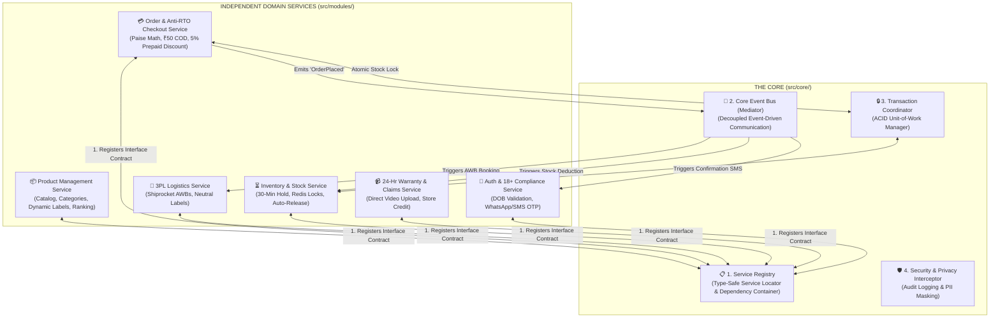
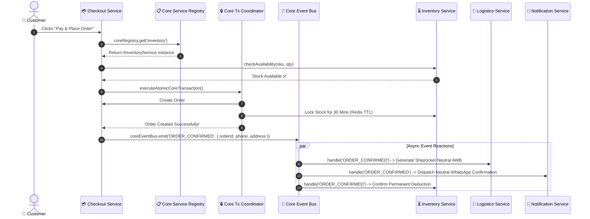

# 🔌 Document 16: Core & Service Integration Specification

**Project Name:** Aura Retail & Lifestyle (Discreet Adult Wellness & Intimate Care E-Commerce Marketplace)  
**Document Status:** Confirmed / Approved  
**Version:** 1.0.0  
**Date:** 2026-11-10  
**Author / Partner:** Planning & Technical Documentation Partner  

---

## 1. Purpose

Yeh document platform ke **Core Engine aur Usse Connect Hone Wali Sabhi Independent Services ke Integration Mechanism** ko define karta hai. 

Aapki requirement ke mutabiq:
1. Sabhi domain services (Product Management, Inventory, Checkout, Logistics, Warranty, Auth) independent aur isolated units ke roop mein build hongi.
2. Har service ke sath automated tests rahenge taaki zero manual testing karni pade.
3. Yeh document specifically define karta hai ki **"Services Core ke sath kaise connect hongi, kaunsa communication pattern use hoga, aur end mein sabhi services aapas mein kaise seamlessly interact karengi."**

---

## 2. Integration Approach: The Mediator + Service Registry Pattern

Services ko Core se connect karne ke liye hum **In-Process Mediator & Service Registry Pattern** (Clean Architecture / Hexagonal Ports) follow karte hain.



### Approach ke 3 Golden Rules:
1. **No Direct Module-to-Module Imports:** `checkout.service.ts` kabhi bhi `import { inventoryService } from '../inventory'` nahi karega. Woh **Core Service Registry** se contract request karega: `core.services.get('inventory')`.
2. **Synchronous Queries vs Asynchronous Events:**
   - **Queries (Data mangna):** Service Registry ke zariye type-safe interfaces call honge (e.g. "Kya SKU-101 stock mein hai?").
   - **Mutations (State change hona):** Core Event Bus ke zariye decoupled events emit honge (e.g. `OrderConfirmedEvent` emit hua ➔ Inventory ne stock deduct kiya, Logistics ne AWB banayi, SMS ne neutral alert bheja).
3. **Pluggable & Independently Testable:** Har service ko akele test kiya ja sakta hai ek **Mock Core** provide karke, bina doosri services ko chalaye.

---

## 3. Core Engine ke 4 Pillars (Kaise Connect Hoga?)

### Pillar 1: Service Contract (The Port / Interface)
Har service ka ek strict TypeScript Interface define hota hai. Example:

```typescript
// src/core/contracts/inventory.contract.ts
export interface IInventoryService {
  checkAvailability(sku: string, quantity: number): Promise<boolean>;
  reserveStock(orderId: string, sku: string, quantity: number, ttlSeconds: number): Promise<ReservationResult>;
  releaseStock(orderId: string, sku: string): Promise<void>;
  deductStockPermanently(orderId: string): Promise<void>;
}
```

---

### Pillar 2: Core Service Registry (Registration & Lookup)
Jab application start hoti hai ya test environment initialise hota hai, har service apne aap ko Core ke paas register karti hai:

```typescript
// src/core/registry.ts
export class CoreServiceRegistry {
  private services = new Map<string, any>();

  register<T>(name: string, serviceInstance: T): void {
    this.services.set(name, serviceInstance);
  }

  get<T>(name: string): T {
    const service = this.services.get(name);
    if (!service) {
      throw new Error(`[Core Error]: Service '${name}' is not registered with Core.`);
    }
    return service as T;
  }
}

export const coreRegistry = new CoreServiceRegistry();
```

---

### Pillar 3: Core Event Bus (Asynchronous Decoupling)
Services ko aapas mein bina tight-coupling ke interact karwane ke liye Core Event Bus kaam karta hai:

```typescript
// src/core/events/event-bus.ts
type EventHandler<T = any> = (payload: T) => Promise<void>;

export class CoreEventBus {
  private handlers = new Map<string, EventHandler[]>();

  on<T>(eventName: string, handler: EventHandler<T>): void {
    const existing = this.handlers.get(eventName) || [];
    this.handlers.set(eventName, [...existing, handler]);
  }

  async emit<T>(eventName: string, payload: T): Promise<void> {
    const existing = this.handlers.get(eventName) || [];
    // Har handler parallel aur safe execution karega with error boundary
    await Promise.all(
      existing.map(async (fn) => {
        try {
          await fn(payload);
        } catch (err) {
          logger.error({ err, eventName }, '[Event Bus Error]: Event listener failed');
        }
      })
    );
  }
}

export const coreEventBus = new CoreEventBus();
```

---

### Pillar 4: Transaction Coordinator (Unit of Work)
Jab ek transaction mein multiple services shamil hon (e.g. Order banana + Stock hold lock karna), toh **Core Transaction Coordinator** ensure karta hai ki ya toh dono succeed hon, ya dono rollback ho jayein:

```typescript
// src/core/transaction-coordinator.ts
export async function executeAtomicCoreTransaction<T>(
  work: (tx: PrismaClient) => Promise<T>
): Promise<T> {
  return await prisma.$transaction(async (tx) => {
    return await work(tx);
  });
}
```

---

## 4. Practical Example: Product Management Service Core Se Kaise Connect Hoti Hai?

Aapne jo example diya tha—ki Product Management Service catalog ko manage karegi (categories, "NEW" labels, "BEST SELLER" badges, aur manual ranking control):

### Step A: Product Service Interface & Implementation
```typescript
// src/modules/catalog/product-management.service.ts
import { IProductManagementService, ProductFilter, ProductWithBadges } from '@/core/contracts/product.contract';
import { coreRegistry } from '@/core/registry';
import { coreEventBus } from '@/core/events/event-bus';

export class ProductManagementService implements IProductManagementService {
  
  // 1. Products List with Dynamic & Manual Labels
  async getProducts(filter: ProductFilter): Promise<ProductWithBadges[]> {
    const rawProducts = await prisma.product.findMany({
      where: { isActive: true },
      include: { variants: true, category: true }
    });

    return rawProducts.map((product) => {
      // Data-Driven Rules
      const isNew = differenceInDays(new Date(), product.createdAt) <= 7;
      const isBestSeller = product.salesCount > 100;
      
      // Manual Override (Admin Custom Tag)
      const displayLabel = product.manualLabelOverride 
        ? product.manualLabelOverride // e.g. "Editor's Pick"
        : isNew ? 'NEW' : isBestSeller ? 'BEST SELLER' : null;

      return {
        ...product,
        badge: displayLabel,
        rankingWeight: product.customRankWeight || 0
      };
    }).sort((a, b) => b.rankingWeight - a.rankingWeight); // High rank products top par
  }

  // 2. Admin Manual Override Action
  async setProductManualLabel(productId: string, label: string): Promise<void> {
    await prisma.product.update({
      where: { id: productId },
      data: { manualLabelOverride: label }
    });

    // Core Event emit karta hai taaki Cache aur Edge invalidate ho sake
    await coreEventBus.emit('PRODUCT_UPDATED', { productId, label });
  }
}

// Service ko Core Registry mein register karte hain
export const productManagementService = new ProductManagementService();
coreRegistry.register('productManagement', productManagementService);
```

---

## 5. End-to-End Flow: Order Confirmation & Multi-Service Orchestration

Jab customer order place karta hai, toh Core ke zariye sabhi services kaise smoothly sync hoti hain:



---

## 6. Automatic Testing Strategy: Zero Manual Testing

Aapko testing manually nahi karni padegi. Har service ke sath uska automated test suite rahega jo **Mock Core** ke sath standalone execute hoga:

```
Testing Pipeline Structure:
├── src/modules/catalog/tests/
│   ├── product-labels.test.ts      <-- Verifies "NEW" label & Manual Overrides
│   └── ranking-weights.test.ts     <-- Verifies that custom weight products appear on top
├── src/modules/checkout/tests/
│   ├── paise-pricing.test.ts       <-- Verifies 5% prepaid discount & ₹50 COD fee
│   └── idempotency.test.ts         <-- Verifies duplicate order prevention
└── src/core/tests/
    ├── event-bus.test.ts           <-- Verifies all service event listeners respond
    └── service-registry.test.ts    <-- Verifies zero missing service contracts
```

### Automated Test Example (Vitest):
```typescript
// src/modules/catalog/tests/product-labels.test.ts
import { describe, it, expect } from 'vitest';
import { ProductManagementService } from '../product-management.service';

describe('Product Management Service: Label & Ranking Engine', () => {
  const service = new ProductManagementService();

  it('should apply "NEW" label automatically if created within last 7 days', async () => {
    const products = await service.getProducts({ category: 'massagers' });
    const recentProduct = products.find(p => p.slug === 'brand-new-wand');
    
    expect(recentProduct?.badge).toBe('NEW');
  });

  it('should respect manual override if admin explicitly sets "Editor\'s Pick"', async () => {
    await service.setProductManualLabel('prod_123', "Editor's Pick");
    const products = await service.getProducts({});
    const editedProduct = products.find(p => p.id === 'prod_123');

    expect(editedProduct?.badge).toBe("Editor's Pick");
  });
});
```

* **Result:** Terminal par single command (`pnpm test`) run karte hi 100+ tests **2 second ke andar execute honge** aur har feature ko mathematically verify kar denge.

---

## 7. Development Order (Kaise Banega?)

Hum is 4-step sequence mein build karenge:

1. **Step 1: The Core Foundation (`src/core/`)**
   - Service Registry, Event Bus, Type-Safe Contracts, Error Handler.
2. **Step 2: Service-by-Service Implementation (`src/modules/`)**
   - Pehle **Product Management Service** (with automated tests).
   - Phir **Inventory & 30-min Lock Service** (with automated tests).
   - Phir **Checkout & Anti-RTO Service** (with automated tests).
   - Phir **Auth & 18+ Verification Service** (with automated tests).
   - Phir **Logistics & Warranty Services** (with automated tests).
3. **Step 3: Core Integration**
   - Sabhi services ko Core Event Bus aur Service Registry se link karna.
4. **Step 4: End-to-End Automated Robot Test (Playwright)**
   - Poora simulated user flow automatically run karna: Catalog ➔ Cart ➔ Hold ➔ Checkout ➔ Webhook.

---

Yeh document ab officially hamari technical suite ka hissa hai. Kya yeh approach aapke vision ke sath 100% align karti hai? Ab hum **Step 1: The Core Foundation & Project Scaffolding** shuru karein?
