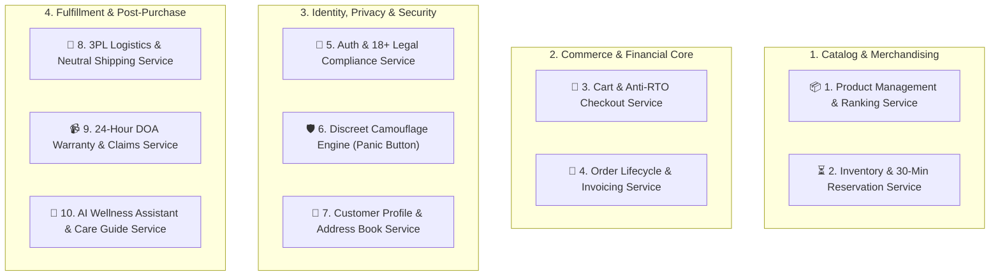

# 🏛️ Document 17: Core & Domain Services Master Inventory

**Project Name:** Aura Retail & Lifestyle (Discreet Adult Wellness & Intimate Care E-Commerce Marketplace)  
**Document Status:** Confirmed / Approved by User  
**Version:** 1.0.0  
**Date:** 2026-11-10  
**Author / Partner:** Planning & Technical Documentation Partner  

---

## 1. Purpose

Yeh document platform ke **Core Engine aur Sabhi 10 Domain Services ka Master Inventory Specification** hai. Isme `feature_extraction/` ke 40+ UI blueprints ke front-facing features aur platform ke **Invisible Logical/Backend Systems** ko ek complete, structured blueprint ke roop mein record kiya gaya hai. 

Is document ke rules aur inventory se yeh finalize hota hai ki:
1. Core mein kaunse foundational system components rahenge.
2. Kaun-kaun si 10 domain services independently develop hongi.
3. Har service ke paas kaunse UI-facing aur hidden logical capabilities honge.
4. Har service ke sath automated tests kaise co-locate rahenge taaki zero manual testing karni pade.

---

## 2. The Core Architecture (Foundational Backbone)

Core platform ka central nervous system hai jo kisi specific business domain ko run nahi karta, balki sabhi services ko connect karta hai, transaction safety deta hai, aur security guardrails enforce karta hai.

```
┌────────────────────────────────────────────────────────────────────────────────────────┐
│                                       THE CORE                                         │
│                                                                                        │
│  1. Service Registry & DI Container ── Sabhi services ko connect & locate karta hai    │
│  2. Central Event Bus (Mediator)   ── Services ke beech decoupled events emit karta hai│
│  3. Database & Pool Singleton      ── PostgreSQL 16 + PgBouncer connection manager     │
│  4. Distributed Lock & Cache Store ── Redis 7 connection & atomic key manager          │
│  5. Transaction Coordinator (ACID) ── Multi-service atomic operations & rollbacks      │
│  6. Security & PII Encryption Engine── AES-256-GCM encryption & masked logging         │
│  7. Unified Error & Response Bridge── Standard JSend/RFC-7807 response envelopes       │
│  8. Central Staff Audit Logger     ── Internal data inspection tracking (DPDP Act)     │
└────────────────────────────────────────────────────────────────────────────────────────┘
```

### Core ke 8 Essential Components:
1. **Service Registry (`coreRegistry`):** Type-safe service locator jahan sabhi 10 services apne contracts (`ports`) register karti hain. Zero direct module-to-module imports.
2. **Central Event Bus (`coreEventBus`):** Asynchronous event dispatcher (e.g., `ORDER_CONFIRMED` event se Logistics AWB generate hoti hai aur SMS send hota hai).
3. **Database Connection Pooler:** PostgreSQL 16 client singleton with PgBouncer transaction pooling.
4. **Distributed Cache & Lock Manager:** Redis 7 client managing sub-millisecond atomic keys (`SET ... NX EX`).
5. **Atomic Transaction Coordinator:** Multi-service Unit of Work manager jo cross-service database operations ko single ACID transaction mein wrap karta hai.
6. **PII Encryption & Redaction Engine:** Customer phone numbers aur addresses ko AES-256-GCM encrypt karta hai aur application logs mein automatically redact karta hai (`+91 98*****210`).
7. **Unified Error & Response Bridge:** Sabhi API responses aur errors ko uniform JSend / RFC 7807 format (`{ success, data, error, meta }`) mein wrap karta hai.
8. **Staff PII Audit Logger:** Support agents dwara customer PII view karne par automated `StaffAuditLog` entry create karta hai.

---

## 3. The 10 Domain Services Master Inventory



---

### 📦 Service 1: Product Management & Ranking Service
* **Folder Location:** `src/modules/catalog/`
* **UI Features (Feature Extraction se):**
  - Category breadcrumbs, 4-column responsive PLP grid, multi-angle zoomable gallery, color swatches, size pills, related products (*"You May Also Like"*).
* **Logical Backend Systems (Hidden Engine):**
  - **Dynamic Automated Rules:** Products ≤ 7 days old get auto-badge **"NEW"**; Top 10% sales volume get auto-badge **"BEST SELLER"**.
  - **Manual Admin Override Engine:** Admin panel se kisi bhi product par custom badge set karna (**"Editor's Pick"**, **"Trending"**, **"Discreet Favorite"**).
  - **Custom Ranking Weight Engine:** Numerical score field (`customRankWeight`) jo search aur category lists mein product ki exact position control karta hai.
  - **Medical Safety Badges Mapping:** 100% Medical-grade Silicone, Phthalate-Free, IPX7 Waterproof, Sub-50dB Whisper Quiet specs indexing.
* **Automated Tests (`src/modules/catalog/tests/`):**
  - `dynamic-badges.test.ts`: Verifies automated "NEW" and "BEST SELLER" calculations.
  - `manual-overrides.test.ts`: Verifies admin manual tags take precedence over auto tags.
  - `ranking-weights.test.ts`: Verifies that high-weight products sort to the top.

---

### ⏳ Service 2: Inventory & 30-Minute Reservation Service
* **Folder Location:** `src/modules/inventory/`
* **UI Features:**
  - Real-time stock status badge (*"In Stock"*, *"Low Stock: Only 3 left"*, *"Currently Reserved"*).
* **Logical Backend Systems (Hidden Engine):**
  - **30-Minute Redis Hold:** Sets atomic key with TTL (`stock:sku:lock user_id EX 1800 NX`).
  - **BullMQ Auto-Release Worker:** Background worker checks for expired locks every 60 seconds and restores held inventory to the public catalog at minute 30:01.
  - **Optimistic Concurrency Control:** Version counter on `InventoryItem` preventing flash-sale overselling.
* **Automated Tests (`src/modules/inventory/tests/`):**
  - `stock-reservation.test.ts`: Verifies lock acquisition and rejection on stock = 0.
  - `auto-release-worker.test.ts`: Verifies BullMQ releases stock when TTL expires.
  - `concurrency-race.test.ts`: Verifies simultaneous checkouts never result in negative stock.

---

### 🛒 Service 3: Cart & Anti-RTO Checkout Service
* **Folder Location:** `src/modules/checkout/`
* **UI Features (Feature Extraction se):**
  - Cart item counter, quantity dropdown, coupon/voucher input, order summary breakdown, payment method selectors.
* **Logical Backend Systems (Hidden Engine):**
  - **Integer Paise Math Engine:** All pricing computed in paise (₹2,499.00 = `249900`), eliminating float math bugs.
  - **Anti-RTO Flat ₹50 COD Surcharge:** Adds 5000 paise fee if payment mode is COD.
  - **Prepaid Incentive Engine:** Deducts 5% discount (capped at ₹150 / 15000 paise) for UPI/Cards.
  - **Free Shipping Threshold:** Free delivery for prepaid orders > ₹499 (49900 paise).
  - **Idempotency Engine:** `Idempotency-Key` header cached in Redis for 24 hours to prevent duplicate checkout requests.
* **Automated Tests (`src/modules/checkout/tests/`):**
  - `anti-rto-pricing.test.ts`: Verifies ₹50 COD fee addition and 5% prepaid discount cap.
  - `idempotency.test.ts`: Verifies duplicate requests return identical cached response.

---

### 📑 Service 4: Order Lifecycle & Invoicing Service
* **Folder Location:** `src/modules/orders/`
* **UI Features (Feature Extraction se):**
  - My Orders list, order status stepper (Placed, Processing, Dispatched, Delivered), invoice download.
* **Logical Backend Systems (Hidden Engine):**
  - **State Machine Engine:** Valid transitions strictly enforced (`PENDING_PAYMENT` ➔ `CONFIRMED` ➔ `PROCESSING` ➔ `DISPATCHED` ➔ `DELIVERED` / `CANCELLED`).
  - **Neutral Invoicing:** Tax invoice PDF permanently locks seller entity name to **"Aura Retail & Lifestyle"** and category to **"Personal Grooming & Wellness Kits"**.
  - **Payment Webhook Verifier:** Validates incoming Cashfree/PhonePe webhooks with HMAC-SHA256 signature checks.
* **Automated Tests (`src/modules/orders/tests/`):**
  - `state-machine.test.ts`: Verifies invalid transitions (e.g. Delivered ➔ Pending) throw errors.
  - `webhook-hmac.test.ts`: Verifies fake/tampered webhooks are rejected with HTTP 401.

---

### 🔐 Service 5: Auth & 18+ Legal Compliance Service
* **Folder Location:** `src/modules/auth/`
* **UI Features (Feature Extraction se):**
  - Login/Register modal, phone/email input, 6-digit OTP input, Date of Birth selector.
* **Logical Backend Systems (Hidden Engine):**
  - **Mandatory 18+ Age Enforcer:** Calculates age from DOB; blocks accounts if `age < 18` at application and PostgreSQL constraint levels.
  - **Passwordless Multi-Channel OTP:** WhatsApp primary ➔ SMS secondary ➔ Email fallback routing via MSG91.
  - **Rate Limiting Engine:** Strict Redis limiter: Max 3 OTP requests / 10 minutes per IP/Phone.
  - **Stateless HttpOnly JWT:** Encrypted session cookies with Redis session blacklist revocation.
* **Automated Tests (`src/modules/auth/tests/`):**
  - `dob-age-check.test.ts`: Verifies rejection of any date resulting in age < 18 years.
  - `otp-rate-limit.test.ts`: Verifies 4th OTP request within 10 minutes throws HTTP 429.

---

### 🛡️ Service 6: Discreet Camouflage Engine (Panic Button)
* **Folder Location:** `src/modules/privacy/`
* **UI Features:**
  - Floating Quick Exit / Panic Button in header and mobile navigation.
* **Logical Backend & Client Systems (Hidden Engine):**
  - **Pre-Hydrated Decoy DOM:** "Everyday Minimalist" lifestyle blog pre-loaded in browser memory on page load.
  - **0ms Swap Latency:** Pure client-side React state swap; zero HTTP request or network wait.
  - **Audio/Video Silencer:** Mutes and pauses any running media element instantly.
  - **Tab & Favicon Disguise:** Alters document title and browser tab favicon to neutral green leaf.
* **Automated Tests (`src/modules/privacy/tests/`):**
  - `camouflage-swap.test.ts`: Verifies DOM replacement happens with zero network calls.
  - `media-silence.test.ts`: Verifies HTML5 video/audio elements are paused immediately.

---

### 👤 Service 7: Customer Profile & Address Book Service
* **Folder Location:** `src/modules/customer/`
* **UI Features (Feature Extraction se):**
  - Address book management (Add/Edit/Delete/Set Default), profile details, wishlist toggle.
* **Logical Backend Systems (Hidden Engine):**
  - **Indian PIN Code Validator:** Auto-resolves City, State, and courier serviceability from 6-digit PIN codes.
  - **1-Click Local Privacy Purge:** Footer button clears `localStorage`, cart session, and auth cookies instantly.
  - **DPDP Right-to-be-Forgotten:** Account deletion hashes phone and email irreversibly while preserving tax records.
* **Automated Tests (`src/modules/customer/tests/`):**
  - `pincode-validator.test.ts`: Verifies valid vs invalid Indian postal codes.
  - `data-erasure.test.ts`: Verifies PII fields are replaced with cryptographic hashes on purge.

---

### 🚚 Service 8: 3PL Logistics & Neutral Shipping Service
* **Folder Location:** `src/modules/logistics/`
* **UI Features (Feature Extraction se):**
  - Tracking status tracker, courier partner name, tracking URL.
* **Logical Backend Systems (Hidden Engine):**
  - **Shiprocket / Delhivery API Adapter:** 1-click AWB airway bill generation upon order confirmation.
  - **Neutral Label Enforcement:** Shipping waybills permanently declare sender as **"Aura Retail & Lifestyle"** and item as **"Personal Grooming & Wellness Kits"**.
  - **Courier Webhook Processor:** Listens for `DELIVERED` status and **starts the 24-hour DOA warranty clock**.
* **Automated Tests (`src/modules/logistics/tests/`):**
  - `awb-generation.test.ts`: Verifies neutral sender and category are transmitted to courier API.
  - `delivery-webhook.test.ts`: Verifies `DELIVERED` event triggers the 24-hr warranty timer.

---

### 📹 Service 9: 24-Hour DOA Warranty & Claims Service
* **Folder Location:** `src/modules/warranty/`
* **UI Features (Feature Extraction se):**
  - Warranty claim page, unboxing video upload dropzone, claim ticket status.
* **Logical Backend Systems (Hidden Engine):**
  - **24-Hour Claim Gate:** Verifies `submittedAt <= deliveredAt + 24 hours`; locks portal if expired.
  - **Direct-to-Cloud Pre-signed URLs:** Generates Cloudflare R2 secure PUT URLs for video upload (<50MB) bypassing server memory.
  - **Store Credit Voucher Generator:** Generates 100% store credit voucher (`AURA-VOUCH-XXXX`) valid for 1 year upon admin approval.
* **Automated Tests (`src/modules/warranty/tests/`):**
  - `claim-window.test.ts`: Verifies claim rejection at 24 hours 1 minute post-delivery.
  - `presigned-url.test.ts`: Verifies pre-signed URL generates strictly for video formats (<50MB).

---

### 🤖 Service 10: AI Wellness Assistant & Care Guide Service
* **Folder Location:** `src/modules/ai-assistant/`
* **UI Features (Feature Extraction se):**
  - 24/7 Wellness chat widget, FAQ quick questions.
* **Logical Backend Systems (Hidden Engine):**
  - **Server-Sent Events (SSE) Stream:** Streaming responses via Google Gemini 1.5 Flash (TTFT < 400ms).
  - **Mandatory Medical Disclaimer:** System prompt guardrail injecting medical disclaimers on health queries.
  - **Internal Care Knowledge Base (RAG):** Context injection for silicone care, body safety, and sizing advice.
* **Automated Tests (`src/modules/ai-assistant/tests/`):**
  - `disclaimer-guardrail.test.ts`: Verifies that health/pain queries trigger mandatory disclaimers.
  - `streaming-response.test.ts`: Verifies SSE chunk formatting and latency.

---

## 4. Master Inventory Summary Table

| Service Identifier | Domain Scope | Primary Responsibility | Automated Test Suite |
| :--- | :--- | :--- | :--- |
| **THE CORE** | System Backbone | Registry, Event Bus, Postgres/Redis Singletons, Transactions, PII Encryption, Audit Logs | `src/core/tests/` |
| **Service 1: Product Management** | Catalog | Dynamic "NEW" & "BEST SELLER" rules, manual overrides, custom ranking, medical badges | `src/modules/catalog/tests/` |
| **Service 2: Inventory & Hold** | Inventory | 30-min Redis TTL reservation locks, BullMQ auto-release worker at 30:01 mins | `src/modules/inventory/tests/` |
| **Service 3: Cart & Anti-RTO** | Checkout | Paise math, flat ₹50 COD fee, 5% prepaid discount, idempotency key caching | `src/modules/checkout/tests/` |
| **Service 4: Order Lifecycle** | Transactions | State machine, neutral invoices under "Aura Retail & Lifestyle", webhook confirmation | `src/modules/orders/tests/` |
| **Service 5: Auth & 18+ Compliance**| Identity | WhatsApp/SMS OTP, mandatory DOB verification (Age ≥ 18), HttpOnly JWT | `src/modules/auth/tests/` |
| **Service 6: Camouflage Engine** | Privacy | 0ms client-side decoy blog swap, audio muting, tab title & favicon disguise | `src/modules/privacy/tests/` |
| **Service 7: Customer Profile** | Accounts | Indian PIN code validator, address book, wishlist, 1-click privacy purge | `src/modules/customer/tests/` |
| **Service 8: Logistics & Shipping** | Integration | Neutral AWBs ("Personal Grooming & Wellness Kits"), courier delivery tracking webhooks | `src/modules/logistics/tests/` |
| **Service 9: 24-Hr DOA Warranty** | Post-Purchase | Pre-signed Cloudflare R2 video upload, 24-hr claim window, Store Credit voucher generator | `src/modules/warranty/tests/` |
| **Service 10: AI Wellness Bot** | AI Assistant | Streaming care guidance, anatomy care FAQs, medical liability guardrails | `src/modules/ai-assistant/tests/` |

---

Yeh complete Master Inventory document ab permanently record aur lock ho chuka hai.
Aage ka technical faisla aur implementation isi inventory par based hoga.
