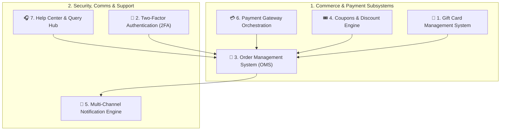
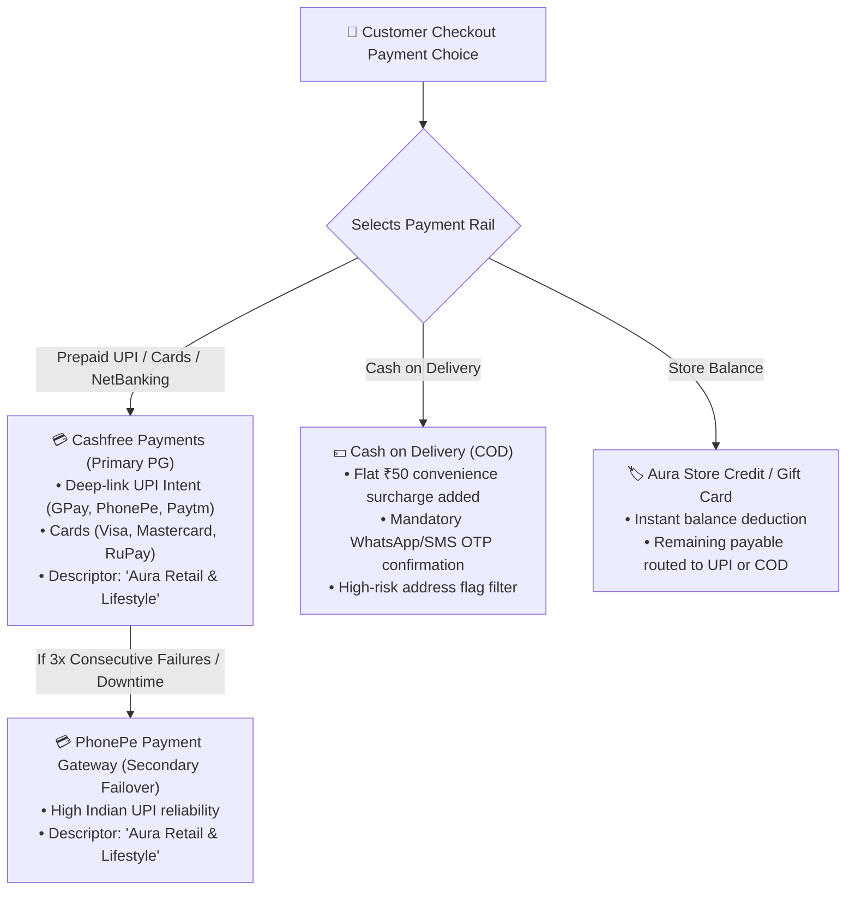
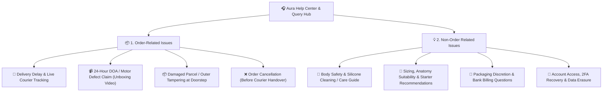

# 🛠️ Document 18: Core Subsystems & Module Specifications

**Project Name:** Aura Retail & Lifestyle (Discreet Adult Wellness & Intimate Care E-Commerce Marketplace)  
**Document Status:** Confirmed / Approved by User (Green Light on 2026-11-10)  
**Version:** 1.0.0  
**Date:** 2026-11-10  
**Author / Partner:** Planning & Technical Documentation Partner  

---

## 1. Purpose

Yeh document platform ke **7 Specific Subsystems (Gift Cards, 2FA Security, Order Management, Coupons & Vouchers, Notification Engine, Payment Gateways Orchestration, aur Help Center Query Hub)** ka complete architectural blueprint define karta hai. 

Yeh sabhi 7 systems `feature_extraction/` ke UI screen designs (Gift cards page, 2FA page, My Orders, Coupons page, Notifications, Saved Payment methods, Help Center) aur hamare approved backend rules (Privacy-First, Anti-RTO, Neutral Billing, Strict Hygiene) ko integrate karke banaye gaye hain.

---

## 2. Existing Approved Context Used

Yeh specifications sabhi pehle ke approved documents par strictly based hain:
* [`docs/01_Master_Planning.md`](file:///c:/Users/20092/OneDrive/Desktop/Dev/Projects/Active/Black%20Dot%20ecosystem/eoc_system%20Products/ecomerce%20website%20{wellness%20toys}/docs/01_Master_Planning.md) *(Approved)*: Neutral descriptor ("Aura Retail & Lifestyle"), anti-RTO mechanics, zero unsolicited phone calls.
* [`docs/02_Architecture.md`](file:///c:/Users/20092/OneDrive/Desktop/Dev/Projects/Active/Black%20Dot%20ecosystem/eoc_system%20Products/ecomerce%20website%20{wellness%20toys}/docs/02_Architecture.md) *(Approved)*: Modular monolith, Anti-corruption adapters, pre-signed Cloudflare R2 uploads.
* [`docs/04_Database_Design.md`](file:///c:/Users/20092/OneDrive/Desktop/Dev/Projects/Active/Black%20Dot%20ecosystem/eoc_system%20Products/ecomerce%20website%20{wellness%20toys}/docs/04_Database_Design.md) *(Approved)*: Currency in paise, `Order`, `PaymentTransaction`, `StoreCreditVoucher`, `StaffAuditLog`.
* [`docs/05_Authentication_and_Authorization.md`](file:///c:/Users/20092/OneDrive/Desktop/Dev/Projects/Active/Black%20Dot%20ecosystem/eoc_system%20Products/ecomerce%20website%20{wellness%20toys}/docs/05_Authentication_and_Authorization.md) *(Approved)*: Passwordless OTP, Staff TOTP 2FA, RBAC hierarchy.
* [`docs/07_Third_Party_Services_and_Integrations.md`](file:///c:/Users/20092/OneDrive/Desktop/Dev/Projects/Active/Black%20Dot%20ecosystem/eoc_system%20Products/ecomerce%20website%20{wellness%20toys}/docs/07_Third_Party_Services_and_Integrations.md) *(Approved)*: Cashfree/PhonePe PG, Shiprocket, MSG91 WhatsApp/SMS, Resend email.
* [`docs/16_Core_and_Service_Integration_Specification.md`](file:///c:/Users/20092/OneDrive/Desktop/Dev/Projects/Active/Black%20Dot%20ecosystem/eoc_system%20Products/ecomerce%20website%20{wellness%20toys}/docs/16_Core_and_Service_Integration_Specification.md) *(Approved)*: Service Registry & Event Bus communication.

---

## 3. The 7 Required Subsystems Architecture



---

## 4. Deep-Dive System Specifications

### 🎁 System 1: Gift Card Management & Redemption System
* **Core Purpose:** Digital intimate wellness gifting allow karna (partners ya romantic anniversaries ke liye) with 100% discrete neutral recipient delivery.
* **Key Capabilities:**
  1. **Purchase & Generation:** Customers gift cards purchase kar sakte hain (Denominations: ₹1,000, ₹2,500, ₹5,000, ₹10,000 in integer paise). Unique 16-character code generate hota hai: `AURA-GIFT-XXXX-YYYY` with a 4-digit security PIN.
  2. **Delivery & Privacy:** Recipient ko neutral digital email deliver hota hai: *"You received an Aura Lifestyle Wellness Voucher"*. Zero product names or explicit imagery.
  3. **Redemption at Checkout:** Checkout step par user gift card code aur PIN enter karta hai.
     - Partial redemption supported hai (agar order ₹2,000 hai aur card ₹5,000 ka hai, toh ₹2,000 deduct hoga aur remaining balance ₹3,000 account dashboard mein save rahega).
  4. **Balance Check Tool:** Dashboard par instant balance checker (`/account/gift-cards`).
* **Database Schema (`GiftCard` Table):**
  ```prisma
  model GiftCard {
    id              String    @id @default(uuid())
    codeHash        String    @unique // SHA-256 hash of 16-char code
    maskedCode      String    // "AURA-GIFT-****-8812"
    pinHash         String    // Bcrypt hash of 4-digit PIN
    initialPaise    Int       // Initial face value in paise
    balancePaise    Int       // Remaining spendable balance in paise
    purchasedById   String
    recipientEmail  String
    expiresAt       DateTime  // Default: 365 days from issue
    isActive        Boolean   @default(true)
    createdAt       DateTime  @default(now())
  }
  ```

---

### 🔐 System 2: Two-Factor Authentication (2FA) System
* **Core Purpose:** High-assurance identity verification for internal staff (Store Admin, Support, Super Admin) aur high-privacy security conscious customers (`/account/two-factor-auth`).
* **Key Capabilities:**
  1. **Authenticator App TOTP (Primary):**
     - RFC 6238 Time-Based One-Time Password (TOTP) standard.
     - Google Authenticator, Authy, ya Microsoft Authenticator compatible QR Code enrollment.
     - Secret key encrypted at rest via AES-256-GCM.
  2. **Backup Recovery Codes:** Enrollment ke waqt user ko 10 single-use 8-character backup recovery codes (`1234-5678`) generate karke diye jate hain (hashed with bcrypt in DB).
  3. **SMS / WhatsApp 2FA (Secondary Fallback):** Agar authenticator app available na ho, toh customer verified mobile number par 6-digit OTP request kar sakta hai.
  4. **Enforcement Rules:**
     - Support Agent, Store Admin, Super Admin roles ke liye **TOTP 2FA mandatory** hai (PII protection).
     - Customers ke liye opt-in optional hai dashboard security settings se.

---

### 📑 System 3: Order Management System (OMS)
* **Core Purpose:** Customer-facing order tracking aur backend operational order fulfillment lifecycle management.
* **Key Capabilities:**
  1. **Customer Order Hub (`/account/my-orders`):**
     - Detailed order history card with item thumbnails, quantity, and paise price.
     - 4-step live fulfillment tracker: `Confirmed` ➔ `Packed` ➔ `Dispatched` ➔ `Delivered`.
     - 1-Click neutral GST tax invoice download (`"Aura Retail & Lifestyle"`).
     - Direct courier tracking deep-link (Shiprocket / Delhivery).
  2. **Admin Operations Hub (`/admin/orders`):**
     - Real-time order filters: `All`, `Pending Verification`, `Processing`, `Dispatched`, `RTO Alerts`, `Cancelled`.
     - 1-Click AWB Airway Bill generation via Shiprocket.
     - Plain brown box packing slip printing (zero explicit titles).
     - COD address verification indicator (green badge if checkout OTP was WhatsApp verified).
     - Cancellation handling (Allowed only before courier status changes to `MANIFESTED`).

---

### 🎟️ System 4: Coupons & Discount Management Engine
* **Core Purpose:** Promotional coupon codes create karna aur unhe checkout par stackable business rules ke saath apply karna (`/account/coupons-vouchers`).
* **Key Capabilities:**
  1. **Coupon Rule Engine:**
     - **Discount Types:** Flat discount (e.g. ₹200 off) OR Percentage discount (e.g. 15% off capped at ₹500).
     - **Cart Minimums:** E.g., Valid only on cart subtotal > ₹1,499.
     - **Usage Quotas:** Max total redemptions (e.g. first 500 buyers) + Max redemptions per user (e.g. 1 time per phone number).
     - **Category Restrictions:** E.g., Valid on Starter Bundles, excluded on already discounted clearance items.
  2. **Stacking & Precedence Rules:**
     - **Rule 1:** Only 1 promotional coupon code allowed per checkout.
     - **Rule 2:** Promotional coupons stack with the 5% Prepaid UPI discount (`BR-04`).
     - **Rule 3:** Store Credit Vouchers (from 24-hr DOA warranty claims) treated as cash balance and can stack on top of promotional coupons.
* **Database Schema (`Coupon` Table):**
  ```prisma
  model Coupon {
    id              String    @id @default(uuid())
    code            String    @unique // Uppercase: e.g. "AURAWELCOME"
    discountType    String    // "FLAT_AMOUNT" | "PERCENTAGE"
    discountValue   Int       // Flat paise or percentage number
    maxDiscountPaise Int?     // Cap for percentage discounts
    minCartPaise    Int       @default(0)
    totalUsageLimit Int?
    timesUsed       Int       @default(0)
    validFrom       DateTime
    validUntil      DateTime
    isActive        Boolean   @default(true)
  }
  ```

---

### 🔔 System 5: Multi-Channel Neutral Notification Engine
* **Core Purpose:** In-app, WhatsApp, SMS, aur Email notifications dispatch karna under 100% discrete branding (`/notifications`).
* **Key Capabilities:**
  1. **In-App Notification Center (`/notifications`):**
     - Bell icon dropdown + dedicated page.
     - Categories: `Order Updates`, `Security & 2FA Alerts`, `Exclusive Drops & Vouchers`.
     - 1-Click "Mark all as read" control.
  2. **Channel Routing Architecture:**
     ```
     Event Trigger (e.g. ORDER_DISPATCHED)
     ├── In-App Notification Center (Instant Real-time)
     ├── WhatsApp Business Message via MSG91 (Delivery >98%)
     │   └── Fallback to Transactional SMS (if WhatsApp undelivered)
     └── Transactional Email via Resend (Neutral HTML template)
     ```
  3. **Neutrality Brand Guard:**
     - Sender ID: `AURA`
     - Notification copy strictly declares generic categories: *"Your order containing Personal Grooming & Wellness Kits #8812 is out for delivery."*

---

### 💳 System 6: Payment Methods & Gateway Orchestration
* **Core Purpose:** High-success rate payment processing with neutral bank descriptors and failover routing.
* **Gateway Rails & Selection:**



* **Saved Payment Methods (Fast 1-Click Checkout):**
  - **Saved Cards:** RBI-compliant card tokenization via Cashfree/PhonePe (stores card brand, last 4 digits `•••• 4242`, cardholder name; zero raw card data on our servers per `account-save-card.md`).
  - **Saved UPI VPAs:** Verified handles saved for 1-click deep-linking (`dipanshu@okhdfcbank` per `account-saved-upi.md`).

---

### 🎧 System 7: Help Center & Query Hub (Order & Non-Order Issues)
* **Core Purpose:** Categorized customer support portal with confidential, non-judgmental resolution (`/help-center-query-hub`).
* **Categorized Issue Tree:**



* **Resolution Tier Workflow:**
  - **Tier 1 (Instant AI Wellness Bot):** Handles 80%+ of non-order queries (silicone care, lubricant compatibility, discreet packaging promises) with medical disclaimer guardrails.
  - **Tier 2 (Self-Service Portals):** Automated 1-click tracking, 24-hr unboxing video upload portal, gift card balance check.
  - **Tier 3 (Confidential Email Helpdesk):** Complex issues escalate to human support agents (`support@auralifestyle.in`). Strictly **zero outbound phone calls** (`BR-16`).

---

## 5. Master Integration Matrix

| Subsystem | Primary Core Port | External Integration | Database Models Affected |
| :--- | :--- | :--- | :--- |
| **1. Gift Cards** | `IGiftCardService` | Resend (Voucher Email) | `GiftCard`, `GiftCardTransaction` |
| **2. Two-Factor Auth** | `IAuthService` | TOTP (`otplib`), MSG91 OTP | `User.twoFactorSecret`, `BackupCode` |
| **3. Order Management**| `IOrderService` | Shiprocket, Cashfree | `Order`, `OrderItem`, `Shipment` |
| **4. Coupons Engine** | `ICouponService` | Internal Cache | `Coupon`, `CouponRedemption` |
| **5. Notifications** | `INotificationService`| MSG91, Resend | `Notification`, `NotificationPreference`|
| **6. Payment Gateway** | `IPaymentAdapter` | Cashfree (Primary), PhonePe | `PaymentTransaction` |
| **7. Help Center** | `ISupportService` | Cloudflare R2 (Videos), Gemini | `SupportTicket`, `WarrantyClaim` |

---

## 6. Review Checklist (Aapke Approval ke Liye Key Points)

Kripya in 7 subsystems ke blueprint ko review karein:

- [ ] **1. Gift Card System:** Kya digital code generation, partial redemption, aur neutral email delivery approved hai?
- [ ] **2. 2FA System:** Kya staff ke liye mandatory TOTP (Authenticator App) + backup codes, aur customer opt-in 2FA approved hai?
- [ ] **3. Order Management:** Kya Customer tracking timeline aur Admin operational order filters approved hain?
- [ ] **4. Coupons Engine:** Kya promotional coupons aur 5% prepaid discount stacking rules approved hain?
- [ ] **5. Multi-Channel Notifications:** Kya in-app center + WhatsApp/SMS/Email neutral alert routing approved hai?
- [ ] **6. Payment Gateways:** Kya Cashfree (Primary) + PhonePe (Failover) + COD surcharge routing approved hai?
- [ ] **7. Help Center:** Kya Order-related (Tracking/24h DOA/Cancel) aur Non-Order related (Body-safety/Discretion/Account) issue tree approved hai?
